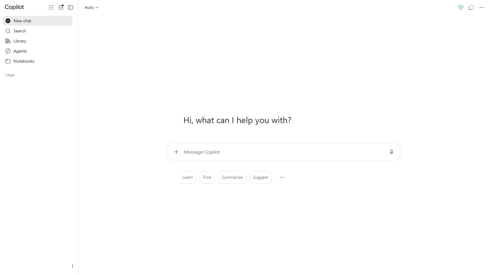
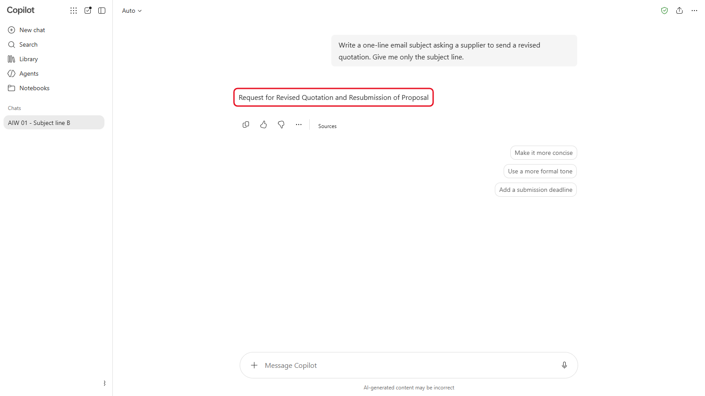
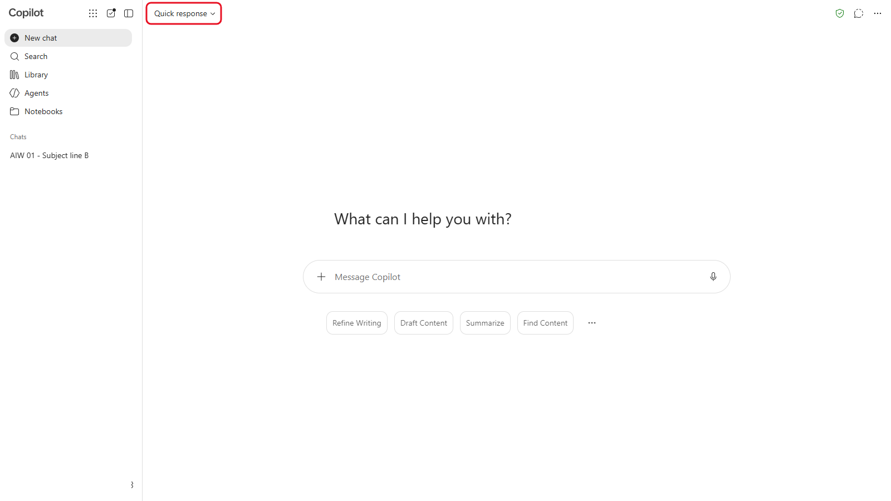
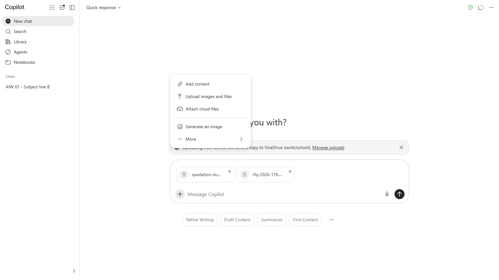
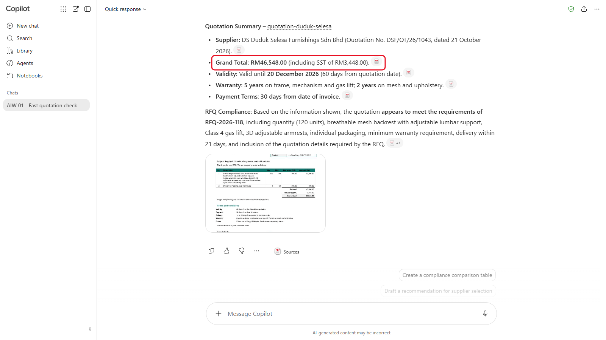
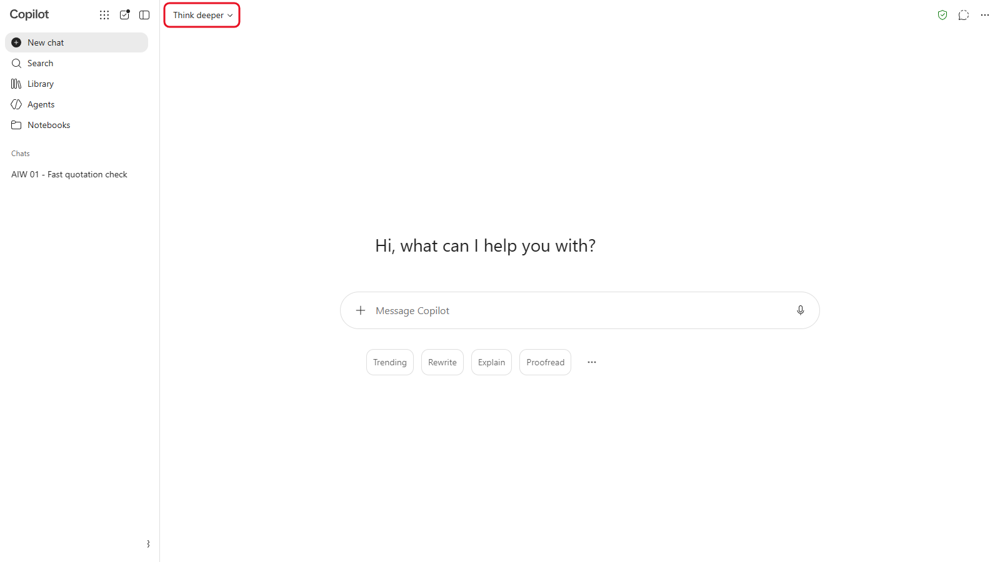
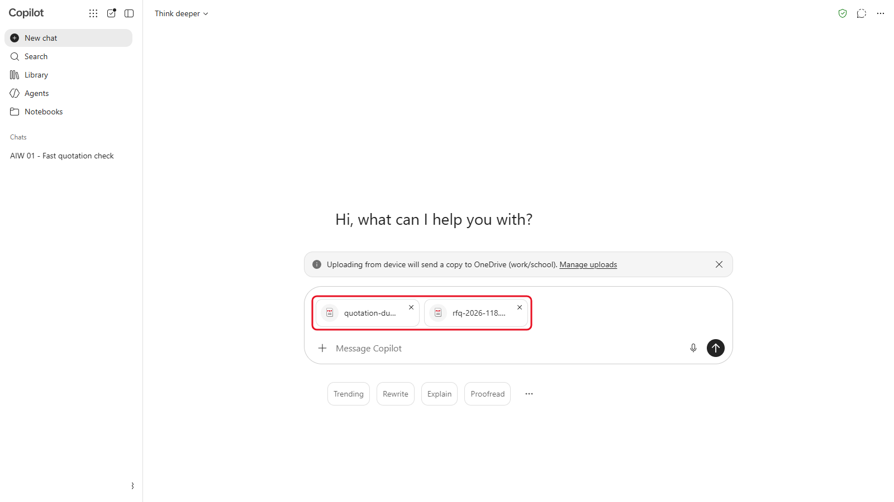
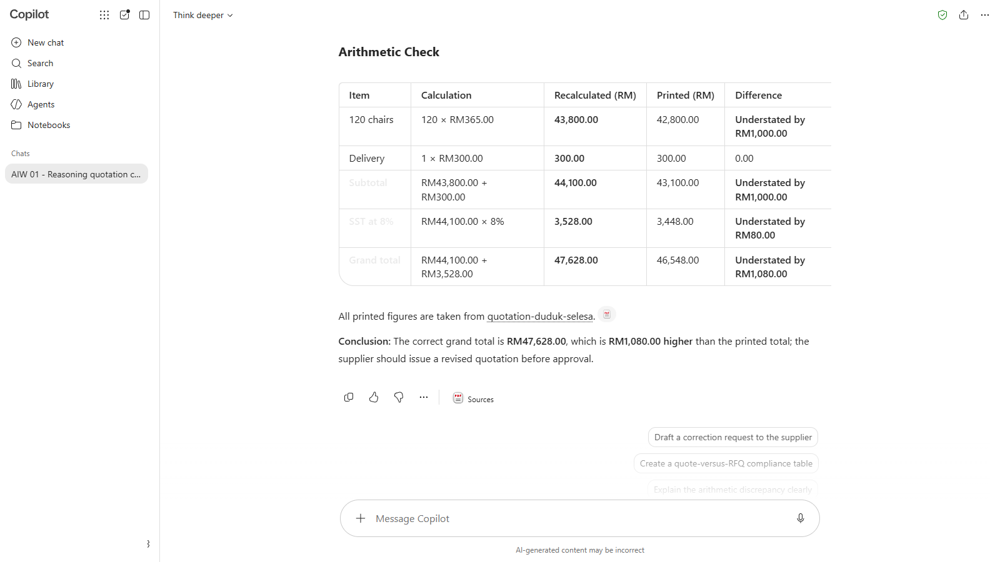

# 01 - Cara Large Language Model Sebenarnya Berfungsi

Sebelum anda membina apa-apa, elok faham dahulu apa yang berlaku di dalam alat AI. Pembantu AI tidak mencari jawapan atau mengira seperti spreadsheet. Ia meramal teks. Itulah sebabnya ia pandai dalam banyak perkara, dan itu juga punca kebanyakan kesilapannya. Dalam modul ini, anda beri sebut harga pembekal yang sama kepada dua jenis model dan bandingkan apa yang setiap satu perasan.

> **Prompt:** setiap prompt yang anda perlukan ada dalam langkah-langkah di bawah, dengan butang Salin. [Halaman prompt](./prompts.md) juga mengumpulkan semuanya dalam satu halaman.

**Anggaran masa:** 40 minit

**Hasil anda:** Dua analisis bagi sebut harga yang sama, satu daripada Quick response dan satu daripada Think deeper, serta nota ringkas tentang perbezaannya.

---

## Apa yang Anda Akan Pelajari

- Terangkan dengan bahasa mudah bagaimana large language model menghasilkan jawapan
- Nyatakan mengapa prompt yang sama boleh memberi jawapan berbeza setiap kali
- Bezakan Quick response dengan Think deeper (fast model dan reasoning model), dan bila hendak menggunakan setiap satu
- Namakan jenis kesilapan yang perlu disemak: aritmetik, tarikh dan butiran rekaan

---

## Sebelum Anda Mula

Anda perlukan satu alat AI yang sudah dibuka dan log masuk (lihat [kad produk](../../14-product-cards/), dalam bahasa Inggeris), dan fail sampel:

| Fail | Kandungan |
|---|---|
| `rfq-2026-118.pdf` | Permintaan sebut harga (request for quotation, RFQ) Sinar Maju untuk 120 kerusi jaring ergonomik |
| `quotation-duduk-selesa.pdf` | Sebut harga daripada seorang pembekal sebagai jawapan kepada permintaan itu |

> **Muat turun:** **[sample-files.zip](../../01-how-llms-behave/sample-files.zip)** (kedua-dua fail sekali gus), kemudian klik kanan fail itu dan pilih **Extract All** sebelum anda mula.

> **Nota:** semua syarikat, orang dan angka dalam fail kursus adalah rekaan. Sinar Maju Sdn Bhd ialah pengedar bekalan pejabat di Petaling Jaya, dan dalam kursus ini anda bekerja di Jabatan Perolehannya. Kursus ini menganggap **10 November 2026** sebagai tarikh hari ini: setiap sebut harga dinilai pada tarikh itu, walau apa pun tarikh kelas anda. Fail sampel dan tangkapan skrin kekal dalam bahasa Inggeris, seperti kebanyakan dokumen perolehan dan paparan Microsoft 365 di tempat kerja.

Istilah baharu diterangkan dalam [glosari](../../14-product-cards/glossary.md) (dalam bahasa Inggeris).

---

## Topik

**Meramal, bukan mencari.** Large language model (LLM) menulis sedikit demi sedikit. Setiap kali, ia memilih cebisan teks seterusnya yang paling mungkin berdasarkan semua teks sebelumnya. Ia tidak ada kalkulator atau database melainkan alat itu menyediakannya. Bagi model, jumlah yang tercetak dalam sebut harga hanyalah teks biasa.

**Mengapa jawapan berbeza.** Model memilih antara beberapa perkataan seterusnya yang mungkin, dengan sedikit unsur rawak. Jadi prompt yang sama boleh memberi jawapan berbeza setiap kali. Itu berguna semasa merangka teks, dan menjadi sebab untuk menyemak apa-apa yang mesti tepat.

**Quick response dan Think deeper.** Quick response ialah fast model: ia menjawab serta-merta. Think deeper ialah reasoning model (atau "thinking"): ia menyelesaikan masalah langkah demi langkah sebelum menjawab. Ia lebih lambat, tetapi lebih banyak menangkap kesilapan dalam tugas seperti menyemak angka. Ini nama pilihan dalam Copilot. Kebanyakan alat lain ada pilihan yang sama dengan nama berbeza (lihat Nota Produk).

**Apa yang perlu disemak.** LLM kuat dalam membaca, meringkaskan dan menulis semula. Ia lebih lemah dalam aritmetik, tarikh, dan mengaku "saya tidak tahu". Ia juga boleh menyatakan sesuatu butiran dengan yakin walaupun butiran itu tiada dalam sumber. Setiap modul dalam kursus ini membina tabiat menyemak perkara-perkara ini.

---

## 1.1 Tanya Soalan yang Sama Dua Kali

1. Buka alat AI anda dan mulakan new chat.

   

   *New chat dalam Copilot. Dalam alat lain, cari **New chat** di bahagian atas sebelah kiri.*
2. Hantar prompt ini:

   ```
   Tulis satu baris subjek e-mel untuk meminta pembekal menghantar sebut harga yang telah disemak semula. Beri saya baris subjek itu sahaja.
   ```

   

   *Jawapan pertama: satu baris subjek, seperti yang diminta.*

3. Mulakan satu lagi new chat dan hantar prompt yang sama, tanpa mengubah apa-apa.

   

   *Prompt sama, new chat, ayat berbeza.*
4. Bandingkan kedua-dua baris subjek.

Susunan katanya hampir pasti berbeza. Kedua-duanya tidak salah: model cuma memilih perkataan lain yang juga sesuai. Ingat perkara ini apabila anda memerlukan angka yang tepat.

---

## 1.2 Semak Sebut Harga dengan Quick Response

1. Mulakan new chat dan pilih **Quick response**, atau fast model dalam alat lain ([kad produk](../../14-product-cards/) menunjukkan di mana).

   

   *Dalam Copilot, **Quick response** ialah fast model dalam menu model.*
2. Muat naik `rfq-2026-118.pdf` dan `quotation-duduk-selesa.pdf`.

   

   *Muat naik kedua-dua PDF dengan **+** > **Upload images and files**. Fail itu dipaparkan sebagai kad dalam kotak mesej.*
3. Hantar prompt ini:

   ```
   Saya bekerja di bahagian perolehan Sinar Maju Sdn Bhd. Saya telah memuat naik permintaan sebut harga kami (RFQ-2026-118) dan sebut harga daripada seorang pembekal. Ringkaskan sebut harga itu dalam lima poin: pembekal, grand total, tempoh sah, jaminan dan terma pembayaran. Kemudian beritahu saya dalam satu ayat sama ada sebut harga itu memenuhi RFQ.
   ```

   

   *Ringkasan Quick response. Perhatikan grand total yang diberikannya.*

4. Catat grand total yang diberikan oleh model, dan sama ada model itu kata sebut harga memenuhi RFQ.

---

## 1.3 Semak Sekali Lagi dengan Think Deeper

1. Mulakan new chat dan tukar kepada **Think deeper**, atau reasoning model (thinking) dalam alat lain.

   

   *Dalam Copilot, **Think deeper** ialah reasoning model.*
2. Muat naik dua fail yang sama.

   

   *Dua fail yang sama, sedia untuk dihantar.*
3. Hantar prompt yang sama seperti dalam 1.2, kemudian hantar prompt ini:

   ```
   Sekarang semak aritmetiknya. Kira semula setiap amaun baris sebagai kuantiti x harga seunit, kemudian subjumlah, cukai dan grand total. Tunjukkan jalan kira dalam jadual dan bandingkan setiap angka dengan angka yang tercetak dalam sebut harga.
   ```

   

   *Semakan aritmetik oleh Think deeper. Jadualnya dikaburkan supaya anda boleh bandingkan dengan keputusan anda sendiri dahulu.*

4. Bandingkan apa yang ditemui oleh Think deeper dengan catatan anda dari 1.2.

> **Petua:** jangan terima bulat-bulat angka daripada mana-mana model. Semak satu baris sendiri dengan kalkulator: kuantiti darab harga seunit.

<details markdown="1">
<summary>Apa yang patut anda lihat?</summary>

Sebut harga itu mencetak grand total **RM46,548.00**, sedangkan grand total yang betul ialah **RM47,628.00**.

Baris 1 ialah 120 kerusi pada harga RM365.00, iaitu RM43,800.00. Sebut harga itu mencetak RM42,800.00, jadi subjumlahnya kurang RM1,000.00, dan selepas cukai 8%, grand totalnya kurang RM1,080.00. Amaun dalam perkataan sepadan dengan angka yang salah, jadi halaman itu nampak konsisten.

Quick response selalunya mengulang jumlah yang tercetak tanpa menyemaknya. Think deeper lebih cenderung mengira 120 x 365.00 dan menemui perbezaan itu. Kedua-duanya boleh terlepas pandang, dan itulah yang akan anda bincangkan.

</details>

---

## 1.4 Bincangkan Apa yang Anda Lihat

Bersama rakan di sebelah anda, jawab tiga soalan ini:

1. Adakah Quick response menyemak angka, atau sekadar mengulang angka yang tercetak pada halaman?
2. Apa yang Think deeper buat secara berbeza, dan berapa lama lagi masa yang diambilnya?
3. Untuk tugas apa dalam kerja anda sendiri anda akan memilih setiap jenis model?

> **Perkara utama:** jawapan yang yakin dan tersusun kemas tidak semestinya jawapan yang sudah disemak. Anda akan membina semakan itu ke dalam pembantu AI anda sendiri dalam Modul 03.

---

## Nota Produk

| Copilot Chat (Basic) | M365 Copilot (Premium) | ChatGPT | Claude | Gemini |
|---|---|---|---|---|
| Dalam menu model di bahagian atas chat (asalnya menunjukkan **Auto**), pilih **Quick response** untuk 1.2 dan **Think deeper** untuk 1.3. Maksimum tiga fail bagi setiap mesej | Sama seperti Basic | Pilih fast model atau thinking model dalam menu model. Pelan percuma mungkin hanya menawarkan satu model | Pilih model, atau hidupkan extended thinking, dalam menu model di bawah kotak mesej | Pilih fast model atau thinking model dalam menu model |

---

## Latihan Kendiri

Beri Quick response satu soalan daripada kerja anda sendiri yang anda sudah tahu jawapannya, seperti satu pengiraan atau beza hari antara dua tarikh. Kemudian tanya Think deeper soalan yang sama. Adakah mana-mana satu memberi jawapan salah? Yang mana satu menerangkan bagaimana ia mendapat jawapannya?

---

## Penyelesaian Masalah

| Masalah | Apa yang perlu disemak |
|---|---|
| Anda tidak jumpa menu model | Sesetengah pelan percuma hanya ada satu model. Berpasangan dengan rakan yang menggunakan alat atau pelan lain |
| Model kata ia tidak boleh membaca PDF | Muat naik semula. Jika masih gagal, buka PDF itu, copy semua teks dan paste dalam chat |
| Kedua-dua model memberi jawapan yang sama | Bagus. Tetap semak satu baris dengan kalkulator: tujuannya ialah menyemak, bukan mempercayai model yang lebih perlahan |
| Jawapan terhenti separuh jalan | Alat itu sibuk. Tunggu seminit dan hantar prompt sekali lagi |

---

## Ringkasan Pelajaran

LLM meramal teks, jadi ia sangat baik dengan perkataan tetapi kurang boleh dipercayai untuk pengiraan, tarikh dan fakta yang mesti tepat. Think deeper menyelesaikan masalah langkah demi langkah dan menangkap lebih banyak kesilapan, tetapi masih boleh terlepas pandang. Mulai sekarang, setiap lab ada semakan yang anda buat sendiri.

**Uji diri:** Mengapa Quick response mungkin mengulang jumlah salah yang tercetak dalam sebut harga tanpa menyedarinya?
