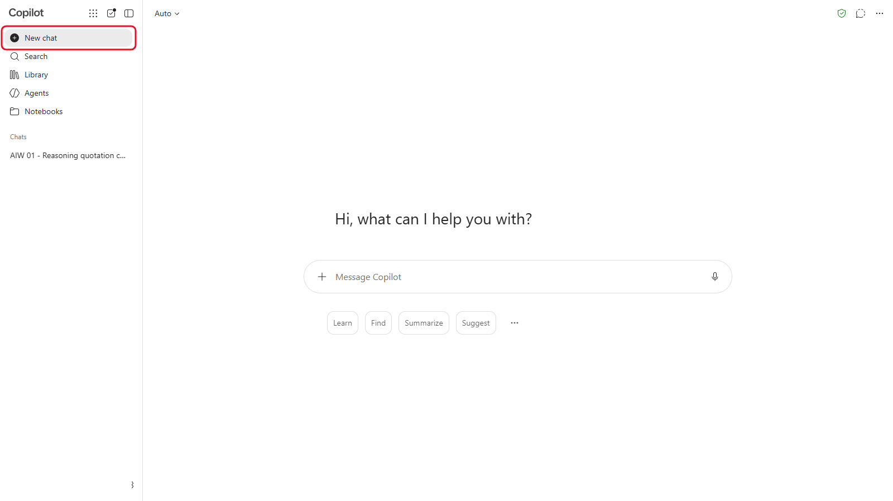
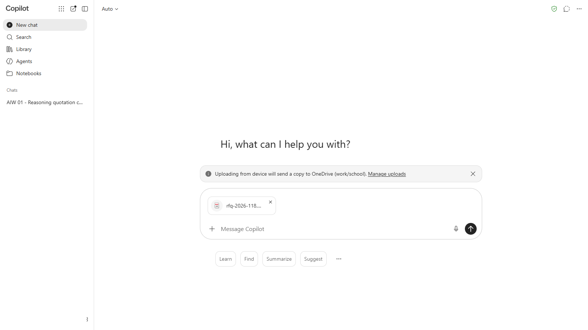
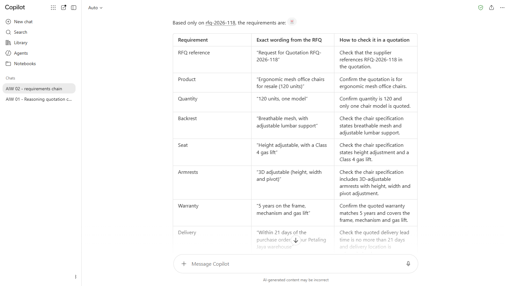
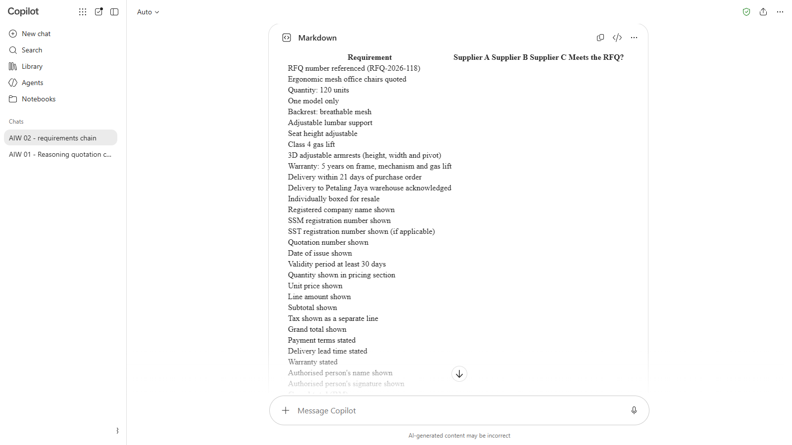
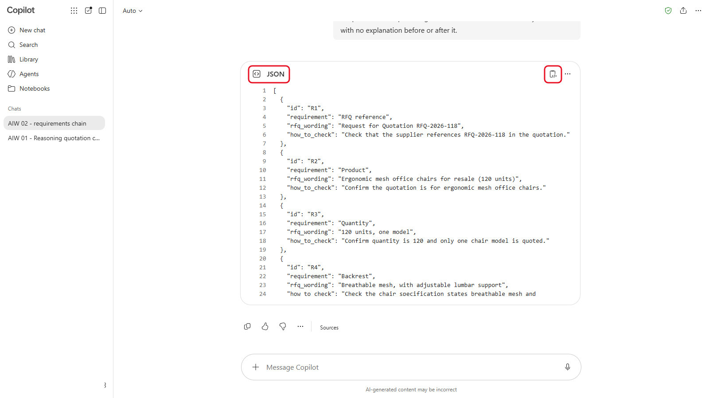
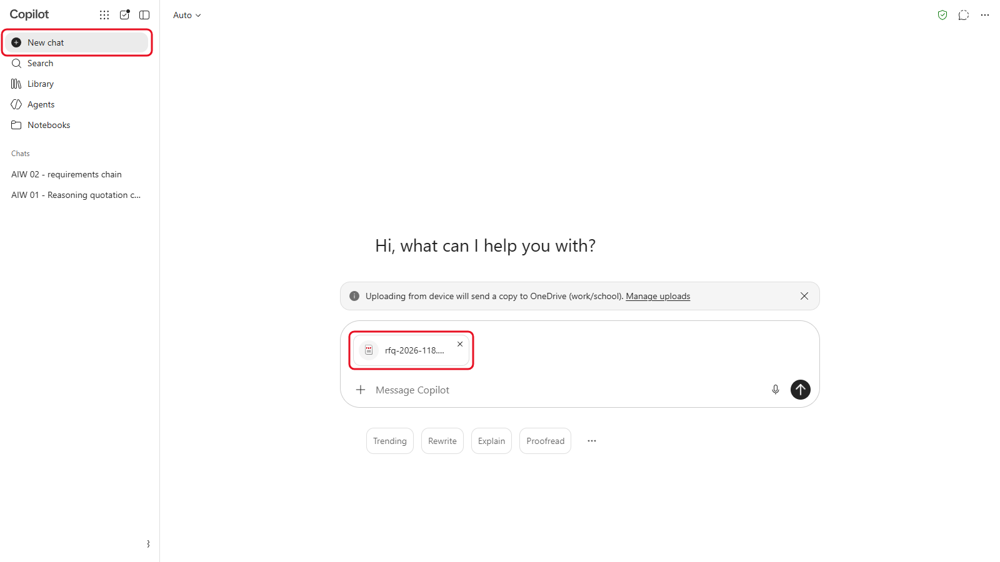
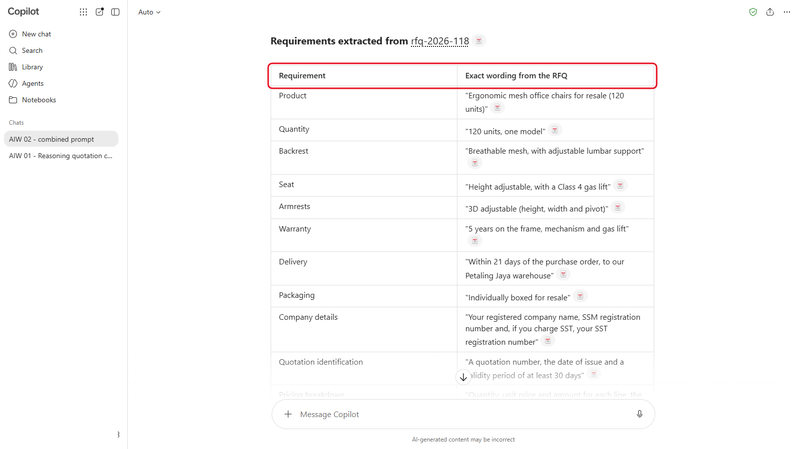

# 02 - Context Engineering dan Structured Output

Dalam Modul 01, anda nampak bahawa model hanya tahu apa yang ada di hadapannya. Context engineering ialah kemahiran meletakkan perkara yang betul di hadapan model: tugasnya, latar belakangnya, sumbernya, formatnya, dan tiada apa-apa yang mengganggu. Dalam modul ini, anda pecahkan satu tugas kepada prompt chain tiga prompt pendek, dan dapatkan output dalam format yang boleh digunakan oleh manusia dan juga sistem.

> **Prompt:** setiap prompt yang anda perlukan ada dalam langkah-langkah di bawah, dengan butang Salin. [Halaman prompt](./prompts.md) juga mengumpulkan semuanya dalam satu halaman.

**Anggaran masa:** 50 minit

**Hasil anda:** Senarai semak keperluan, jadual perbandingan kosong dan versi JSON bagi keperluan yang sama, semuanya daripada RFQ kerusi Sinar Maju.

---

## Apa yang Anda Akan Pelajari

- Senaraikan apa yang masuk ke dalam context model: arahan, fail, chat history dan memory
- Tulis prompt dengan GCSE (Goal, Context, Source, Expectations) dan sempadan yang jelas pada sumber
- Pecahkan satu tugas kepada prompt chain, setiap prompt pendek dibina atas yang sebelumnya
- Minta structured output: jadual Markdown untuk manusia, JSON untuk sistem lain
- Tahu bila perlu memulakan new chat

---

## Sebelum Anda Mula

Anda perlukan `rfq-2026-118.pdf` dari Modul 01.

> **Muat turun:** **[sample-files.zip Modul 01](../../01-how-llms-behave/sample-files.zip)** jika anda belum ada, kemudian klik kanan fail itu dan pilih **Extract All**.

Istilah baharu diterangkan dalam [glosari](../../14-product-cards/glossary.md) (dalam bahasa Inggeris).

---

## Topik

**Context ialah semua yang dilihat oleh model.** Itu termasuk prompt anda, fail yang dimuat naik, mesej sebelumnya dalam chat, custom instructions anda dan apa-apa yang alat itu ingat tentang anda (memory). Model tidak tahu bahagian mana yang paling penting melainkan anda beritahu. Chat yang panjang dan penuh dengan tugas lain boleh mengelirukan model, sebab itulah new chat selalunya memberi jawapan yang lebih baik.

**GCSE, satu tahap lebih tinggi.** Dari kursus Beginner: **G**oal (apa yang anda mahu), **C**ontext (untuk siapa dan mengapa), **S**ource (apa yang perlu digunakan) dan **E**xpectations (format, panjang, nada). Pada tahap ini, tambah sempadan: suruh model guna sumber itu sahaja, dan beritahu apa yang perlu dibuat jika sumber tidak menjawab soalan. Contohnya: "Senaraikan keperluan dalam RFQ ini (goal) untuk pegawai perolehan yang membandingkan tiga sebut harga (context). Guna PDF yang dilampirkan sahaja (source). Beri jadual dengan satu baris bagi setiap keperluan, dan tulis 'Tidak dinyatakan' jika ada yang tiada (expectations)." Prompt dalam modul ini mengikut corak itu.

**Prompt chain.** Satu prompt yang sangat panjang meminta model membuat semuanya sekali gus, dan kesilapan sukar dikesan. Prompt chain membuat satu langkah bagi setiap prompt. Anda semak setiap hasil sebelum langkah seterusnya menggunakannya.

**Structured output.** Jadual Markdown mudah dibaca oleh manusia dan mudah di-paste ke dalam Word atau Excel. JSON ialah format yang boleh dibaca oleh software lain, satu field demi satu field. Dalam Modul 10, workflow n8n anda akan memerlukan JSON.

---

## 2.1 Langkah 1: Keluarkan Keperluan

1. Mulakan new chat dalam alat AI anda.

   

   *Mula daripada chat kosong supaya tiada apa-apa daripada kerja sebelum ini yang masuk.*
2. Muat naik `rfq-2026-118.pdf`.

   

   *RFQ sudah dilampirkan dan sedia untuk dihantar bersama prompt.*
3. Hantar prompt ini:

   ```
   Goal: senaraikan setiap keperluan dalam permintaan sebut harga yang dilampirkan (RFQ-2026-118) supaya saya boleh menyemak sebut harga pembekal berdasarkannya.
   Context: Saya eksekutif perolehan di Sinar Maju Sdn Bhd, sebuah pengedar bekalan pejabat. Kami akan menerima beberapa sebut harga untuk RFQ ini.
   Source: guna RFQ yang dilampirkan sahaja. Jika sesuatu tidak dinyatakan dalam RFQ, jangan tambah.
   Expectations: jadual Markdown dengan tiga lajur: Keperluan, Ayat tepat daripada RFQ, Cara menyemaknya dalam sebut harga. Masukkan juga keperluan tentang apa yang mesti ada dalam sebut harga, bukan keperluan produk sahaja.
   ```

   

   *Jadual Langkah 1 (tangkapan skrin daripada versi bahasa Inggeris). Semak setiap petikan dalam lajur tengah dengan RFQ.*

4. Semak jadual itu dengan RFQ. Setiap baris mesti datang daripada dokumen itu, dengan ayat yang sama tepat dalam lajur kedua.

> **Petua:** jika ada baris yang tiada dalam RFQ, balas `Buang mana-mana baris yang tidak boleh anda petik daripada RFQ.` Itulah gunanya sempadan dalam baris Source.

---

## 2.2 Langkah 2: Jadikan Jadual Perbandingan

Dalam chat yang sama, hantar:

```
Guna jadual keperluan di atas sahaja, buat jadual perbandingan kosong dalam Markdown untuk tiga sebut harga pembekal. Satu baris bagi setiap keperluan. Lajur: Keperluan, Pembekal A, Pembekal B, Pembekal C, Memenuhi RFQ? Biarkan sel pembekal kosong. Tambah baris di bahagian bawah untuk Grand total (RM), Sah sehingga dan Terma pembayaran.
```



*Copilot meletakkan jadual dalam kotak **Markdown**. Guna butang copy kotak itu untuk paste ke dalam Word atau Excel.*

Sesetengah alat memecahkan satu keperluan gabungan kepada beberapa baris, contohnya "Jaring yang telap udara, dengan sokongan lumbar boleh laras" menjadi dua baris. Itu tidak mengapa, asalkan setiap baris masih datang daripada jadual Langkah 1 anda.

Copy jadual itu ke dalam Word atau Excel untuk melihat sama ada ia di-paste dengan kemas. Jika ia keluar sebagai baris-baris teks yang penuh dengan aksara |, anda telah copy Markdown mentah: minta AI tunjukkan jadual itu seperti biasa, bukan dalam code box, kemudian pilih jadual itu dan copy. Anda akan mengisi jadual seperti ini dengan sebut harga sebenar dalam Modul 03.

---

## 2.3 Langkah 3: Jadikan JSON

Dalam chat yang sama, hantar:

```
Sekarang beri saya keperluan yang sama dalam bentuk JSON, supaya sistem lain boleh membacanya. Guna senarai objek, setiap satu dengan field ini: "id" (R1, R2 dan seterusnya), "requirement", "rfq_wording" dan "how_to_check". Beri JSON sahaja, tanpa penerangan sebelum atau selepasnya.
```



*JSON Langkah 3: satu objek bagi setiap keperluan, dengan empat field yang anda minta.*

Semak bahawa setiap objek sepadan dengan satu baris jadual Langkah 1 anda. Nama field kekal dalam bahasa Inggeris kerana workflow dalam Modul 10 membacanya. Dalam Modul 10, workflow n8n anda akan meminta AI memberi jawapan JSON dengan cara yang sama.

> **Nota:** JSON yang tepat akan berbeza antara seorang peserta dengan yang lain, seperti yang anda lihat dalam Modul 01. Yang mesti sama ialah kandungannya: keperluan yang sama, dalam field dengan nama yang anda minta.

---

## 2.4 Bandingkan dengan Satu Prompt Besar

1. Mulakan **new chat** dan muat naik `rfq-2026-118.pdf` sekali lagi.

   

   *New chat untuk satu prompt besar, supaya ia tidak boleh membina atas prompt chain tadi.*
2. Hantar semuanya sekali gus:

   ```
   Baca RFQ yang dilampirkan, senaraikan semua keperluan, buat jadual perbandingan kosong untuk tiga pembekal, dan beri saya keperluan itu dalam bentuk JSON.
   ```

   

   *Satu prompt besar. Bandingkan lajur dan barisnya dengan prompt chain anda.*

3. Bandingkan hasilnya dengan prompt chain tiga langkah anda. Yang mana satu tertinggal keperluan, atau mencampuradukkan format? Yang mana anda percaya untuk dijadikan asas kerja seterusnya?

> **Perkara utama:** guna prompt chain untuk tugas baharu, atau tugas yang kesilapannya membawa kesan: anda semak setiap langkah sebelum langkah seterusnya dibina atasnya. Satu prompt sudah memadai untuk tugas yang cepat dan mudah, dan prompt panjang dengan langkah bernombor, sempadan sumber dan format yang ditetapkan jauh lebih baik daripada prompt satu baris di atas. Apabila setiap langkah prompt chain berfungsi dengan konsisten, gabungkan langkah-langkah itu ke dalam arahan tetap supaya anda tidak perlu mengulangnya. Itulah yang anda buat dengan Quotation Checker dalam Modul 03.

---

## Nota Produk

| Copilot Chat (Basic) | M365 Copilot (Premium) | ChatGPT | Claude | Gemini |
|---|---|---|---|---|
| Muat naik RFQ dengan **+**. Copilot mungkin menunjukkan jadual atau JSON dalam kotak **Markdown** atau **JSON**: copy dengan butang copy kotak itu sendiri | Sama seperti Basic | Jadual dan JSON dipaparkan dalam kotak berformat dengan butang copy | JSON yang panjang mungkin dibuka dalam panel sisi; copy dari situ | Guna **Export to Sheets** di bawah jadual untuk menghantarnya ke Google Sheets |

---

## Latihan Kendiri

Ambil satu borang atau senarai semak daripada kerja anda sendiri (tanpa data sebenar). Minta alat AI anda menukarnya kepada JSON dengan nama field yang anda pilih. Kemudian minta ia menukar JSON itu kembali kepada jadual Markdown. Adakah apa-apa yang hilang?

---

## Penyelesaian Masalah

| Masalah | Apa yang perlu disemak |
|---|---|
| Jadual ada keperluan yang tiada dalam RFQ | Minta ia memetik ayat RFQ bagi setiap baris, dan buang baris yang tidak boleh dipetik |
| Model lupa jadual sebelumnya | Anda telah memulakan new chat. Langkah 1 hingga 3 mesti dalam chat yang sama |
| Ada teks sebelum atau selepas JSON | Minta sekali lagi: "Beri JSON sahaja." |
| Nama field JSON berbeza daripada yang anda minta | Paste nama field itu sekali lagi dan minta ia guna nama itu dengan tepat |

---

## Ringkasan Pelajaran

Context yang baik adalah khusus dan bersempadan: matlamat, latar belakang, satu sumber yang perlu digunakan, dan format yang anda perlukan. Prompt chain yang pendek membolehkan anda menyemak setiap langkah sebelum langkah seterusnya bergantung padanya. Format juga sebahagian daripada permintaan: jadual untuk manusia, JSON untuk software.

**Uji diri:** Mengapa lebih selamat menjalankan tiga prompt pendek dalam satu chat berbanding satu prompt panjang, dan bila anda patut memulakan new chat?
