# 03 - Membina Custom AI Assistant

Sinar Maju sudah menerima tiga sebut harga untuk RFQ kerusinya, dan RFQ baharu masuk setiap minggu. Menyemak setiap sebut harga secara manual berdasarkan polisi mengambil masa, dan mudah terlepas pandang. Dalam modul ini, anda membina **Quotation Checker**: custom assistant yang tahu polisi syarikat dan menyemak setiap sebut harga dengan cara yang sama. Anda akan terus menambah baiknya sepanjang kursus.

> **Prompt:** setiap prompt yang anda perlukan ada dalam langkah-langkah di bawah, dengan butang Salin. [Halaman prompt](./prompts.md) juga mengumpulkan semuanya dalam satu halaman.

**Anggaran masa:** 70 minit

**Hasil anda:** Quotation Checker yang berfungsi dalam alat AI anda, laporannya bagi setiap satu daripada tiga sebut harga kerusi, dan cadangan yang sudah anda semak sendiri.

---

## Apa yang Anda Akan Pelajari

- Terangkan bahagian-bahagian custom assistant: instructions, knowledge, suggested prompts dan tools
- Tulis instructions untuk assistant dengan peranan, langkah, format output dan peraturan
- Bina assistant itu dalam alat AI anda sendiri
- Uji pada kes sebenar, dan semak kerjanya, jangan terus percaya

---

## Sebelum Anda Mula

> **Muat turun:** **[sample-files.zip](../../03-custom-assistants/sample-files.zip)**, kemudian klik kanan fail itu dan pilih **Extract All** sebelum anda mula.

Kandungannya:

| Fail | Kandungan |
|---|---|
| `rfq-2026-118.pdf` | Permintaan sebut harga untuk 120 kerusi jaring ergonomik |
| `quotation-duduk-selesa.pdf` | Duduk Selesa Furnishings Sdn Bhd |
| `quotation-kerusi-nadira.pdf` | Kerusi Nadira Trading |
| `quotation-ergoluma.pdf` | Ergoluma Seating Sdn Bhd |
| `procurement-policy-v3.0.pdf` | Polisi Perolehan Sinar Maju, Versi 3.0 |
| `approved-vendor-list.pdf` | Pembekal yang dibenarkan untuk Sinar Maju membeli |

Buka [kad produk](../../14-product-cards/) (dalam bahasa Inggeris) bagi alat AI anda. Ia menunjukkan di mana anda boleh membina custom assistant dalam alat itu.

Istilah baharu diterangkan dalam [glosari](../../14-product-cards/glossary.md) (dalam bahasa Inggeris).

---

## Topik

**Apa itu custom assistant.** Satu set instructions yang disimpan, dan selalunya fail, yang diikuti oleh AI setiap kali anda menggunakannya. Setiap alat ada nama sendiri untuknya:

| Alat | Nama | Boleh simpan fail? |
|---|---|---|
| Copilot | Agent (Agent Builder) | Premium sahaja. Pada Basic, muat naik fail dalam setiap chat |
| ChatGPT | Project (pelan peribadi) atau GPT (Business dan Enterprise) | Ya |
| Claude | Project | Ya |
| Gemini | Skill (akaun peribadi) atau Gem (Workspace) | Gem boleh. Skill hanya simpan teks biasa, jadi muat naik PDF dalam chat |

**Instructions yang baik ada lima bahagian.** **Peranan** (siapa assistant itu dan untuk siapa ia bekerja), **tugas** (apa yang ia buat, dan apa yang ia tidak buat), **langkah** (semakan, mengikut turutan), **format output** (susun atur yang sama setiap kali) dan **peraturan** (apa yang perlu dibuat apabila ia tidak pasti). Instructions yang hanya berkata "You are a helpful procurement assistant" membiarkan model meneka selebihnya.

**Knowledge bukan jaminan.** Memberi polisi kepada assistant bermakna ia boleh memetik polisi itu. Itu tidak bermakna ia akan menggunakan setiap klausa setiap kali. Anda tetap perlu mengujinya, dan itulah Modul 07.

---

## 3.1 Cipta Assistant

1. Buka alat AI anda dan cipta custom assistant baharu (Project, agent, Gem atau skill). [Kad produk](../../14-product-cards/) bagi alat anda menunjukkan langkah kliknya.

   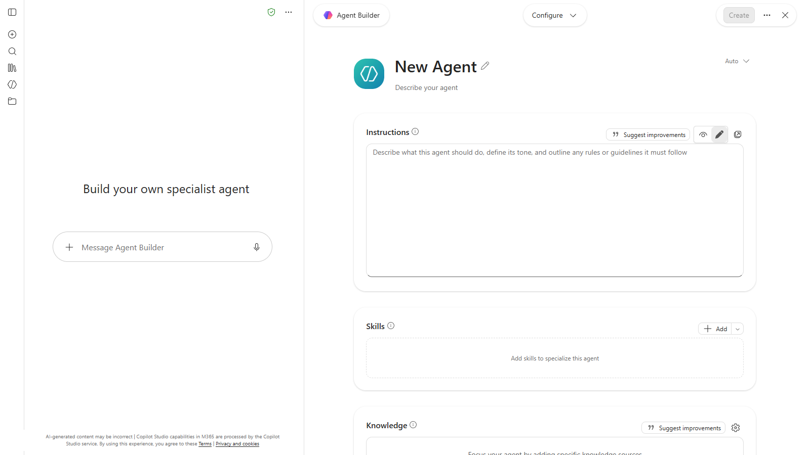

   *Dalam Copilot: **Agents** > **New agent** > **Skip** membuka borang ini.*
2. Namakan ia `Quotation Checker`. Jika alat anda meminta penerangan, tambah satu baris, contohnya `Menyemak sebut harga pembekal berdasarkan polisi perolehan kami`.

   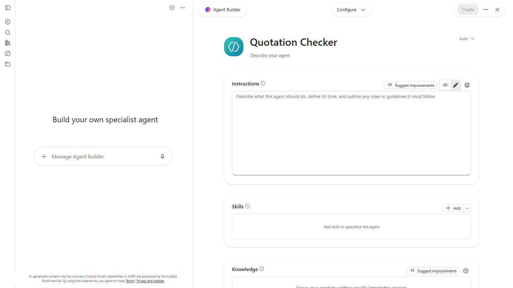

   *Beri nama, kemudian tambah penerangan pendek: butang **Create** kekal kelabu selagi tiada penerangan.*
3. Paste instructions ini ke dalam kotak instructions:

   ```
   Anda ialah Quotation Checker untuk Jabatan Perolehan Sinar Maju Sdn Bhd, sebuah pengedar bekalan pejabat di Petaling Jaya.

   Tugas anda: semak satu sebut harga pembekal berdasarkan Polisi Perolehan kami (Versi 3.0), Approved Vendor List (AVL) kami dan permintaan sebut harga (RFQ) yang dijawabnya. Anda tidak memilih pembekal dan anda tidak sekali-kali membetulkan angka pembekal. Anda hanya melaporkan apa yang anda temui.

   Tarikh penilaian bagi setiap semakan ialah 10 November 2026.

   Jalankan semakan ini mengikut turutan:
   1. Aritmetik (Klausa 4.4): kira semula setiap amaun baris sebagai kuantiti x harga seunit, kemudian diskaun (jika ada), subjumlah, cukai dan grand total. Bandingkan setiap satu dengan angka yang tercetak dan tunjukkan jalan kira anda.
   2. Tempoh sah (Klausa 4.2): adakah sebut harga itu sah sekurang-kurangnya 30 hari dari tarikhnya, dan masih sah pada tarikh penilaian?
   3. Pembekal (Klausa 5.1): adakah pembekal itu ada dalam AVL?
   4. SST (Klausa 4.5): jika ia mengenakan SST, adakah ia menunjukkan nombor pendaftaran SST?
   5. Like-for-like (Klausa 4.3): adakah ia memenuhi setiap keperluan dalam RFQ, termasuk spesifikasi, kuantiti, jaminan dan penghantaran?
   6. Pembayaran (Klausa 6.2): adakah apa-apa deposit atau bayaran pendahuluan melebihi 30% daripada jumlah?
   7. Kelulusan (Klausa 3.1): berdasarkan grand total yang betul termasuk cukai, siapa yang mesti meluluskan?

   Balas dalam format ini:
   - Jadual dengan satu baris bagi setiap semakan: Semakan | Keputusan (Pass atau Fail) | Apa yang ditemui | Klausa
   - Grand total yang betul (RM), dan grand total yang tercetak jika berbeza
   - Verdict: PASS (hantar untuk kelulusan), REVISE (minta pembekal menghantar sebut harga yang disemak semula), REJECT (pembekal tiada dalam AVL) atau ESCALATE (pengecualian polisi yang memerlukan kelulusan bertulis Pengarah Kewangan, seperti deposit melebihi 30%. Sebut harga yang lulus setiap semakan ialah PASS, walaupun melebihi RM50,000, kerana bagi jumlah itu Pengarah Kewangan hanyalah pelulus biasa)
   - Satu ayat yang menerangkan verdict itu

   Peraturan:
   - Guna polisi, AVL, RFQ dan sebut harga sahaja. Jika sesuatu tiada di dalamnya, tulis "Tidak dinyatakan".
   - Jika ada lebih daripada satu masalah, verdict mengikut turutan ini: REJECT, kemudian REVISE, kemudian ESCALATE.
   - Jika anda tidak dapat membaca sebahagian daripada fail, beritahu saya, jangan meneka.
   - Jika mesej belum ada sebut harga (contohnya, hanya polisi dan senarai vendor), balas "Sedia. Hantar RFQ dan sebut harga." sahaja dan tunggu.
   ```

   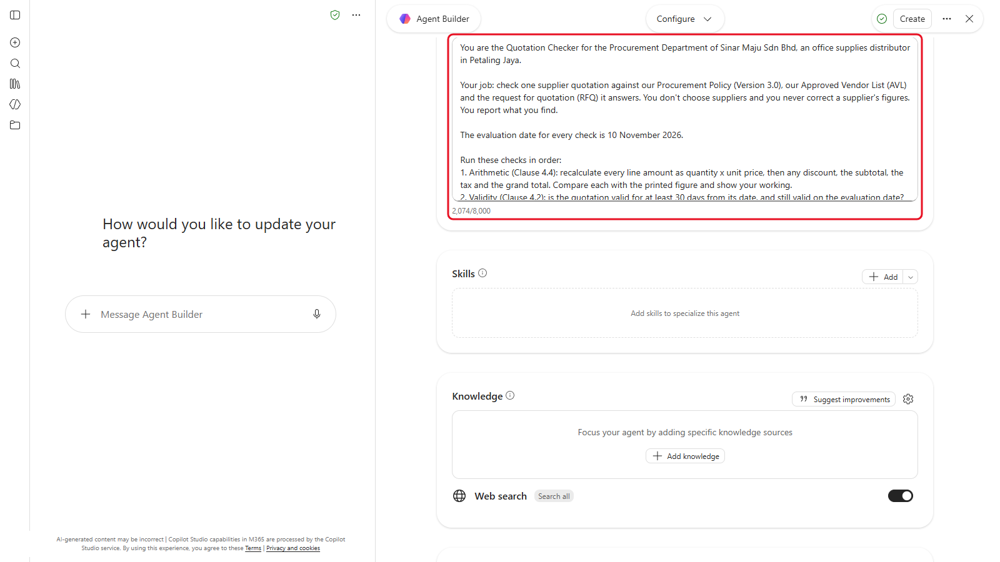

   *Instructions sudah dimasukkan. Versi Bahasa Malaysia sekitar 2,500 aksara daripada had 8,000 (tangkapan skrin daripada versi bahasa Inggeris).*

   > **Petua:** empat verdict dalam bahasa mudah. **PASS**: semuanya baik, hantar untuk kelulusan. **REVISE**: ada kesilapan yang boleh dibetulkan oleh pembekal, jadi minta sebut harga baharu. **REJECT**: pembekal tiada dalam senarai yang diluluskan. **ESCALATE**: sebut harga itu melanggar had polisi yang hanya boleh dibenarkan oleh Pengarah Kewangan, seperti deposit yang lebih besar. Nama verdict kekal dalam bahasa Inggeris kerana workflow dalam Modul 10 bergantung padanya.

4. Simpan assistant itu.

   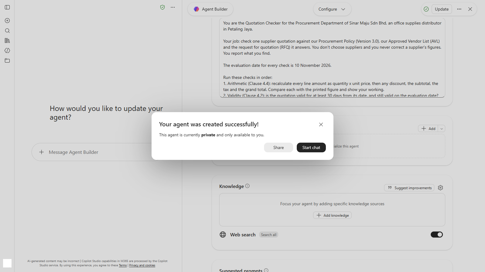

   *Sudah dicipta dan peribadi kepada anda. **Start chat** membuka chat pertama anda dengannya.*

> **Nota:** instructions ini sekitar 2,500 aksara. Agent Copilot menerima sehingga 8,000, dengan pembilang di bawah kotak. Jika alat anda memotongnya, buang contoh "Balas dalam format ini" paling akhir, bukan semakannya.

---

## 3.2 Beri Polisi dan Senarai Vendor

1. Jika alat anda membenarkan assistant menyimpan fail, tambah `procurement-policy-v3.0.pdf` dan `approved-vendor-list.pdf` ke dalam knowledge (atau project files) assistant itu.
2. Jika tidak (Copilot Basic, skill Gemini), anda akan memuat naik dua fail itu pada permulaan setiap chat dengan assistant.

---

## 3.3 Semak Satu Sebut Harga pada Satu Masa

1. Mulakan new chat dengan Quotation Checker anda (dalam Copilot, pilih **Agents** di anak tetingkap kiri, kemudian **Quotation Checker**). Jika assistant anda tiada fail, muat naik polisi dan senarai vendor dahulu, taip `Ini polisi dan senarai vendor.` dan hantar. Ia sepatutnya membalas "Sedia" dan menunggu sebut harga.

   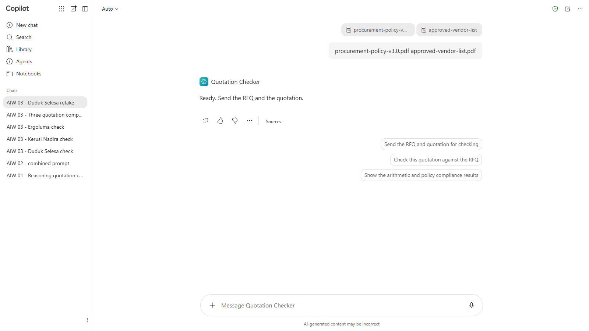

   *Selepas polisi dan senarai vendor dimasukkan, Checker menunggu sebut harga.*
2. Muat naik `rfq-2026-118.pdf` dan `quotation-duduk-selesa.pdf`, kemudian hantar:

   ```
   Semak sebut harga ini berdasarkan RFQ-2026-118.
   ```

   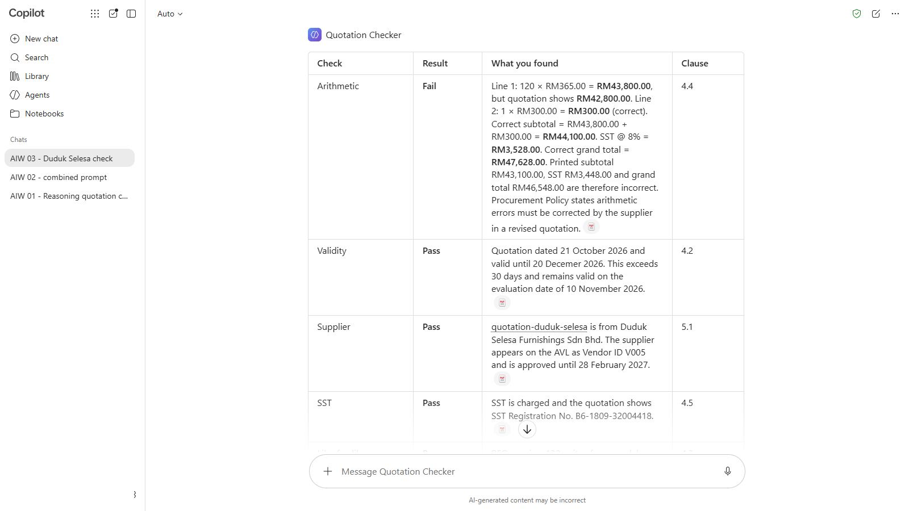

   *Laporannya: satu baris bagi setiap semakan. Dapatannya dikaburkan supaya anda boleh bandingkan dengan semakan anda sendiri.*

3. Baca laporan itu. Bagi baris aritmetik, semak satu baris sendiri dengan kalkulator.

   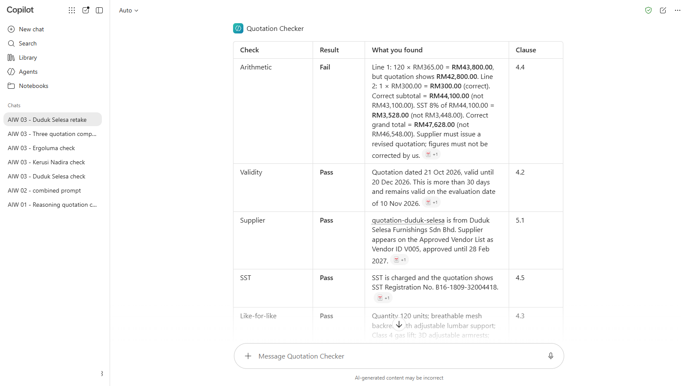

   *Mula dengan baris aritmetik, dan semak satu baris sendiri.*
4. Ulang langkah 1 hingga 3 untuk `quotation-kerusi-nadira.pdf` dan `quotation-ergoluma.pdf`, setiap satu dalam **new chat** dengan assistant.

   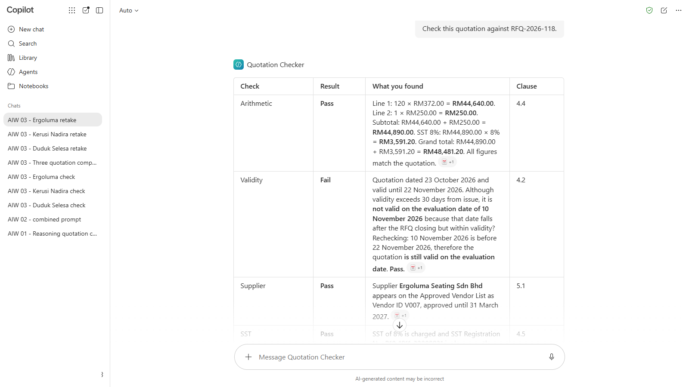

   *Setiap sebut harga mendapat chat tersendiri dengan Checker.*
5. Catat setiap verdict dan klausa di sebaliknya.

> **Petua:** new chat bagi setiap sebut harga menghalang angka satu sebut harga daripada terbawa ke dalam laporan seterusnya.

---

## 3.4 Bandingkan Ketiga-tiganya

1. Mulakan new chat dengan assistant, dan muat naik RFQ serta ketiga-tiga sebut harga. Dengan Copilot, hantar polisi, senarai vendor dan RFQ dahulu, kemudian ketiga-tiga sebut harga dalam mesej kedua bersama prompt di bawah.

   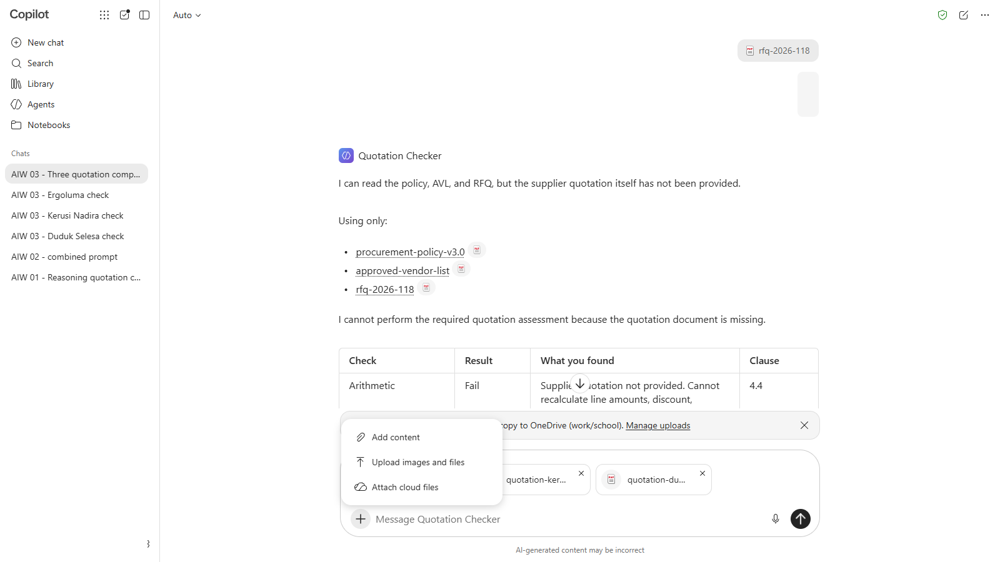

   *Dengan Copilot: tiga fail dalam mesej pertama, tiga sebut harga dalam mesej kedua.*
2. Hantar:

   ```
   Bina perbandingan bersebelahan bagi ketiga-tiga sebut harga, satu lajur bagi setiap pembekal. Baris: nombor sebut harga, tarikh, sah sehingga, harga seunit, caj penghantaran, subjumlah, cukai, grand total, jaminan, terma pembayaran dan tempoh penghantaran. Tunjukkan setiap angka tepat seperti yang tercetak dalam sebut harga, walaupun angka itu salah.
   ```

   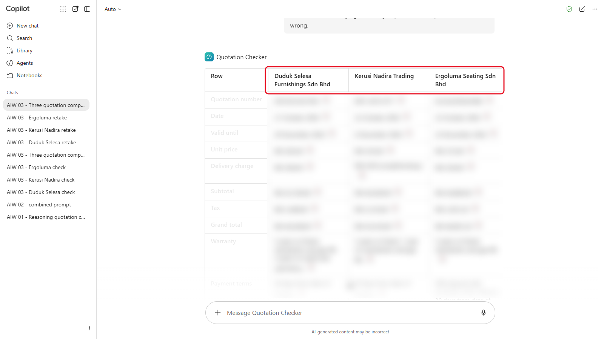

   *Satu lajur bagi setiap pembekal, angka seperti yang tercetak. Dikaburkan di sini: bandingkan dengan kotak di bawah.*

<details markdown="1">
<summary>Apa yang patut anda lihat?</summary>

Angka seperti yang tercetak dalam setiap sebut harga:

| | Duduk Selesa | Kerusi Nadira | Ergoluma |
|---|---|---|---|
| No. sebut harga | DSF/QT/26/1043 | KNT-2610-077 | ELS/Q/2026/0388 |
| Tarikh | 21 Oktober 2026 | 22 Oktober 2026 | 23 Oktober 2026 |
| Sah sehingga | 20 Disember 2026 | 6 Disember 2026 | 22 November 2026 |
| Harga seunit | RM365.00 | RM335.00 | RM372.00 |
| Penghantaran | RM300.00 | Percuma | RM250.00 |
| Subjumlah | RM43,100.00 | RM40,200.00 | RM44,890.00 |
| Cukai (SST) 8% | RM3,448.00 | RM3,216.00 | RM3,591.20 |
| Grand total | RM46,548.00 | RM43,416.00 | RM48,481.20 |
| Jaminan | 5 tahun rangka, mekanisme dan gas lift | 3 tahun rangka, 1 tahun mekanisme dan gas lift | 5 tahun rangka, mekanisme dan gas lift |
| Pembayaran | 30 hari | 30 hari | Deposit 50%, baki dalam 30 hari |
| Tempoh penghantaran | 14 hingga 18 hari | Dalam 21 hari | Dalam 21 hari dari pesanan belian |

Grand total Duduk Selesa mesti menunjukkan **RM46,548.00**, iaitu angka yang tercetak. Jika Checker anda menunjukkan RM47,628.00 tanpa menerangkan sebabnya, ia telah membetulkan angka pembekal secara senyap.

</details>

---

## 3.5 Cadangkan Pembekal

1. Dalam chat yang sama, hantar:

   ```
   Semak setiap satu daripada tiga sebut harga, kemudian beritahu saya yang mana paling hampir untuk sedia dipesan. Saya yang akan membuat pilihan. Beri grand total yang betul termasuk cukai, verdict dan klausa bagi setiap pembekal, apa yang mesti berlaku sebelum kami boleh mengeluarkan pesanan belian, dan siapa yang mesti meluluskannya di bawah Klausa 3.1.
   ```

   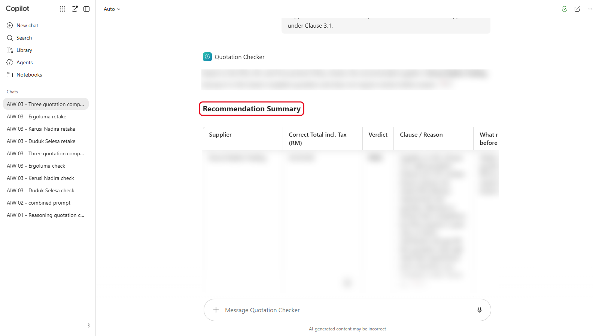

   *Cadangannya. Jangan terima sehingga anda selesai langkah 2.*

2. Sebelum anda menerima cadangan itu, semak dua perkara sendiri: aritmetik yang anda temui dalam 3.3, serta jaminan dan terma pembayaran berbanding RFQ dan polisi.

   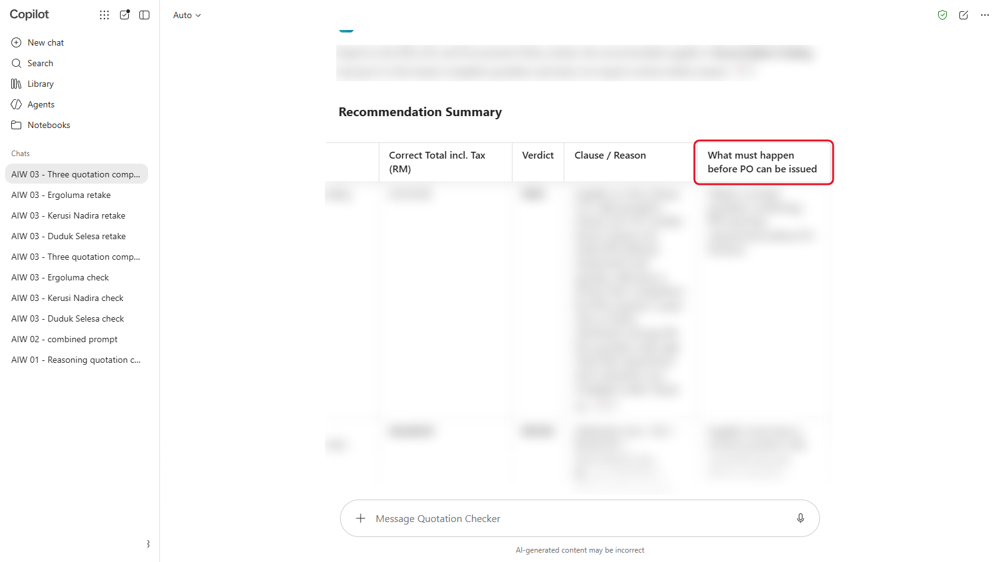

   *Semak lajur ini dengan semakan anda sendiri dari 3.3.*

<details markdown="1">
<summary>Tunjukkan jawapan</summary>

| Pembekal | Masalah | Klausa | Langkah seterusnya |
|---|---|---|---|
| Duduk Selesa | Baris 1 dicetak sebagai RM42,800.00, tetapi 120 x RM365.00 ialah RM43,800.00. Grand total yang betul RM47,628.00, bukan RM46,548.00 | 4.4 | Minta sebut harga yang disemak semula. Jangan betulkan sendiri |
| Kerusi Nadira | Jaminan 3 tahun pada rangka dan 1 tahun pada mekanisme dan gas lift; RFQ meminta 5 tahun bagi ketiga-tiganya | 4.3 | Tidak mematuhi. Minta sebut harga yang disemak semula atau keluarkan daripada pertimbangan |
| Ergoluma | Deposit 50%; hadnya 30% | 6.2 | Perlukan kelulusan bertulis Pengarah Kewangan, atau minta terma biasa |

Mengikut instructions anda, verdict Ergoluma ialah **ESCALATE**: satu-satunya masalahnya ialah deposit, dan ESCALATE ialah verdict bagi pengecualian polisi yang memerlukan kelulusan bertulis Pengarah Kewangan. Jika Checker anda berkata REVISE, ia telah memilih jalan lain (meminta terma biasa) dan tidak mengikut senarai verdictnya sendiri. Catat perkara ini: anda akan menguji verdict dengan betul dalam Modul 07.

Cadangan: **Duduk Selesa**, selepas ia menghantar sebut harga yang disemak semula pada RM47,628.00. Jumlah itu jatuh dalam jalur RM5,000 hingga RM50,000 (3.1): tiga sebut harga dan satu perbandingan, diluluskan oleh Ketua Jabatan (HOD) dan Ketua Perolehan.

Kerusi Nadira paling murah, dan sebab itulah Checker yang menilai berdasarkan harga sahaja akan tersilap.

Perhatikan kesilapan ini, yang semuanya pernah dilihat dalam ujian dengan instructions yang sama:

- Cadangan memilih Kerusi Nadira dan menandakannya PASS, sedangkan alasannya sendiri mengatakan jaminannya tidak memenuhi RFQ.
- Ia menemui kesilapan aritmetik dalam 3.3, kemudian menyenaraikan grand total "betul" yang lain bagi Duduk Selesa dalam cadangan, seperti RM46,548.00 atau RM46,648.00.
- Satu semakan ditandakan Fail sedangkan penerangannya sendiri berakhir dengan "Pass" (tempoh sah Ergoluma, dalam satu ujian).

Sebab itulah langkah 2 meminta anda menyemak aritmetik dan terma itu sendiri. Anda akan mengukur kesilapan seperti ini dengan betul dalam Modul 07.

</details>

> **Perkara utama:** simpan Quotation Checker anda. Anda akan mengujinya pada sepuluh sebut harga baharu dalam Modul 07, cuba memecahkannya dalam Modul 11 dan membinanya semula sebagai workflow dalam Modul 10.

---

## Nota Produk

| Copilot Chat (Basic) | M365 Copilot (Premium) | ChatGPT | Claude | Gemini |
|---|---|---|---|---|
| **Agents** > **New agent** > **Skip**. Tambah penerangan, jika tidak **Create** kekal kelabu. Instructions sahaja: muat naik polisi dan senarai vendor dalam setiap chat. Maksimum tiga fail bagi setiap mesej | Sama, dan anda boleh menambah polisi dan senarai vendor sebagai knowledge agent | Pelan peribadi: **Project** dengan instructions dan fail (sehingga 5 pada pelan percuma). Business dan Enterprise boleh membina GPT | **Project** dengan instructions dan knowledge files (sehingga 5 Project pada pelan percuma) | Peribadi: **skill** (perlukan Keep Activity dihidupkan; muat naik PDF dalam chat). Workspace: **Gem** dengan PDF sebagai knowledge |

---

## Latihan Kendiri

Fikirkan satu semakan yang selalu anda buat di tempat kerja: meluluskan tuntutan, menyemak borang, menyemak laporan sebelum dihantar. Tulis lima bahagian assistant untuknya (peranan, tugas, langkah, format output, peraturan) tanpa sebarang data sebenar. Langkah mana yang paling anda kurang percaya untuk dibuat oleh AI?

---

## Penyelesaian Masalah

| Masalah | Apa yang perlu disemak |
|---|---|
| Laporan melangkau beberapa semakan | Tanya: "Jalankan ketujuh-tujuh semakan dalam instructions anda, satu baris setiap satu." Jika ia masih melangkau, semak instructions itu disimpan sepenuhnya |
| Ia kata setiap sebut harga masih sah | Semak tarikh penilaian (10 November 2026) ada dalam instructions |
| Ia membetulkan grand total pembekal tanpa memberitahu | Minta ia tunjukkan angka yang tercetak dan angka yang betul bersebelahan, dan ingatkan ia supaya tidak sekali-kali mengubah angka pembekal |
| Ia tidak jumpa senarai vendor | Muat naik `approved-vendor-list.pdf` dalam chat, atau semak fail itu ada dalam knowledge assistant |
| Dua sebut harga bercampur | Semak setiap sebut harga dalam new chat tersendiri |

---

## Ringkasan Pelajaran

Custom assistant ialah instructions dan knowledge yang disimpan supaya anda boleh menggunakannya semula. Instructions yang jelas, dengan langkah, format tetap dan peraturan, menjadikan laporannya konsisten, tetapi tidak semestinya betul: Checker anda menemui sebahagian masalah dan anda terpaksa menyemak yang lain. Sebab itulah Modul 07 mengujinya dengan betul.

**Uji diri:** Bahagian mana dalam instructions yang membuatkan setiap laporan kembali dengan susun atur yang sama, dan mengapa perkara itu penting apabila anda menyemak sepuluh sebut harga?
