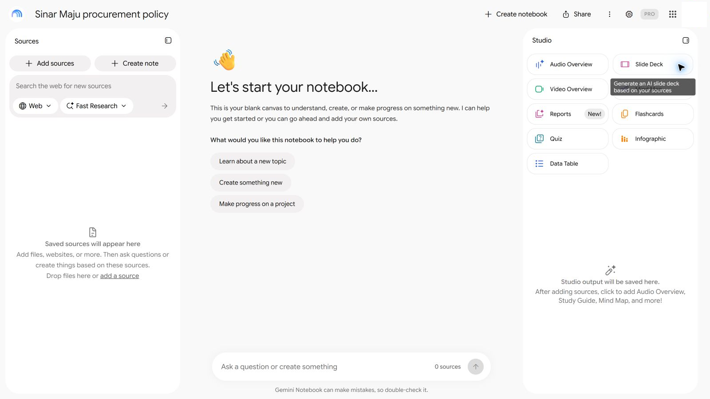
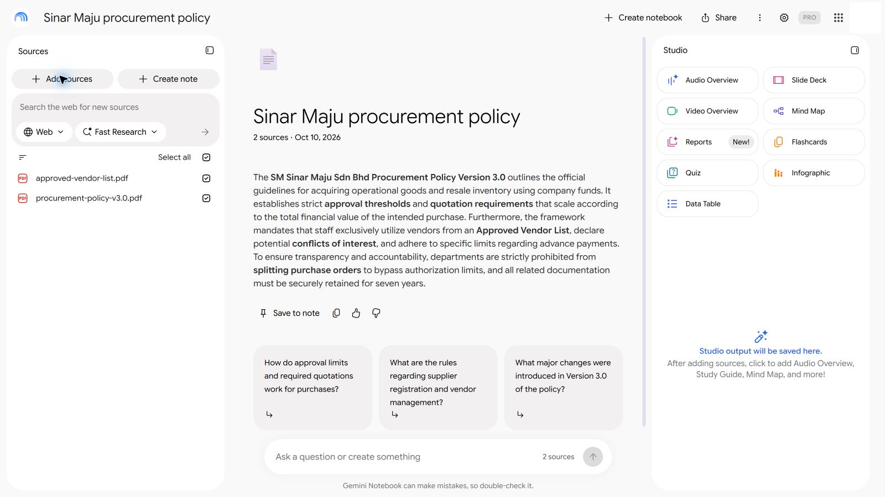
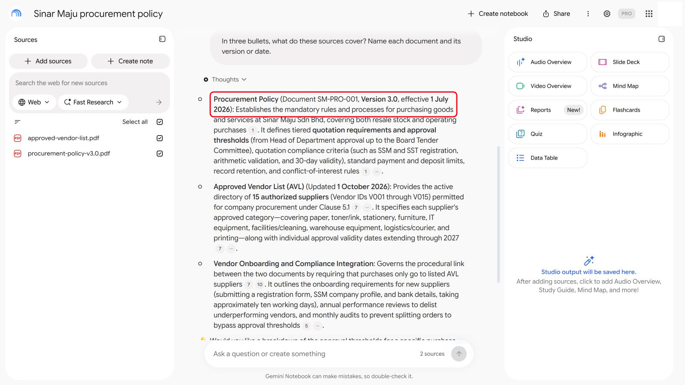
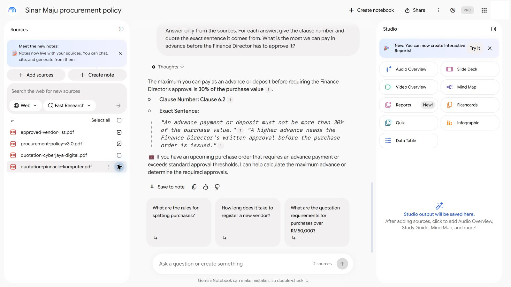
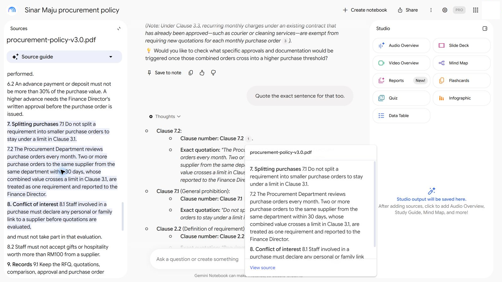
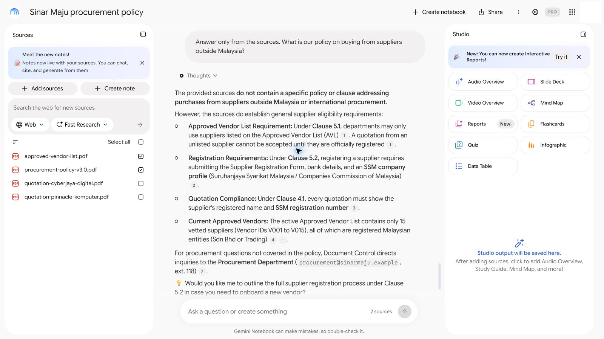

# 04 - Grounded Research dan Jawapan Berasaskan Sumber

Quotation Checker anda memetik polisi perolehan. Tetapi apabila rakan sekerja bertanya "berapa banyak deposit yang boleh kita bayar?", bolehkah anda mempercayai jawapannya, dan bolehkah anda tunjukkan dari mana jawapan itu datang? Dalam modul ini, anda menyediakan notebook polisi yang menjawab hanya daripada dokumen Sinar Maju sendiri, dan anda menyemak setiap citation yang diberikannya.

> **Prompt:** setiap prompt yang anda perlukan ada dalam langkah-langkah di bawah, dengan butang Salin. [Halaman prompt](./prompts.md) juga mengumpulkan semuanya dalam satu halaman.

**Anggaran masa:** 55 minit

**Hasil anda:** Notebook polisi yang menjawab daripada Polisi Perolehan, lima jawapan yang sudah disemak bersama nombor klausanya, dan satu soalan yang dengan betul dikatakannya tidak dapat dijawab.

---

## Apa yang Anda Akan Pelajari

- Terangkan beza antara jawapan daripada ingatan model dengan jawapan yang berasaskan sumber anda (grounded)
- Sediakan notebook berasaskan sumber dalam AI tool anda
- Semak citation dengan cepat, dan kenal pasti citation yang tidak menyokong jawapan
- Tanya soalan dengan cara yang menjadikan jawapan mudah disemak
- Kenali jawapan "Saya tidak jumpa perkara itu dalam sumber" yang baik

---

## Sebelum Anda Mula

> **Muat turun:** **[sample-files.zip](../../04-grounded-research/sample-files.zip)**, kemudian klik kanan fail itu dan pilih **Extract All** sebelum anda mula.

Kandungannya ialah `procurement-policy-v3.0.pdf` dan `approved-vendor-list.pdf`.

Lab ini paling sesuai dalam **Gemini Notebook** (dahulunya NotebookLM), yang percuma dengan akaun Google dan memautkan setiap citation kepada petikan tepatnya. Jika anda hanya ada Copilot, Copilot Notebook juga sama baiknya: tangkapan skrin menunjukkan Gemini, tetapi langkahnya sama. Project ChatGPT atau Claude juga boleh digunakan. Lihat Nota Produk di bawah.

Istilah baharu diterangkan dalam [glosari](../14-product-cards/glossary.md). Jika syarikat anda menyekat Gemini Notebook, lihat [Jika syarikat anda menyekat sesuatu tool](../../14-product-cards/locked-down.md) (dalam bahasa Inggeris).

---

## Topik

**Jawapan grounded dan tidak grounded.** Tanya chat biasa "berapakah deposit biasa untuk perabot pejabat?" dan model menjawab daripada apa yang dipelajarinya semasa latihan: munasabah, tetapi bukan polisi sesiapa. Jawapan grounded datang daripada dokumen yang anda berikan, dan merujuk kembali kepadanya.

**Tool berasaskan sumber.** Notebook (Gemini Notebook, Copilot Notebooks) atau Project menyimpan sumber anda bersama dan menjawab daripadanya. Sesetengah tool berpegang ketat pada sumber; yang lain mencampurkan pengetahuan umum melainkan anda menyuruhnya jangan.

**Citation juga satu dakwaan.** Nombor citation menunjukkan dari mana tool itu berkata jawapan itu datang. Ia masih boleh merujuk kepada klausa yang salah, atau klausa yang berkata sesuatu yang sedikit berbeza. Menyemaknya hanya mengambil beberapa saat jika anda meminta nombor klausa dan ayat yang tepat.

**"Saya tidak tahu" ialah jawapan yang baik.** Apabila sumber tidak meliputi sesuatu soalan, jawapan yang betul ialah menyatakannya. Assistant yang sentiasa ada jawapan sebenarnya meneka pada sesetengah masa.

---

## 4.1 Sediakan Notebook Polisi

1. Buka notebook tool anda dan cipta notebook (atau Project) baharu bernama `Sinar Maju procurement policy`.

   

   *Dalam Gemini Notebook: **Create notebook**, tukar namanya, kemudian **Add sources**.*
2. Tambah `procurement-policy-v3.0.pdf` dan `approved-vendor-list.pdf` sebagai sumber.

   

   *Hanya dua PDF itu, kedua-duanya ditanda. Notebook menulis ringkasan tentangnya.*
3. Tanya:

   ```
   Dalam tiga poin, apakah yang diliputi oleh sumber-sumber ini? Namakan setiap dokumen dan versi atau tarikhnya.
   ```

   

   *Semak versinya: jawapan sepatutnya menamakan Versi 3.0 (tangkapan skrin daripada versi bahasa Inggeris).*

4. Semak bahawa kedua-dua dokumen dinamakan, dan polisi ditunjukkan sebagai Versi 3.0.

---

## 4.2 Tanya Lima Soalan Polisi

Hantar setiap soalan secara berasingan, dan catat setiap jawapan serta nombor klausanya.

```
Jawab daripada sumber sahaja. Bagi setiap jawapan, beri nombor klausa dan petik ayat tepat yang menjadi asasnya. Berapakah jumlah maksimum yang boleh kami bayar secara pendahuluan sebelum Pengarah Kewangan perlu meluluskannya?
```

```
Berapa lamakah sebut harga pembekal mesti sah?
```

```
Siapakah yang perlu meluluskan pembelian bernilai RM80,000 termasuk cukai?
```

```
Adakah sebut harga perlu menunjukkan nombor pendaftaran SST pembekal?
```

```
Apakah yang berlaku jika satu jabatan membuat beberapa pesanan kecil dengan pembekal yang sama dalam bulan yang sama?
```



*Jawapan pertama menetapkan corak: nombor klausa dan ayat yang tepat.*

> **Petua:** soalan pertama menetapkan corak (jawab daripada sumber sahaja, beri klausa, petik ayatnya). Jika jawapan seterusnya tidak lagi memetik ayat, katakan `Petik ayat tepat untuk jawapan itu juga.`

---

## 4.3 Semak Setiap Citation

1. Bagi setiap jawapan, buka PDF polisi dan cari klausa yang dinamakannya. Dalam Gemini Notebook, klik nombor citation. Dalam Copilot, pilih **Sources** di bawah jawapan untuk melihat fail yang digunakannya, kemudian buka PDF itu sendiri dan cari klausanya.

   

   *Klik nombor citation untuk melihat petikannya, kemudian **View source** untuk membukanya dalam polisi.*
2. Baca ayat yang dipetik dalam PDF. Adakah ia menyatakan perkara yang sama seperti jawapan?
3. Tandakan setiap jawapan **Betul**, **Klausa salah** atau **Tidak menyokong jawapan**.

<details markdown="1">
<summary>Apa yang patut anda lihat?</summary>

Setiap jawapan sepatutnya merujuk klausa yang menjadi sumbernya.

| Soalan | Jawapan | Klausa |
|---|---|---|
| Berapakah jumlah maksimum yang boleh dibayar secara pendahuluan tanpa kelulusan tambahan? | 30% daripada nilai pembelian. Lebih daripada itu memerlukan kelulusan bertulis Pengarah Kewangan terlebih dahulu | 6.2 |
| Berapa lamakah sebut harga mesti sah? | Sekurang-kurangnya 30 hari dari tarikh dikeluarkan, dan masih sah pada tarikh penilaian | 4.2 |
| Siapakah yang meluluskan pembelian RM80,000? | Pengarah Kewangan (melebihi RM50,000) | 3.1 |
| Mestikah sebut harga menunjukkan nombor SST? | Ya, jika pembekal mengenakan SST | 4.5 |
| Apakah yang berlaku kepada beberapa pesanan kecil kepada pembekal yang sama? | Pesanan daripada satu jabatan kepada satu pembekal dalam tempoh 30 hari yang secara keseluruhan melepasi had dianggap sebagai satu pembelian dan dilaporkan kepada Pengarah Kewangan | 7.2 |

Jika sesuatu jawapan tiada nombor klausa, atau klausa itu menyatakan perkara yang berbeza apabila anda membukanya, itu bermakna semakan citation gagal.

</details>

---

## 4.4 Tanya Sesuatu yang Tidak Diliputi oleh Polisi

Hantar:

```
Jawab daripada sumber sahaja. Apakah polisi kami tentang membeli daripada pembekal di luar Malaysia?
```



*Jawapan yang baik: sumber tidak meliputinya.*

<details markdown="1">
<summary>Apa yang patut anda lihat?</summary>

Jawapan yang baik menyatakan bahawa sumber tidak meliputi pembelian daripada pembekal luar negara, dan mungkin merujuk anda kepada Jabatan Perolehan (polisi menyenaraikan procurement@sinarmaju.example). Polisi dan senarai vendor tidak menyebutnya langsung.

Jika tool itu memberi anda peraturan tentang pembekal luar negara, ia menjawab daripada pengetahuan umum, bukan sumber anda. Tanya: `Petik klausa yang menyatakan perkara itu.` Ia tidak akan dapat berbuat demikian.

Perhatikan juga versi yang lebih halus. Tool itu boleh berkata sumber tidak meliputinya, kemudian menambah peraturan berkaitan yang memang ada dalam sumber (seperti Klausa 5.1 tentang senarai vendor) dan kesimpulannya sendiri, seperti "semua vendor yang disenaraikan ialah syarikat Malaysia". Peraturan itu tidak mengapa; kesimpulan itu tidak ditulis di mana-mana. Tanya ayat mana yang menyatakannya.

</details>

---

## Nota Produk

| Copilot Chat (Basic) | M365 Copilot (Premium) | ChatGPT | Claude | Gemini |
|---|---|---|---|---|
| **Notebooks** > notebook baharu > **Add references** > **Upload files**. Citation dipaparkan sebagai label kecil dengan butang **Sources** | Sama seperti Basic. **Researcher** juga boleh mencari fail organisasi anda, dengan sumber | **Project** dengan dua PDF itu. Minta klausa dan petikan setiap kali, kerana Project juga menggunakan pengetahuan umum | **Project** dengan dua PDF itu dalam knowledgenya. Minta klausa dan petikan | **Gemini Notebook** (dahulunya NotebookLM): tambah kedua-dua PDF sebagai sumber. Klik nombor citation untuk melihat petikannya, kemudian **View source** untuk membukanya dalam teks PDF |

---

## Latihan Kendiri

Cari satu dokumen awam yang anda gunakan di tempat kerja, seperti polisi yang diterbitkan atau manual produk (tiada yang sulit). Tambahkannya ke dalam notebook dan tanya tiga soalan yang anda sudah tahu jawapannya. Semak setiap citation. Berapa banyak yang tepat sepenuhnya?

---

## Penyelesaian Masalah

| Masalah | Apa yang perlu disemak |
|---|---|
| Jawapan tiada nombor klausa | Mulakan setiap soalan dengan "Jawab daripada sumber sahaja" dan minta klausa serta petikannya |
| Petikan itu tiada dalam PDF | Tool itu mereka-rekanya atau memparafrasanya. Tandakan sebagai salah, dan minta ia mencari ayat yang tepat |
| Notebook kata ia tidak dapat membaca PDF | Buang sumber itu dan tambah semula. Jika masih gagal, copy teks PDF itu ke dalam sumber teks |
| Jawapan menyebut peraturan yang anda tidak jumpa dalam polisi | Tool itu mencampurkan pengetahuan umum. Guna tool yang berasaskan sumber sahaja seperti Gemini Notebook, atau minta ia berkata "tiada dalam sumber" apabila ia tidak dapat memetik satu |

---

## Ringkasan Pelajaran

Grounding AI pada dokumen anda sendiri memberi jawapan yang boleh dijejaki. Tetapi citation hanya berguna jika seseorang menyemaknya, dan menyemak menjadi cepat apabila anda meminta klausa dan ayat yang tepat setiap kali. Tool yang berkata "itu tiada dalam sumber" sedang berfungsi dengan betul.

**Uji diri:** Satu jawapan merujuk Klausa 6.2, tetapi ayat yang dipetik tiada dalam PDF. Apa yang anda buat dengan jawapan itu?
