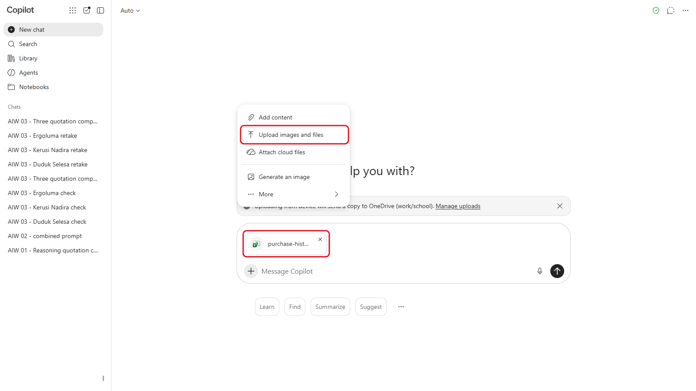
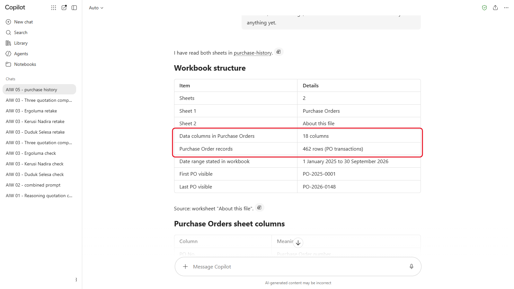
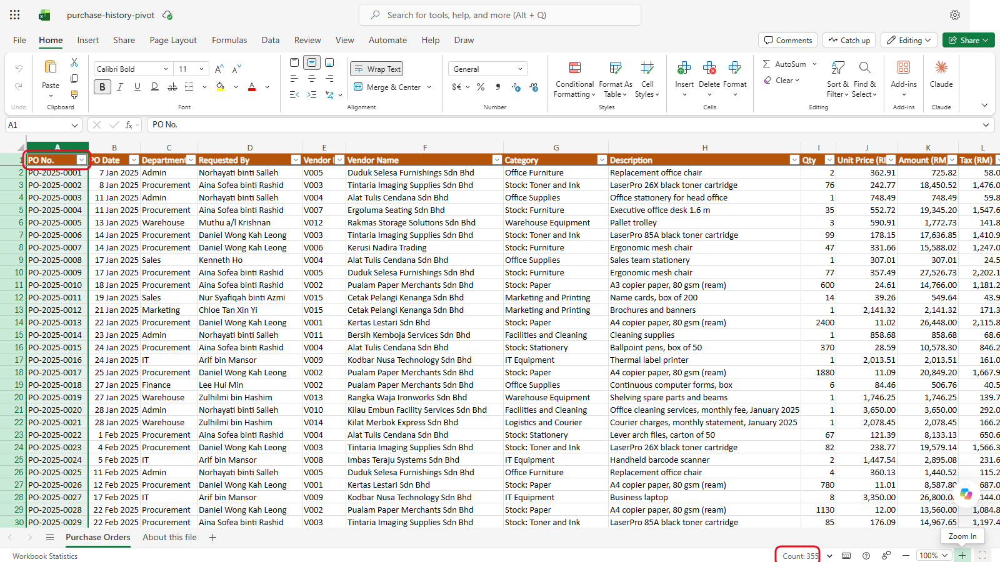
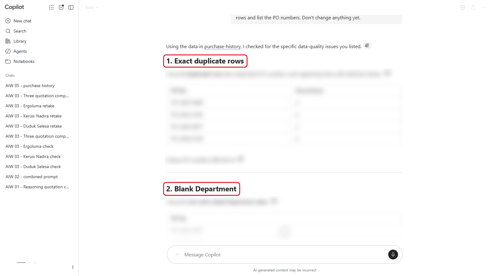
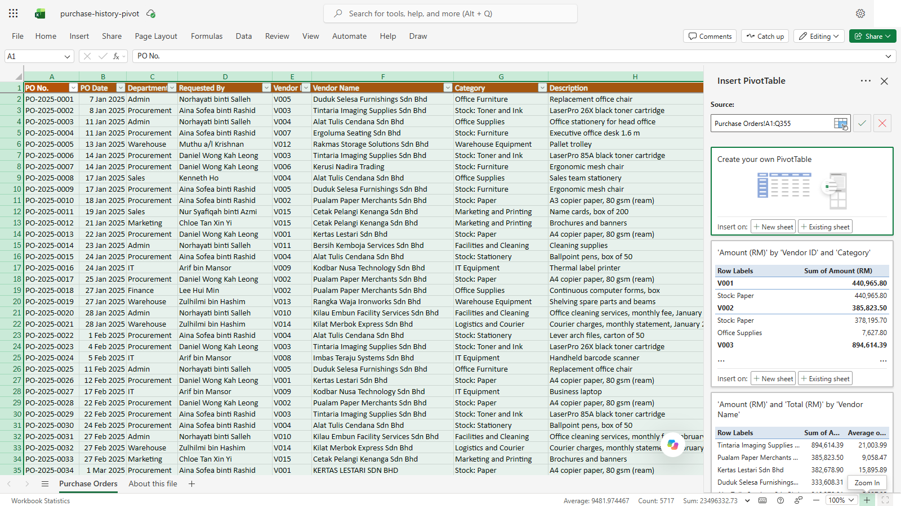
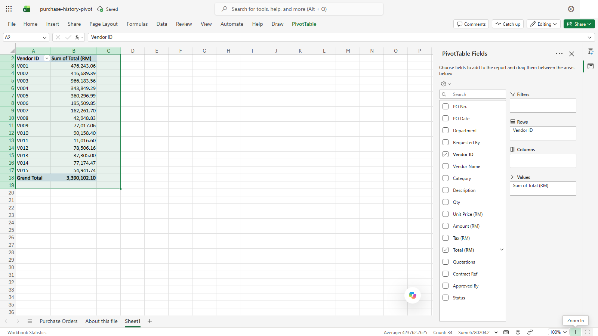
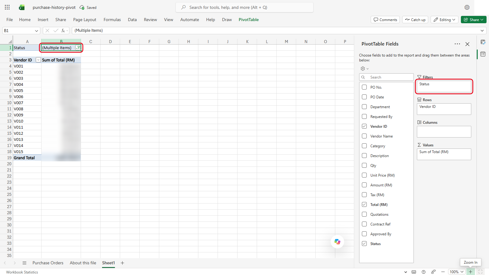
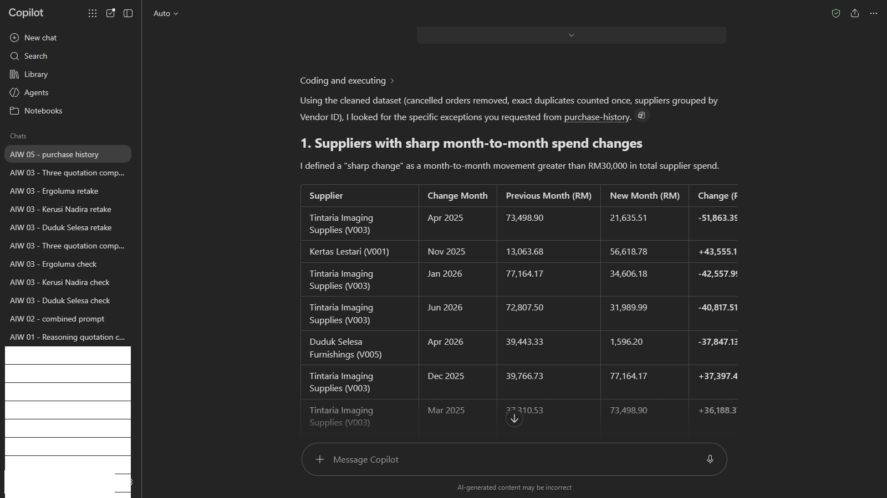
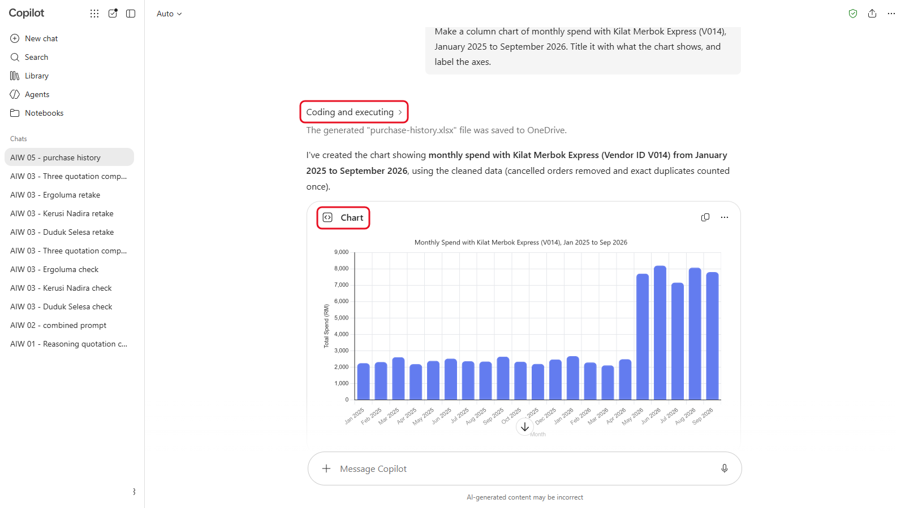

# 05 - Analisis Data Lanjutan dengan AI

Pengarah Kewangan mahu tahu ke mana wang Sinar Maju dibelanjakan, dan sama ada ada sesiapa yang mengelak peraturan perolehan. Anda ada 21 bulan pesanan belian dalam satu spreadsheet. Dalam modul ini, anda menggunakan AI untuk membersihkan data, meringkaskan perbelanjaan dan mencari corak yang akan mengambil masa sehari untuk dikesan oleh seseorang, kemudian anda menyemak angkanya.

> **Prompt:** setiap prompt yang anda perlukan ada dalam langkah-langkah di bawah, dengan butang Salin. [Halaman prompt](./prompts.md) juga mengumpulkan semuanya dalam satu halaman.

**Anggaran masa:** 55 minit

**Hasil anda:** Paparan sejarah pembelian yang sudah dibersihkan, ringkasan perbelanjaan yang sudah anda semak dalam Excel, senarai dapatan untuk Pengarah Kewangan, dan satu carta.

---

## Apa yang Anda Akan Pelajari

- Terangkan bagaimana alat AI menganalisis data: dengan menjalankan kod, atau dengan membaca teks
- Cari dan tangani masalah data sebelum anda menganalisis
- Takrifkan ukuran anda supaya AI mengira apa yang anda maksudkan
- Minta kaedahnya sekali, bukan jawapan sahaja
- Semak angka AI berbanding Excel dalam masa kurang seminit

---

## Sebelum Anda Mula

> **Muat turun:** **[sample-files.zip](../../05-data-analysis/sample-files.zip)**, kemudian klik kanan fail itu dan pilih **Extract All** sebelum anda mula.

Kandungannya ialah data yang sama dalam dua bentuk: `purchase-history.xlsx` (dua sheet: data, dan **About this file**) dan `purchase-history.csv`. Guna `.xlsx` melainkan alat anda meminta CSV.

Buka Excel juga. Anda akan menggunakannya untuk menyemak satu angka.

> **Penting:** data ini rekaan. Di tempat kerja, semak bahawa organisasi anda membenarkan alat AI yang anda gunakan membaca data kewangan sebelum anda memuat naik apa-apa.

Istilah baharu diterangkan dalam [glosari](../../14-product-cards/glossary.md) (dalam bahasa Inggeris).

---

## Topik

**Dua cara menganalisis.** Sesetengah alat menulis dan menjalankan kod (biasanya Python) pada fail anda, kemudian melaporkan hasilnya: ChatGPT, Claude, Gemini dan Copilot (Basic dan Premium) berfungsi dengan cara ini. Yang lain membaca fail sebagai teks dan menganggarkan. Kod jauh lebih boleh dipercayai untuk jumlah dan kiraan. Jika alat anda menunjukkan kod atau jalan kiranya, ia telah menjalankan kod.

**Bersihkan dahulu.** Eksport sebenar ada baris pendua, sel kosong, ejaan yang berbeza-beza dan pesanan yang dibatalkan. Jumlah yang dikira pada data kotor adalah salah, walau seyakin mana pun rupanya.

**Nyatakan dengan tepat apa yang hendak diukur.** "Jumlah perbelanjaan" boleh bermaksud sebelum atau selepas cukai, dengan atau tanpa pesanan yang dibatalkan. Beritahu AI lajur mana yang perlu digunakan dan apa yang perlu dikecualikan. Sheet **About this file** menerangkan maksud setiap lajur.

**Semak satu angka.** Pilih satu nombor dan semak sendiri dalam Excel dengan penapis (filter) atau PivotTable. Jika ia sepadan, anda boleh lebih mempercayai kaedahnya. Jika tidak, minta AI menerangkan perbezaannya.

---

## 5.1 Tinjauan Pertama Data

1. Mulakan new chat dan muat naik `purchase-history.xlsx`.

   

   *Muat naik `.xlsx` dengan **+** > **Upload images and files**.*
2. Hantar:

   ```
   Ini ialah eksport pesanan belian Sinar Maju Sdn Bhd, Januari 2025 hingga September 2026. Baca kedua-dua sheet. Beritahu saya berapa banyak baris dan lajur yang ada, julat tarikhnya, dan maksud setiap lajur. Jangan analisis apa-apa lagi.
   ```

   

   *Bandingkan angka ini dengan Excel. Di sini Copilot berkata 18 lajur dan 462 baris: kedua-duanya salah.*

3. Semak bilangan baris berbanding Excel: pilih lajur PO No. dan baca **Count** di bahagian bawah tetingkap. Ia termasuk baris tajuk, jadi tolak satu.

   

   *Count menunjukkan 355: baris tajuk ditambah 354 baris data.*

Jika angkanya berbeza, percayai Excel. Dalam satu ujian, Copilot melaporkan 462 baris dan 18 lajur bagi fail yang ada 354 baris dan 17 lajur.

---

## 5.2 Cari Masalah Data

Dalam chat yang sama, hantar:

```
Sebelum apa-apa analisis, semak kualiti data. Cari: baris yang merupakan pendua tepat, baris dengan Department kosong, pembekal yang sama dieja dengan cara berbeza, dan pesanan yang dibatalkan. Bagi setiap masalah, beritahu saya berapa banyak baris dan senaraikan nombor PO. Jangan ubah apa-apa lagi.
```



*Satu tajuk bagi setiap masalah. Dapatannya dikaburkan supaya anda boleh bandingkan dengan semakan anda sendiri.*

<details markdown="1">
<summary>Apa yang patut anda lihat?</summary>

Sebelum anda menganalisis, fail ini perlu dibersihkan:

- **Pendua:** 4 baris mengulang baris di atasnya dengan tepat: PO-2025-0040, PO-2025-0192, PO-2026-0077 dan PO-2026-0138.
- **Department kosong:** 6 baris: PO-2025-0035, PO-2025-0153, PO-2026-0029, PO-2026-0075, PO-2026-0089 dan PO-2026-0092.
- **Variasi nama pembekal:** 7 baris Kertas Lestari dieja "KERTAS LESTARI SDN BHD" atau "Kertas Lestari Sdn. Bhd.". Vendor ID (V001) adalah sama, jadi kumpulkan mengikut Vendor ID.
- **Pesanan dibatalkan:** 8 baris. Kecualikannya daripada perbelanjaan.

Jika kiraan anda lebih rendah, minta AI menyenaraikan setiap nombor PO yang ditemuinya dan bandingkan dengan senarai di atas. Dalam satu ujian, Copilot menemui kesemua 4 pendua dan 7 variasi tetapi hanya 2 Department kosong dan 7 baris dibatalkan.

</details>

---

## 5.3 Ringkaskan Perbelanjaan

Dalam chat yang sama, hantar:

```
Sekarang bersihkan data: kira setiap baris pendua sekali sahaja, kumpulkan pembekal mengikut Vendor ID, dan kecualikan pesanan yang dibatalkan. Dengan menggunakan Total (RM), beri saya: bilangan pesanan belian unik, jumlah perbelanjaan, perbelanjaan pada 2025, perbelanjaan dari Januari hingga September 2026, lima pembekal teratas mengikut perbelanjaan, dan perbelanjaan mengikut kategori bersama bahagian setiap kategori. Tunjukkan kaedah yang anda gunakan.
```

Kemudian semak satu angka sendiri:

1. Dalam Excel, pilih data dan pilih **Insert** > **PivotTable**.

   

   *Semak bahawa sumbernya meliputi seluruh jadual, kemudian pilih **New sheet**.*
2. Dalam anak tetingkap **PivotTable Fields** di sebelah kanan, tanda **Vendor ID** (ia masuk ke **Rows**) dan tanda **Total (RM)** (ia masuk ke **Values**). Values sepatutnya menunjukkan **Sum of Total (RM)**.

   

   *Vendor ID dalam **Rows**, Total (RM) dalam **Values**.*
3. Seret **Status** dari senarai field ke dalam kotak **Filters**. Penapis **Status** muncul di atas PivotTable. Bukanya, tanda **Select Multiple Items**, nyahtanda **Cancelled**, dan pilih **OK**.

   

   *Status ditapis untuk mengecualikan Cancelled: penapis menunjukkan **(Multiple Items)**.*
4. Bandingkan jumlah bagi **V003** dengan angka AI. Kedua-duanya sepatutnya sepadan dengan tepat.
5. Sekarang bandingkan **V005**. PivotTable anda lebih tinggi, kerana satu pesanan V005 muncul dua kali dalam fail dan Excel mengira kedua-duanya. Sebab itulah anda membersihkan data sebelum menjumlahkannya.

<details markdown="1">
<summary>Apa yang patut anda lihat?</summary>

Menggunakan **Total (RM)**, tanpa pesanan yang dibatalkan, dengan setiap pendua dikira sekali:

| Ukuran | Nilai |
|---|---|
| Pesanan belian (unik) | 342 (350 sebelum mengecualikan 8 yang dibatalkan) |
| Jumlah perbelanjaan | RM3,281,457.86 |
| Perbelanjaan pada 2025 | RM1,930,291.38 |
| Perbelanjaan Januari hingga September 2026 | RM1,351,166.48 |

| Pembekal teratas | Perbelanjaan |
|---|---|
| Tintaria Imaging Supplies (V003) | RM966,183.56 |
| Kertas Lestari (V001) | RM459,896.83 |
| Pualam Paper Merchants (V002) | RM404,697.46 |
| Duduk Selesa Furnishings (V005) | RM335,418.16 |
| Alat Tulis Cendana (V004) | RM330,183.52 |

Kategori terbesar ialah Stock: Toner and Ink (RM966,183.56, 29.4%), diikuti Stock: Paper (RM857,246.33, 26.1%).

</details>

---

## 5.4 Cari Corak

Dalam chat yang sama, hantar:

```
Cari apa-apa yang patut diketahui oleh Pengarah Kewangan. Khususnya:
1. Mana-mana pembekal yang purata perbelanjaan bulanannya berubah dengan mendadak dan kekal pada paras baharu itu. Bilakah ia berubah, dan sebanyak mana?
2. Pesanan daripada jabatan yang sama kepada pembekal yang sama dalam tempoh 30 hari yang setiap satunya bawah RM5,000, tiada Contract Ref, dan berjumlah RM5,000 atau lebih.
3. Pesanan bernilai RM5,000 atau lebih (Total) dengan kurang daripada 3 sebut harga dan tiada Contract Ref.
4. Pesanan bernilai RM5,000 hingga RM50,000 yang diluluskan oleh sesiapa selain Ketua Perolehan, Rozita binti Mohd Ariff (sheet About this file menyenaraikan siapa yang memegang jawatan apa).
5. Apa-apa corak bermusim dalam pembelian kertas.
Bagi setiap dapatan, senaraikan nombor PO dan angkanya.
```



***Coding and executing** bermakna Copilot telah menjalankan kod. Bukanya untuk melihat kod Python.*

Semak sekurang-kurangnya satu dapatan sendiri: tapis spreadsheet mengikut nombor PO yang disenaraikan oleh AI.

<details markdown="1">
<summary>Tunjukkan jawapan</summary>

- **Perbelanjaan kurier melonjak pada Mei 2026.** Kilat Merbok Express berpurata RM2,388.10 sebulan hingga April 2026, kemudian RM7,792.98 sebulan mulai Mei (kira-kira 3.3 kali ganda). Ia di bawah kontrak, jadi tiada sebut harga baharu diperlukan (3.3), tetapi patut ditanya mengapa.
- **Pembelian berpecah.** Admin membeli daripada Duduk Selesa tiga kali dalam seminggu (PO-2026-0028, PO-2026-0032 dan PO-2026-0036, RM14,547.60 kesemuanya). IT membeli daripada Kodbar Nusa pada 18 dan 19 Ogos 2026 (PO-2026-0125 dan PO-2026-0126, RM9,882.00 kesemuanya). Setiap pesanan hanya sedikit di bawah RM5,000 dengan satu sebut harga (7.1). Pasangan Ogos itu juga akan dikesan oleh semakan bulanan dalam 7.2, yang bermula pada 1 Julai 2026. Caj kontrak, seperti caj pembersihan bulanan Kilau Embun, bukan pembelian berpecah.
- **Sebut harga tidak mencukupi.** PO-2025-0167 (RM8,640.00, 2 sebut harga) dan PO-2026-0071 (RM12,409.20, 1 sebut harga). Kedua-duanya memerlukan tiga (3.1).
- **Pelulus yang salah.** PO-2026-0071 diluluskan oleh HOD Marketing seorang sahaja. Ia juga memerlukan Ketua Perolehan.
- **Corak bermusim kertas.** Pesanan kertas A4 pada November, Disember dan Januari berpurata 4,720 rim sebulan, berbanding 2,471 pada bulan-bulan lain.

Jika ada dapatan yang tiada, tanya tentangnya secara terus, contohnya `Bandingkan purata perbelanjaan bulanan Kilat Merbok Express sebelum dan selepas April 2026.` Bagi corak kertas, minta purata rim sebulan, bukan jumlah perbelanjaan: sesetengah bulan muncul dua kali dalam fail 21 bulan ini, jadi jumlah mengikut bulan mengelirukan.

</details>

---

## 5.5 Buat Satu Carta

Dalam chat yang sama, hantar:

```
Buat carta lajur bagi perbelanjaan bulanan dengan Kilat Merbok Express (V014), Januari 2025 hingga September 2026. Beri tajuk yang menyatakan apa yang ditunjukkan oleh carta itu, dan labelkan paksinya.
```



*Carta itu, dengan tajuk dan paksi berlabel. Semak bulan lonjakannya berbanding dapatan 5.4 anda (tangkapan skrin daripada versi bahasa Inggeris).*

Semak bahawa lonjakan dalam carta sepadan dengan bulan dalam dapatan anda. Jika jawapan 5.4 anda terlepas lonjakan itu, carta inilah tempat anda mengesannya: jangan terima jika AI berkata ia sudah menemuinya sebelum ini. Muat turun carta itu atau ambil tangkapan skrin untuk nota anda.

---

## Nota Produk

| Copilot Chat (Basic) | M365 Copilot (Premium) | ChatGPT | Claude | Gemini |
|---|---|---|---|---|
| Muat naik `.xlsx` dalam chat. Copilot menjalankan Python padanya: buka **Coding and executing** di atas jawapan untuk melihat kodnya | **Analyst** menjalankan kod pada fail itu. Atau buka fail dalam Excel dan guna Copilot di sana | Menjalankan kod pada fail dan boleh melukis carta. Pelan percuma ada had analisis data | Hidupkan penciptaan fail (code execution) di bawah **Settings** > **Capabilities** dahulu. Menjalankan kod dan melukis carta | Muat naik fail dalam chat. Minta ia menunjukkan jalan kiranya |

---

## Latihan Kendiri

Tanya satu lagi soalan yang anda mahu jawapannya tentang data ini, seperti "Jabatan mana yang paling banyak berbelanja untuk alat tulis?" Kemudian semak jawapannya dengan PivotTable sebelum anda mempercayainya.

---

## Penyelesaian Masalah

| Masalah | Apa yang perlu disemak |
|---|---|
| Jumlahnya tidak sepadan dengan PivotTable anda | Tanya AI baris mana yang dimasukkannya, dan sama ada ia membuang pendua dan pesanan yang dibatalkan |
| Ia tidak menemui sebarang pendua | Minta ia membandingkan baris lengkap, kesemua 17 lajur, bukan nombor PO sahaja |
| Ia tidak dapat membuka `.xlsx` | Muat naik `purchase-history.csv` sebagai ganti |
| Ia melaporkan corak tetapi tiada nombor PO | Tanya: "Senaraikan nombor PO di sebalik dapatan itu." Dapatan yang tidak boleh dijejaki bukan dapatan |
| Ia berhenti separuh jalan | Analisis itu mencapai had. Minta satu bahagian pada satu masa |

---

## Ringkasan Pelajaran

AI boleh membersihkan, meringkaskan dan mencari dalam spreadsheet dalam masa beberapa minit, terutamanya apabila ia menjalankan kod. Ia hanya mengira apa yang anda minta, jadi takrifkan ukuran anda dan minta ia membersihkan data dahulu. Dan satu semakan pantas dalam Excel memberitahu anda sama ada boleh mempercayai yang selebihnya.

**Uji diri:** AI berkata jumlah perbelanjaan lebih tinggi daripada angka anda yang sudah dibersihkan. Namakan dua perkara dalam fail ini yang boleh menerangkannya.
