# 06 - Mengawal Output dengan Templat Word dan PowerPoint

Quotation Checker sudah menjalankan tugasnya: Duduk Selesa ialah pembekal yang dicadangkan, selepas ia membetulkan jumlahnya. Sekarang Ketua Perolehan mahukan memo kelulusan pada template syarikat, dan deck pendek untuk mesyuarat kelulusan. Dalam modul ini, anda minta AI mengisi template Sinar Maju, dan lihat mengapa template yang dibina dengan baik sama penting dengan prompt.

> **Prompt:** setiap prompt yang anda perlukan ada dalam langkah-langkah di bawah, dengan butang Salin. [Halaman prompt](./prompts.md) juga mengumpulkan semuanya dalam satu halaman.

**Anggaran masa:** 60 minit

**Hasil anda:** Memo kelulusan pada template Sinar Maju, deck kelulusan empat slaid, dan perbandingan bersebelahan tentang apa yang berlaku dengan template deck yang baik dan yang buruk.

---

## Apa yang Anda Akan Pelajari

- Terangkan apa yang menjadikan template Word atau PowerPoint berfungsi dengan baik bersama AI: styles, named layouts dan placeholders
- Semak struktur template dalam Word dan PowerPoint
- Minta AI mengisi template tanpa mengubah rupanya
- Kenal pasti masalah format yang dibawa oleh output AI, dan betulkannya

---

## Sebelum Anda Mula

> **Muat turun:** **[sample-files.zip](../../06-output-templates/sample-files.zip)**, kemudian klik kanan fail itu dan pilih **Extract All** sebelum anda mula.

Kandungannya:

| Fail | Kandungan |
|---|---|
| `sinar-maju-deck.pptx` | Template persembahan Sinar Maju |
| `sinar-maju-deck-bad.pptx` | Versi lain bagi template yang sama |
| `sinar-maju-memo.docx` | Template memo kelulusan Sinar Maju |

Anda perlukan Word dan PowerPoint versi desktop, serta hasil dari Modul 03. Jika anda tiada hasil itu, prompt sudah memberi faktanya.

Istilah baharu diterangkan dalam [glosari](../14-product-cards/glossary.md).

---

## Topik

**Mengapa template.** Template memastikan setiap memo dan deck mengikut jenama syarikat tanpa sesiapa perlu memikirkan fon. Ia juga memberitahu AI tool di mana setiap perkara diletakkan, jika template itu dibina dengan betul.

**Apa yang ada dalam template yang dibina dengan baik.** Dalam PowerPoint: slide master dengan **named layouts**, dan **placeholders** untuk tajuk dan kandungan, supaya slaid baharu tahu di mana tajuknya diletakkan. Dalam Word: **styles** (Title, Heading 1, Normal), bukan teks yang diformat secara manual, dan teks placeholder yang jelas bertujuan untuk diganti.

**Apa yang AI buat dengan template yang dibina dengan buruk.** Jika setiap slaid ialah layout kosong dengan kotak teks yang berselerak, tiada apa-apa untuk diikuti oleh AI. Ia menyalin apa yang boleh dilihatnya, kedudukan beralih, fon berubah, dan slaid tiada tajuk sebenar, yang juga menyukarkan penggunaannya dengan pembaca skrin.

**Semakan akhir.** Walaupun dengan template yang baik, semak output: angka, nama, baris baharu dalam jadual, dan apa-apa yang terkeluar dari slaid.

---

## 6.1 Lihat Struktur di Sebalik Dua Deck

1. Buka `sinar-maju-deck.pptx` dalam PowerPoint. Pilih **Home** > **Layout** dan lihat senarai layout.

   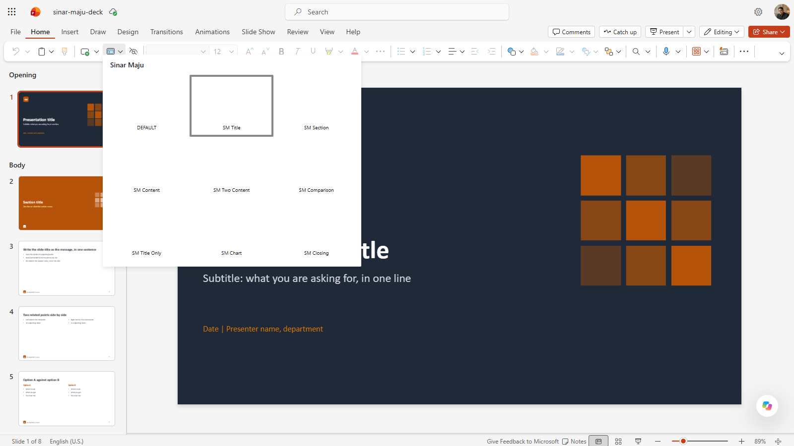

   *Layout deck yang baik, setiap satu dengan nama. Slaidnya menggunakan layout itu.*
2. Pilih **View** > **Outline View**. Tajuk setiap slaid dipaparkan dalam outline.

   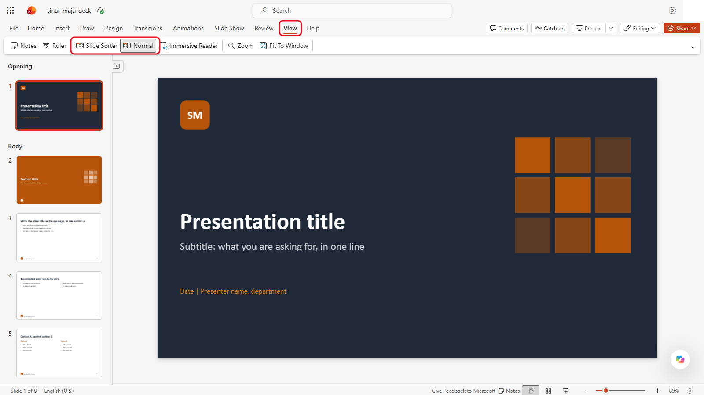

   *PowerPoint for the web tiada Outline View. Guna PowerPoint desktop untuk langkah ini.*
3. Pilih **Review** > **Check Accessibility**.

   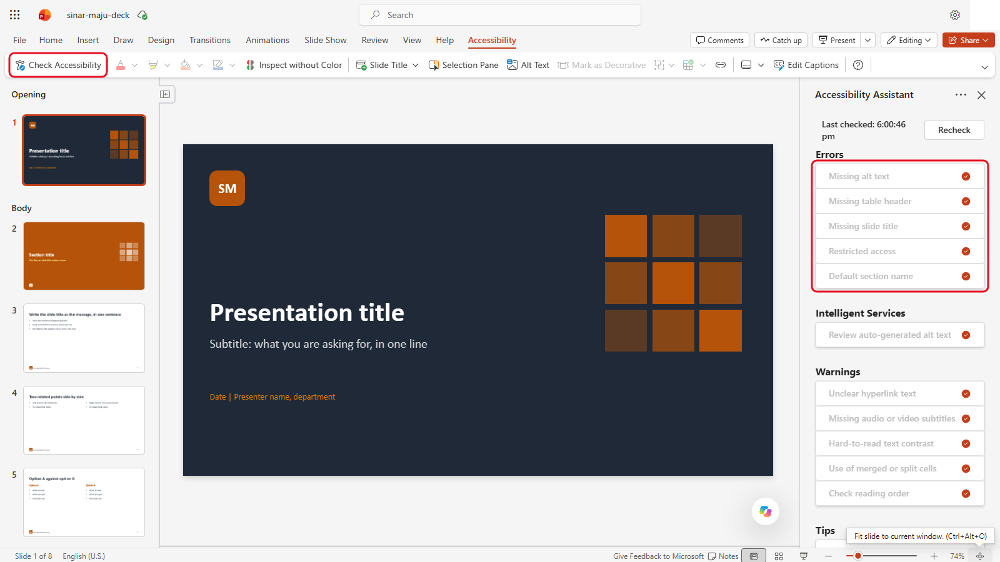

   *Dalam versi web, Check Accessibility ada pada tab **Accessibility** tersendiri.*
4. Tutupnya dan buat tiga perkara yang sama dengan `sinar-maju-deck-bad.pptx`.

   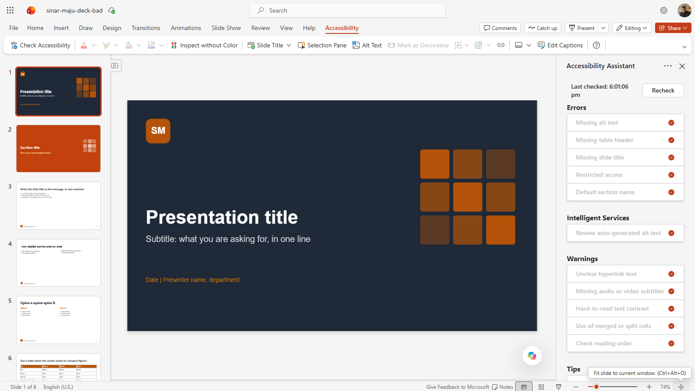

   *Deck yang buruk dalam penyemak versi web. Dalam ujian kami ia tidak menemui tajuk yang hilang, jadi semak dalam PowerPoint desktop.*
5. Catat apa yang berbeza. Pada skrin, kedua-dua deck kelihatan hampir sama.

> **Nota:** buat 6.1 dalam PowerPoint desktop. PowerPoint for the web tiada Outline View, dan dalam ujian kami semakan kebolehcapaiannya tidak melaporkan tajuk slaid yang hilang dalam deck yang buruk. Dalam versi web, **Home** > **Layout** (langkah 1) masih menunjukkan perbezaannya.

Dalam PowerPoint desktop, semakan deck yang buruk menyenaraikan **Missing slide title** bagi kesemua 8 slaid, serta alt text yang hilang bagi bentuk yang dilukisnya. Tajuk itulah yang penting di sini: slaid tanpa tajuk tiada nama dalam outline, anak tetingkap navigasi atau pembaca skrin.

---

## 6.2 Lihat Styles Memo

1. Buka `sinar-maju-memo.docx` dalam Word.

   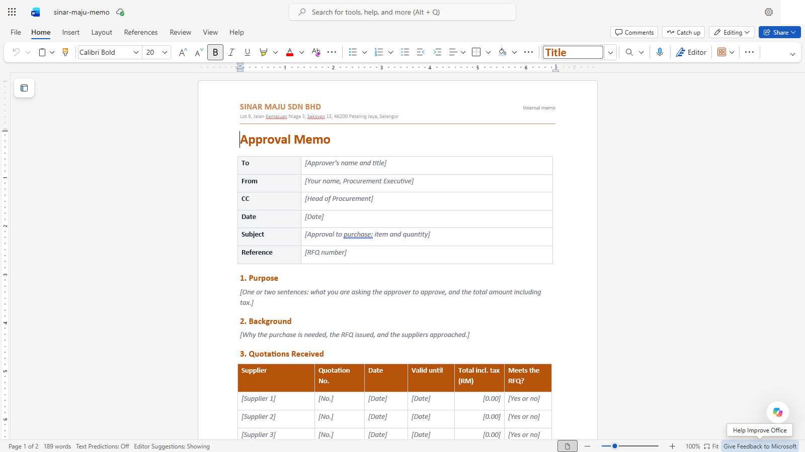

   *Setiap bahagian memo menggunakan style: kursor di sini berada dalam **Title**.*
2. Pilih **View** > **Navigation Pane**. Tajuk bernombor ada di situ kerana ia menggunakan style **Heading 1**.

   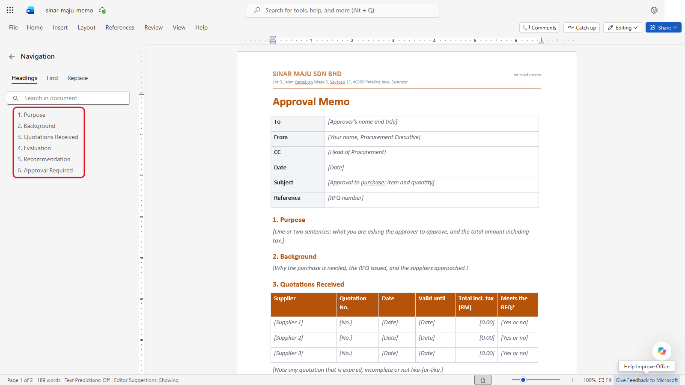

   *Enam tajuk, kerana setiap satu menggunakan **Heading 1**.*
3. Klik ke dalam teks kelabu dalam kurungan siku. Itulah placeholders: semua yang mesti diganti oleh AI (atau anda).

   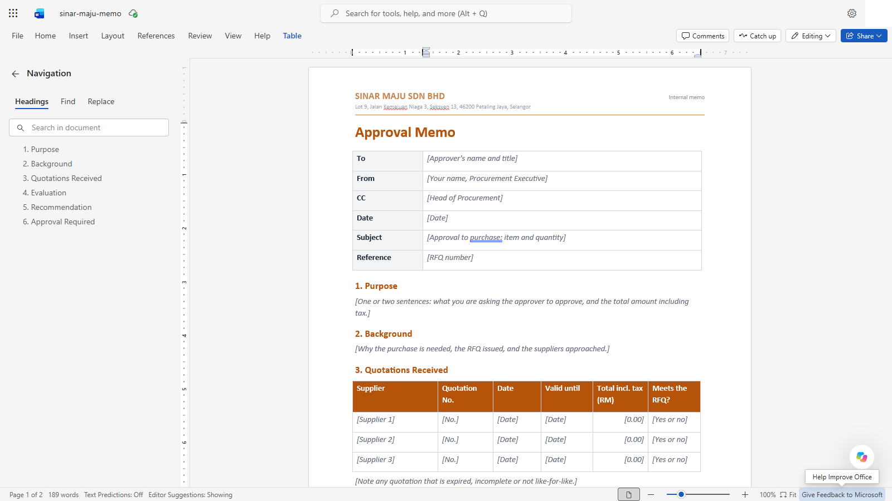

   *Teks kelabu dalam kurungan siku ialah placeholder: semuanya mesti diganti.*

---

## 6.3 Isi Memo

1. Mulakan new chat dalam AI tool anda dan muat naik `sinar-maju-memo.docx`.

   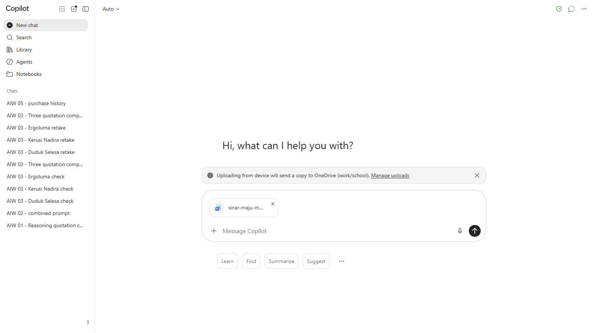

   *Template memo sudah dilampirkan, sedia untuk prompt.*
2. Copy prompt di bawah, ganti `[nama anda]` dengan nama anda sendiri, dan hantar. Ia mengandungi fakta dari Modul 03, jadi ia berfungsi walaupun anda tiada chat itu lagi.

   ```
   Isikan template memo kelulusan yang dilampirkan untuk pembelian ini. Kekalkan template itu tepat seperti asalnya: tajuk, jadual, styles dan layout yang sama. Ganti setiap placeholder dalam kurungan siku, dan jangan tambah apa-apa di luar bahagian template.

   Fakta:
   - Kepada: Rozita binti Mohd Ariff, Ketua Perolehan. Daripada: [nama anda], Eksekutif Perolehan. Tarikh: 10 November 2026.
   - Pembelian: 120 kerusi pejabat jaring ergonomik untuk dijual semula, RFQ-2026-118.
   - Duduk Selesa Furnishings Sdn Bhd, DSF/QT/26/1043, 21 Oktober 2026, sah sehingga 20 Disember 2026. Jumlah tercetak RM46,548.00, tetapi baris 1 sepatutnya RM43,800.00 (120 x RM365.00), jadi jumlah yang betul ialah RM47,628.00 (Klausa 4.4). Selain itu memenuhi RFQ.
   - Kerusi Nadira Trading, KNT-2610-077, 22 Oktober 2026, sah sehingga 6 Disember 2026, RM43,416.00. Jaminan 3 tahun pada rangka dan 1 tahun pada mekanisme dan gas lift; RFQ meminta 5 tahun bagi ketiga-tiganya (Klausa 4.3).
   - Ergoluma Seating Sdn Bhd, ELS/Q/2026/0388, 23 Oktober 2026, sah sehingga 22 November 2026, RM48,481.20. Meminta deposit 50%; hadnya 30% (Klausa 6.2).
   - Cadangan: Duduk Selesa, tertakluk kepada sebut harga yang disemak semula pada RM47,628.00.
   - Kelulusan: jalur RM5,000 hingga RM50,000 di bawah Klausa 3.1, jadi Ketua Jabatan (HOD) dan Ketua Perolehan meluluskan. Bagi stok untuk dijual semula, HOD Perolehan ialah Ketua Perolehan, jadi Rozita binti Mohd Ariff menyemak dan meluluskan. SK: Hafiz bin Kamarudin, Pengarah Kewangan, untuk makluman.

   Beri saya memo yang siap sebagai fail Word yang boleh saya muat turun.
   ```

   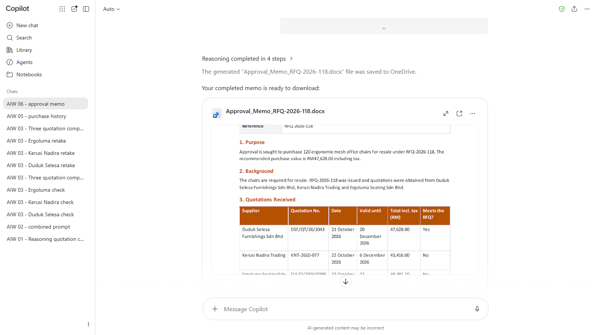

   *Copilot menyimpan memo yang sudah diisi ke OneDrive anda. Bukanya dari kad fail (tangkapan skrin daripada versi bahasa Inggeris).*

3. Muat turun fail itu dan buka dalam Word. Semak Navigation Pane masih menunjukkan enam tajuk, dan tiada lagi teks placeholder kelabu.

   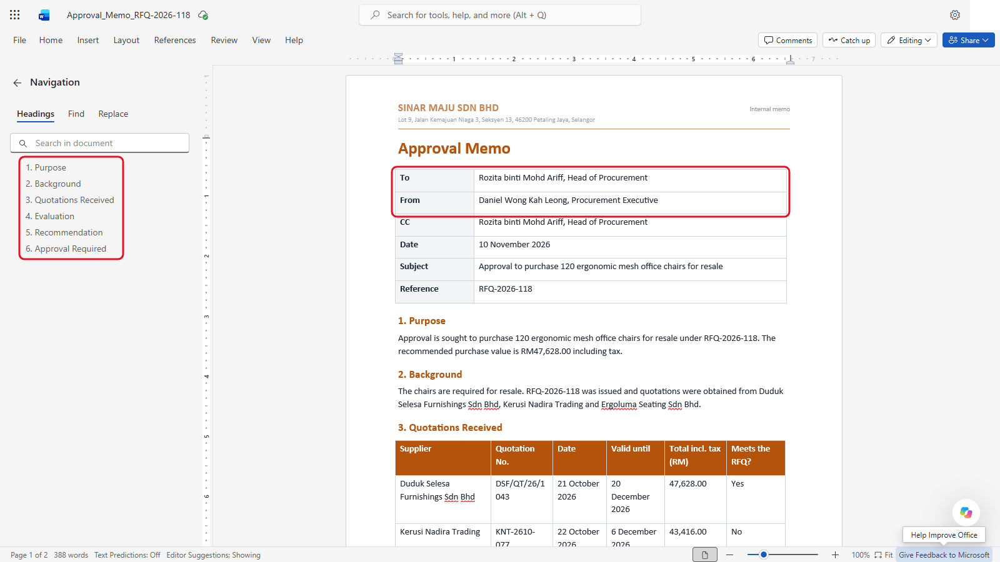

   *Enam tajuk itu kekal, dan placeholders sudah diganti.*

<details markdown="1">
<summary>Apa yang patut anda lihat?</summary>

Memo itu sepatutnya mengisi template tanpa mengubah rupanya: tajuk, jadual dan fon yang sama, dengan setiap placeholder kelabu diganti.

| Field | Jangkaan |
|---|---|
| Perkara | Kelulusan untuk membeli 120 kerusi pejabat jaring ergonomik untuk dijual semula |
| Rujukan | RFQ-2026-118 |
| Sebut harga diterima | Duduk Selesa (DSF/QT/26/1043), Kerusi Nadira (KNT-2610-077), Ergoluma (ELS/Q/2026/0388) |
| Pembekal yang dicadangkan | Duduk Selesa, tertakluk kepada sebut harga yang disemak semula |
| Jumlah termasuk cukai | RM47,628.00 (angka yang dibetulkan, bukan RM46,548.00 yang tercetak) |
| Kelulusan diperlukan | HOD dan Ketua Perolehan (Klausa 3.1, RM5,000 hingga RM50,000) |

Penilaian itu sepatutnya menamakan tiga masalah: aritmetik Duduk Selesa (4.4), jaminan Kerusi Nadira yang lebih pendek (4.3) dan deposit 50% Ergoluma (6.2).

</details>

> **Jika anda tidak nampak ini:** jika tool anda tidak dapat memulangkan fail Word, minta teks memo bahagian demi bahagian, dan paste setiap bahagian ke dalam template sendiri dengan **Paste** > **Keep Text Only**. Cara itu mengekalkan styles template.

---

## 6.4 Buat Deck daripada Template yang Baik

1. Mulakan new chat dan muat naik `sinar-maju-deck.pptx`.

   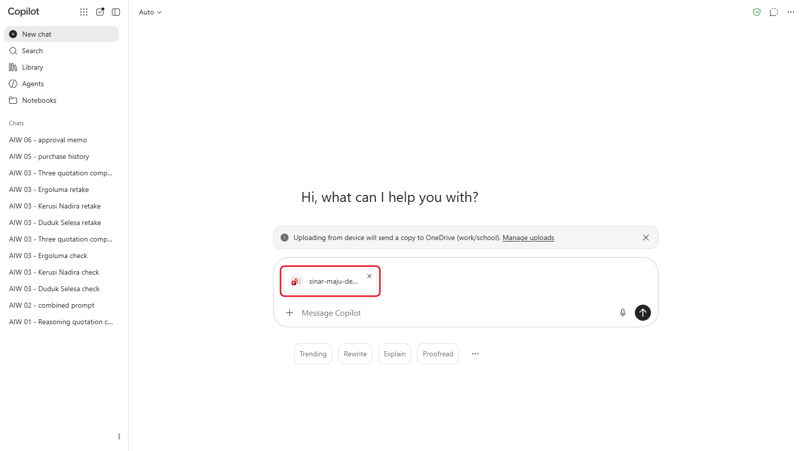

   *Template yang baik sudah dilampirkan.*
2. Hantar:

   ```
   Cipta deck kelulusan empat slaid menggunakan template yang dilampirkan dan layoutnya. Kekalkan fon, warna dan footer template, dan jangan tambah apa-apa milik anda sendiri.
   Slaid 1 (SM Title): "Kelulusan: 120 Kerusi Ergonomik untuk Dijual Semula", subtajuk "Cadangan RFQ-2026-118", tarikh 10 November 2026.
   Slaid 2 (SM Title Only, dengan jadual): perbandingan tiga sebut harga: pembekal, jumlah yang betul (RM), jaminan, terma pembayaran, verdict.
   Slaid 3 (SM Content): cadangan, Duduk Selesa pada RM47,628.00 selepas sebut harga yang disemak semula, dalam tidak lebih daripada empat poin.
   Slaid 4 (SM Closing): keputusan yang diperlukan daripada Ketua Perolehan, dan tarikh akhirnya.
   Fakta untuk slaid 2:
   - Duduk Selesa Furnishings: jumlah yang betul RM47,628.00 (tercetak RM46,548.00); jaminan 5 tahun pada rangka, mekanisme dan gas lift; pembayaran 30 hari dari invois; verdict REVISE (aritmetik, Klausa 4.4).
   - Kerusi Nadira Trading: RM43,416.00; jaminan 3 tahun pada rangka, 1 tahun pada mekanisme dan gas lift; pembayaran 30 hari dari invois; verdict REVISE (jaminan tidak memenuhi RFQ, Klausa 4.3).
   - Ergoluma Seating: RM48,481.20; jaminan 5 tahun pada rangka, mekanisme dan gas lift; deposit 50% bersama pesanan belian; verdict ESCALATE (deposit melebihi 30%, Klausa 6.2).
   Keputusan diperlukan sebelum 17 November 2026.
   Buang slaid contoh template. Beri saya deck yang siap sebagai fail PowerPoint.
   ```

   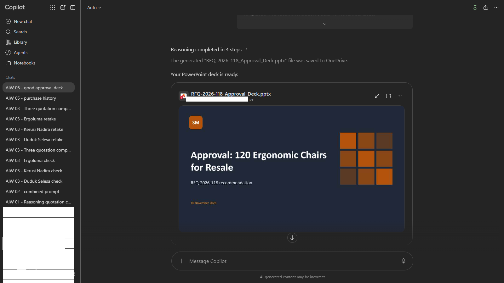

   *Deck daripada template yang baik: tajuknya berada di tempat yang ditetapkan oleh template.*

3. Muat turun dan buka dalam PowerPoint. Semak layout setiap slaid (**Home** > **Layout**), angkanya, dan tiada apa-apa yang terkeluar dari slaid.

   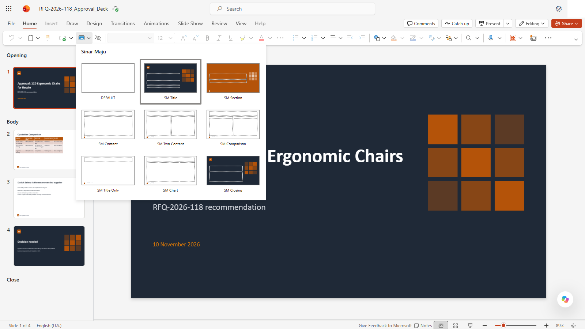

   *Setiap slaid menggunakan layout template. Slaid 1 menggunakan **SM Title**.*

---

## 6.5 Ulang dengan Template yang Buruk

1. Mulakan new chat, muat naik `sinar-maju-deck-bad.pptx`, dan hantar prompt yang sama seperti dalam 6.4, termasuk faktanya (ia masih menamakan layout yang tiada dalam fail ini).

   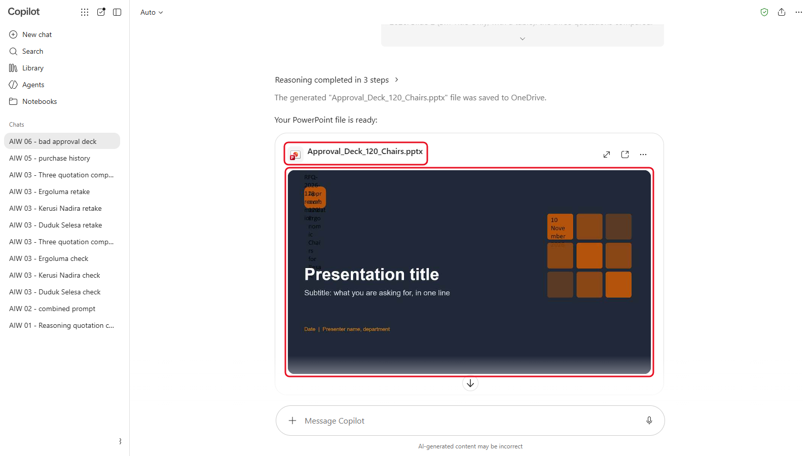

   *Prompt yang sama dengan template yang buruk: tajuk baharu tersepit di satu sudut dan teks contoh lama masih ada.*
2. Buka hasilnya bersebelahan dengan deck dari 6.4. Bandingkan tajuk, fon, kedudukan dan jadualnya.

<details markdown="1">
<summary>Apa yang patut anda lihat?</summary>

Slaid baharu yang dibuat daripada `sinar-maju-deck.pptx` sepatutnya menggunakan layoutnya dan mengekalkan fon dan warnanya. Slaid yang dibuat daripada `sinar-maju-deck-bad.pptx` biasanya beralih: tajuk berpindah, fon berubah, dan slaid tiada tajuk sebenar.

Dalam ujian kami dengan Copilot, template yang baik dipulangkan dengan SM Title, SM Title Only, SM Content dan SM Closing pada slaid 1 hingga 4. Template yang buruk dipulangkan pada layout DEFAULT yang kosong pada setiap slaid, dengan tajuk baharu dihimpit ke dalam kotak sempit dan tajuk contoh template masih ada, walaupun jawapan Copilot mengatakan ia telah menggunakan layout SM. Semak fail itu, bukan penerangan AI tentangnya.

</details>

> **Perkara utama:** prompt itu sama. Perbezaannya datang daripada template. Jika output AI pasukan anda sentiasa perlu dibetulkan, lihat template dahulu sebelum anda menulis semula prompt.

---

## Nota Produk

| Copilot Chat (Basic) | M365 Copilot (Premium) | ChatGPT | Claude | Gemini |
|---|---|---|---|---|
| Copilot memulangkan .docx dan .pptx yang sudah diisi, disimpan ke OneDrive anda: bukanya dari kad fail dalam jawapan. Copilot Chat (Basic) tiada Copilot di dalam Word atau PowerPoint; M365 Copilot (Basic) ada akses standard dalam aplikasi | Copilot dalam Word mengisi memo di tempatnya. Dalam PowerPoint, cipta deck daripada fail template; bekerja pada salinan, kerana ia boleh menggantikan deck yang sedang dibuka | Minta fail yang boleh dimuat turun, atau guna ChatGPT for Word dan PowerPoint (terhad pada Free) | Hidupkan penciptaan fail di bawah **Settings** > **Capabilities**. Claude memulangkan .docx atau .pptx baharu | Workspace: Gemini dalam Docs dan Slides. Peribadi: draf dalam chat dan paste ke dalam template |

---

## Latihan Kendiri

Buka template yang anda guna di tempat kerja (atau satu daripada **File** > **New** dalam PowerPoint). Semak layout dan tajuknya dengan Outline View dan Check Accessibility. Adakah AI tool akan menemui apa yang diperlukannya di dalamnya?

---

## Penyelesaian Masalah

| Masalah | Apa yang perlu disemak |
|---|---|
| Memo dipulangkan dalam fon yang berbeza | Tool itu membina semula dokumen, bukan mengisinya. Paste teks ke dalam template dengan **Keep Text Only** |
| Teks placeholder kelabu masih ada dalam memo | Tanya: "Senaraikan setiap placeholder yang anda tidak ganti, kemudian gantikannya." |
| Deck mengabaikan layout template | Namakan layout bagi setiap slaid dalam prompt, seperti dalam 6.4 |
| Teks terkeluar dari slaid | Minta poin yang lebih sedikit dan lebih pendek, atau pindahkan butiran ke speaker notes |
| Angka dalam deck berbeza daripada memo | AI menaip semula angka itu. Semak setiap angka dengan fakta dalam 6.3 |

---

## Ringkasan Pelajaran

AI mengisi template dengan baik apabila template itu dibina dengan baik: styles dalam Word, named layouts dan placeholders dalam PowerPoint. Prompt yang sama pada template yang dibina dengan buruk memberi slaid yang beralih dan tanpa tajuk. Semak setiap angka selepas AI mengisi template, sama seperti anda menyemak draf rakan sekerja.

**Uji diri:** Rakan sekerja berkata "AI asyik menukar fon kami". Apa yang anda akan lihat dahulu dalam template mereka?
