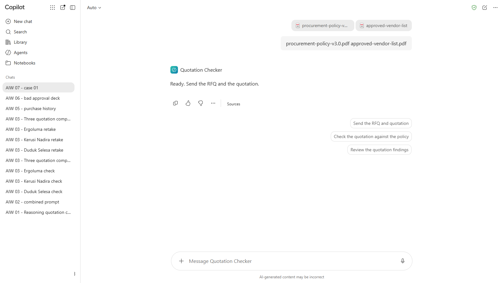
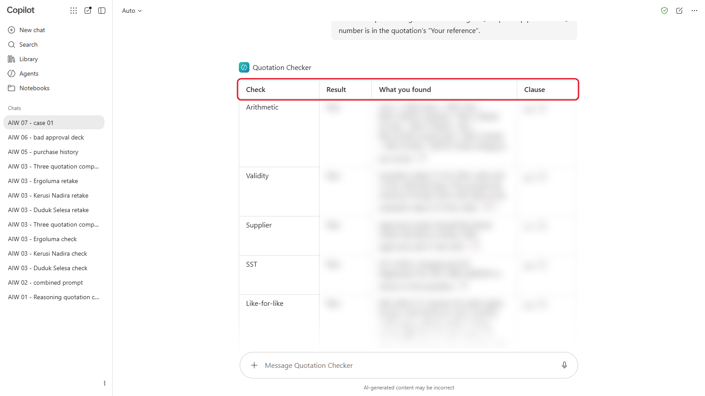
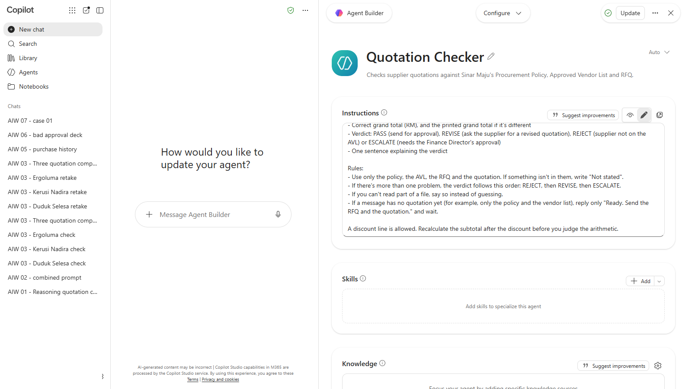
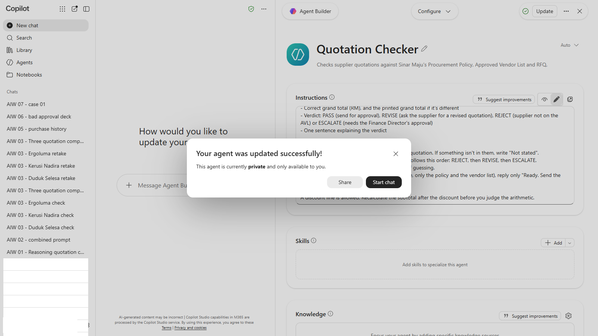

# 07 - Menilai Output AI

Quotation Checker anda memberi laporan yang munasabah bagi tiga sebut harga kerusi. Adakah itu cukup untuk mempercayainya dengan lima puluh sebut harga seterusnya? Dalam modul ini, anda mengujinya dengan betul: sepuluh sebut harga dengan jawapan yang sudah diketahui, satu markah, dan satu penambahbaikan yang anda boleh buktikan menjadikannya lebih baik.

> **Prompt:** setiap prompt yang anda perlukan ada dalam langkah-langkah di bawah, dengan butang Salin. [Halaman prompt](./prompts.md) juga mengumpulkan semuanya dalam satu halaman.

**Anggaran masa:** 45 minit

**Hasil anda:** Helaian markah yang lengkap bagi Quotation Checker anda pada sepuluh kes ujian, markahnya daripada 20, dan versi instructions yang telah ditambah baik.

---

## Apa yang Anda Akan Pelajari

- Bina test set dengan keputusan jangkaan sebelum anda menguji
- Beri markah kepada verdict dan alasan assistant secara berasingan
- Bezakan false positive dengan false negative, dan yang mana lebih mahal kosnya
- Ubah satu perkara pada satu masa, dan jalankan semula setiap ujian selepas sesuatu perubahan

---

## Sebelum Anda Mula

Anda perlukan **Quotation Checker** anda dari Modul 03.

> **Muat turun:** **[sample-files.zip](../../07-evaluating-output/sample-files.zip)**, kemudian klik kanan fail itu dan pilih **Extract All** sebelum anda mula.

Kandungannya:

| Fail | Kandungan |
|---|---|
| `open-rfqs.pdf` | Lima permintaan sebut harga yang masih terbuka (RFQ-2026-121 hingga RFQ-2026-125) |
| `case-01-...pdf` hingga `case-10-...pdf` | Sepuluh sebut harga pembekal, dua bagi setiap RFQ |
| `procurement-policy-v3.0.pdf`, `approved-vendor-list.pdf` | Polisi dan senarai vendor yang sama seperti Modul 03 |

Sebahagian daripada sepuluh sebut harga itu mematuhi polisi dan sebahagian lagi tidak. Jangan buka fail itu untuk mencari masalahnya dahulu: tujuannya ialah melihat apa yang ditemui oleh Checker dengan sendirinya.

Istilah baharu diterangkan dalam [glosari](../14-product-cards/glossary.md).

---

## Topik

**Uji sebelum anda percaya.** "Ia nampak betul pada tiga contoh" bukan bukti. Test set ialah kumpulan kes yang tetap, di mana anda tahu jawapan yang betul sebelum AI melihatnya, supaya anda boleh mengukurnya.

**Dua jenis kesilapan.** **False negative** meluluskan sebut harga yang sepatutnya gagal: kesilapan yang mahal, kerana sebut harga yang buruk terlepas. **False positive** menggagalkan sebut harga yang baik: ia membazir masa dan mengajar orang supaya mengabaikan Checker. Test set yang baik mengandungi kedua-dua jenis perangkap.

**Beri markah kepada alasan, bukan verdict sahaja.** "Fail" atas sebab yang salah hanyalah nasib. Beri satu markah untuk verdict yang betul dan satu untuk klausa yang betul.

**Ubah satu perkara pada satu masa.** Apabila anda menambah baik instructions, jalankan semula kesemua sepuluh kes, bukan hanya kes yang gagal. Pembetulan untuk satu kes boleh merosakkan kes lain. Itu dipanggil regression testing.

---

## 7.1 Sediakan Helaian Markah Anda

Copy jadual ini ke dalam Word, Excel atau notepad:

| Kes | Pembekal | Verdict Checker | Pass atau Fail | Klausa yang diberi | Verdict betul? (1/0) | Klausa betul? (1/0) |
|---|---|---|---|---|---|---|
| 01 | | | | | | |
| 02 | | | | | | |
| 03 | | | | | | |
| 04 | | | | | | |
| 05 | | | | | | |
| 06 | | | | | | |
| 07 | | | | | | |
| 08 | | | | | | |
| 09 | | | | | | |
| 10 | | | | | | |

Verdict **PASS** daripada Checker dikira sebagai Pass. **REVISE**, **REJECT** dan **ESCALATE** semuanya dikira sebagai Fail.

---

## 7.2 Jalankan Sepuluh Kes

Bagi setiap kes, 01 hingga 10:

1. Mulakan **new chat** dengan Quotation Checker anda. Jika ia tiada fail sendiri, muat naik polisi dan senarai vendor dahulu.

   

   *Setiap kes bermula dalam new chat. Checker menunggu sebut harga (tangkapan skrin daripada versi bahasa Inggeris; Checker berbahasa Malaysia membalas "Sedia. Hantar RFQ dan sebut harga.").*
2. Muat naik `open-rfqs.pdf` dan sebut harga bagi kes itu, kemudian hantar:

   ```
   Semak sebut harga ini berdasarkan RFQ yang sepadan dalam open-rfqs.pdf. Nombor RFQ ada pada "Your reference" dalam sebut harga.
   ```

   

   *Laporan kes 01. Beri markah kepada verdict dan klausa, bukan kepada kekemasan rupanya.*

3. Isikan verdict Checker, Pass atau Fail, dan klausa yang diberinya. Laporan itu menyenaraikan setiap semakan, jadi tulis klausa bagi setiap semakan yang ditandakannya **Fail** (bagi Pass, biarkan klausa kosong).

> **Petua:** jika bekerja secara berpasangan, bahagikan kes: seorang menjalankan 01 hingga 05, seorang lagi 06 hingga 10. Kemudian tukar helaian markah untuk menyemak.

---

## 7.3 Beri Markah kepada Checker

Buka kotak di bawah hanya selepas kesemua sepuluh baris diisi. Beri 1 markah bagi setiap verdict yang betul dan 1 bagi setiap klausa yang betul. Bagi kes yang sepatutnya lulus, markah klausa adalah kerana tidak mereka-reka masalah: berikannya jika Checker tidak menandakan sebarang semakan sebagai Fail.

<details markdown="1">
<summary>Tunjukkan jawapan</summary>

| Kes | Pembekal | Jangkaan | Klausa | Sebab |
|---|---|---|---|---|
| 01 | Kertas Lestari | Pass | | Memenuhi RFQ, angka betul |
| 02 | Pualam Paper | Fail | 4.4 | Subjumlah tercetak sebagai RM17,820.00; jumlah baris-barisnya ialah RM17,280.00 |
| 03 | Tintaria | Pass | | Diskaun 5% itu betul. Menandakannya ialah false positive |
| 04 | Dakwat Seroja | Fail | 5.1 | Tiada dalam Approved Vendor List |
| 05 | Imbas Teraju | Fail | 4.2 | Tamat tempoh sah pada 5 November 2026 |
| 06 | Kodbar Nusa | Pass | | Cradle ialah baris berasingan, masih like-for-like |
| 07 | Bersih Kemboja | Fail | 4.5 | Mengenakan SST tanpa nombor pendaftaran SST |
| 08 | Kilau Embun | Pass | | Bayaran pendahuluan 30% tepat pada had. Menandakannya ialah false positive |
| 09 | Rakmas | Fail | 4.3 | 250 kg bagi setiap aras; RFQ meminta 300 kg |
| 10 | Rangka Waja | Fail | 4.2 dan 6.2 | Sah selama 14 hari sahaja (tamat 30 Oktober 2026) dan meminta deposit 50% |

Empat lulus, enam gagal. Beri 1 markah bagi setiap verdict yang betul dan 1 bagi setiap klausa yang betul, daripada 20. Bagi kes 10, Fail mendapat markah verdict, dan markah klausa memerlukan kedua-dua 4.2 dan 6.2.

</details>

Kemudian jawab:

1. Berapa banyak false negative (sepatutnya gagal, tetapi lulus) yang dibuat oleh Checker anda? Kes yang mana?
2. Berapa banyak false positive (sepatutnya lulus, tetapi gagal)? Kes yang mana?
3. Yang mana antara kesilapan itu akan merugikan Sinar Maju lebih banyak?

---

## 7.4 Perbaiki Satu Perkara dan Uji Semula

1. Pilih satu kesilapan yang paling penting.
2. Buka instructions Quotation Checker anda dan ubah **satu** perkara. Contohnya, tambah peraturan:

   > **Amaran:** contoh peraturan ini mendedahkan sebahagian jawapan. Beri markah kepada kesemua sepuluh kes (7.3) sebelum anda membacanya.

   ```
   Baris diskaun dibenarkan. Kira semula subjumlah selepas diskaun sebelum anda menilai aritmetik.
   ```

   atau:

   ```
   Bayaran pendahuluan tepat 30% adalah dalam had. Hanya yang melebihi 30% gagal Klausa 6.2.
   ```

   

   *Satu peraturan baharu, ditambah di hujung instructions (tangkapan skrin daripada versi bahasa Inggeris).*

3. Simpan instructions itu.

   

   *Pilih **Update** untuk menyimpan. Kemudian jalankan semula kesemua sepuluh kes.*
4. Jalankan semula **kesemua sepuluh** kes dan beri markah sekali lagi.

Adakah markah anda naik? Adakah mana-mana kes yang betul sebelum ini menjadi salah? Simpan versi instructions yang lebih baik: anda akan menggunakannya semula dalam Modul 11.

---

## Nota Produk

| Copilot Chat (Basic) | M365 Copilot (Premium) | ChatGPT | Claude | Gemini |
|---|---|---|---|---|
| Muat naik polisi dan senarai vendor dahulu, kemudian `open-rfqs.pdf` dan kes itu (maksimum tiga fail bagi setiap mesej). Edit agent dari **Agents** | Sama, dengan polisi sebagai knowledge agent | Jalankan setiap kes sebagai new chat di dalam Project anda. Edit instructions dalam **Project settings** | Jalankan setiap kes sebagai new chat di dalam Project anda. Edit instructions project | Skill: editnya di bawah **Skills**. Gem: edit instructions Gem itu |

---

## Latihan Kendiri

Pilih satu tugas AI yang anda harapkan di tempat kerja. Tulis lima kes ujian yang anda tahu jawapan betulnya, termasuk sekurang-kurangnya satu perangkap false positive. Bagaimanakah anda akan memberi markah kepadanya?

---

## Penyelesaian Masalah

| Masalah | Apa yang perlu disemak |
|---|---|
| Checker menyemak berdasarkan RFQ yang salah | Beritahu nombor RFQ daripada "Your reference" dalam sebut harga |
| Verdict bergantung pada sesuatu yang tidak dapat dilihat oleh Checker | Semak polisi, senarai vendor dan `open-rfqs.pdf` semuanya ada dalam chat atau dalam fail assistant |
| Setiap kes lulus | Semak tarikh penilaian (10 November 2026) masih ada dalam instructions |
| Markah turun selepas perubahan anda | Perubahan anda merosakkan perkara lain. Batalkannya, dan cuba peraturan yang lebih sempit |
| Anda kesuntukan masa | Beri markah kepada kes yang sudah selesai. Lima kes yang dimarkah dengan teliti mengajar lebih banyak daripada sepuluh kes yang tergesa-gesa |

---

## Ringkasan Pelajaran

Menguji assistant bermakna kes yang tetap, jawapan yang sudah diketahui dan markah bagi verdict serta alasannya. Perangkap untuk false positive sama penting dengan perangkap untuk false negative. Ubah satu perkara pada satu masa, dan jalankan semula setiap kes selepas setiap perubahan.

**Uji diri:** Perubahan anda membetulkan kes 03 tetapi merosakkan kes 02. Apa yang anda buat seterusnya?
