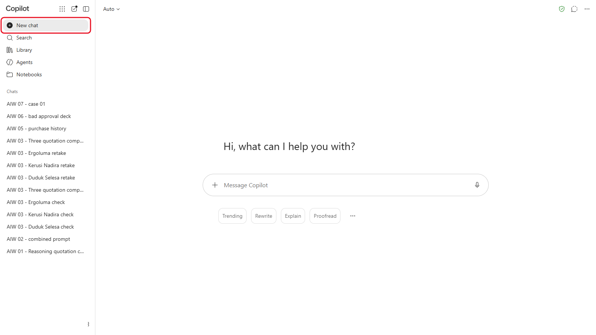
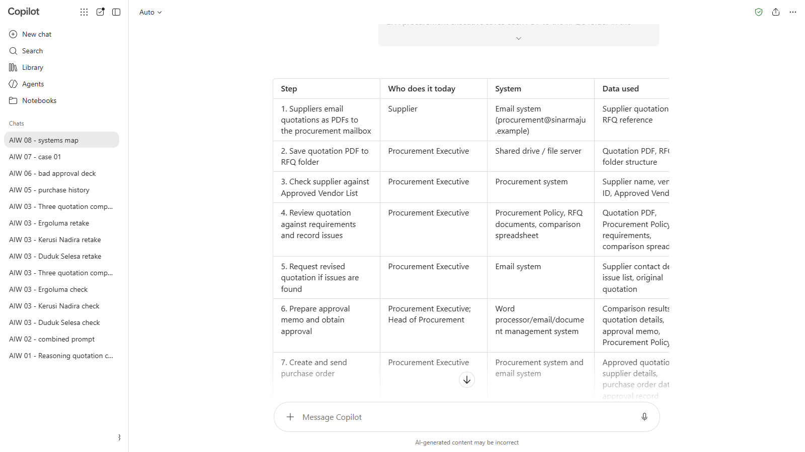
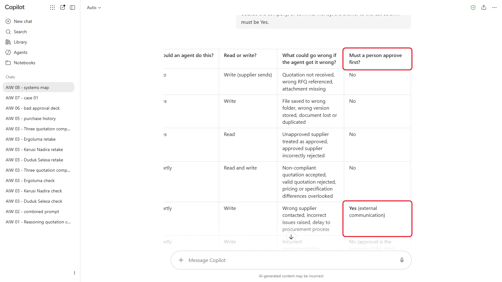
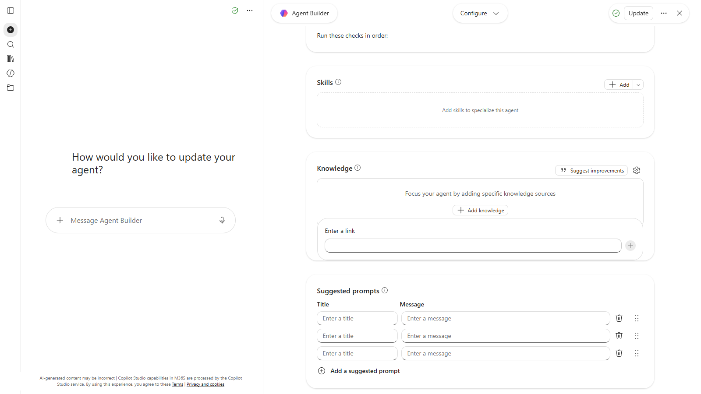
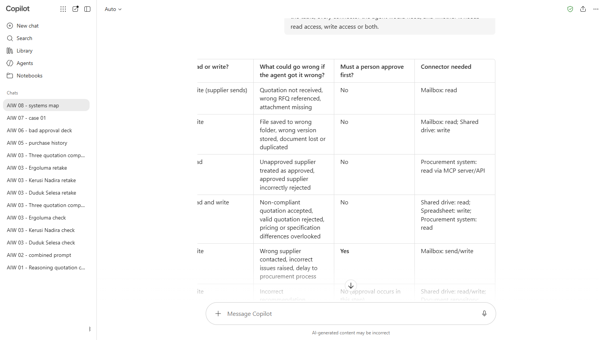

# 08 - AI Agents, Connectors dan MCP

Quotation Checker anda dari Modul 03 membaca apa yang anda berikan dan menulis laporan. Ia tidak boleh membuka peti mel perolehan, mencari senarai vendor dalam sistem perolehan atau menghantar e-mel kepada pembekal. **Agent** boleh, melalui **connector**. Sebelum anda membinanya kemudian hari ini, anda memetakan dengan tepat sistem mana yang diperlukannya, apa yang akan dibuatnya dalam setiap sistem, dan di mana seseorang mesti berkata ya.

> **Prompt:** setiap prompt yang anda perlukan ada dalam langkah-langkah di bawah, dengan butang Salin. [Halaman prompt](./prompts.md) juga mengumpulkan semuanya dalam satu halaman.

**Anggaran masa:** 45 minit

**Hasil anda:** Peta sistem bagi proses kelulusan sebut harga Sinar Maju: setiap langkah, sistem yang disentuhnya, sama ada agent akan membaca atau menulis di situ, dan di mana seseorang memberi kelulusan.

---

## Apa yang Anda Akan Pelajari

- Terangkan perbezaan antara assistant dan agent
- Huraikan apa yang dilakukan oleh connector, dan apa yang ditambah oleh MCP (Model Context Protocol)
- Bezakan akses baca (read) dengan akses tulis (write), dan mengapa ia penting
- Petakan proses perniagaan kepada sistem yang diperlukan oleh agent
- Tentukan di mana seseorang mesti meluluskan sebelum agent bertindak

---

## Sebelum Anda Mula

Tiada fail untuk dimuat turun. Buka alat AI anda, dan [kad produk](../../14-product-cards/) (dalam bahasa Inggeris) baginya, yang menunjukkan di mana connector alat itu berada.

Istilah baharu diterangkan dalam [glosari](../../14-product-cards/glossary.md) (dalam bahasa Inggeris).

---

## Topik

**Assistant dan agent.** Assistant menjawab dan membuat draf. Agent juga **bertindak**: ia boleh mencari dalam peti mel, mengemas kini spreadsheet atau menghantar e-mel, menggunakan tools yang anda berikan kepadanya. Lebih banyak yang boleh dibuatnya, lebih teliti anda perlu menentukan apa yang boleh dibuatnya sendirian.

**Connector.** Connector menghubungkan alat AI kepada sistem lain, seperti Outlook, Google Drive atau SharePoint, supaya ia boleh membaca daripadanya atau menulis kepadanya dengan kebenaran anda. Setiap alat menamakannya secara berbeza: connectors dalam Copilot dan Claude, apps dalam ChatGPT, connected apps dalam Gemini.

**MCP.** Model Context Protocol ialah standard biasa untuk connector. Sistem yang menawarkan **MCP server** boleh disambungkan kepada mana-mana alat AI yang menyokong MCP, sedikit seperti USB-C untuk AI. Ia menerangkan **tools** yang boleh dipanggil oleh AI (seperti "search vendors" atau "create draft purchase order") dan data yang boleh dibacanya.

**Baca dan tulis.** Membaca senarai vendor berisiko rendah. Mencipta pesanan belian atau menghantar e-mel kepada pembekal mengubah sesuatu di dunia sebenar. Beri agent akses paling sedikit yang diperlukannya (least privilege), dan letakkan seseorang di antara agent dan sebarang tindakan tulis yang penting.

---

## 8.1 Terangkan Proses Hari Ini

1. Mulakan new chat dalam alat AI anda.

   

   *New chat untuk peta sistem.*
2. Hantar:

   ```
   Beginilah cara Jabatan Perolehan Sinar Maju mengendalikan sebut harga hari ini:
   1. Pembekal menghantar sebut harga sebagai PDF melalui e-mel ke peti mel perolehan (procurement@sinarmaju.example).
   2. Seorang eksekutif perolehan menyimpan setiap PDF ke dalam folder RFQ itu dalam shared drive.
   3. Mereka menyemak sama ada pembekal itu ada dalam Approved Vendor List dalam sistem perolehan.
   4. Mereka menyemak sebut harga itu berdasarkan Polisi Perolehan dan RFQ, dan mencatat masalah dalam spreadsheet perbandingan.
   5. Jika sebut harga ada masalah, mereka menghantar e-mel kepada pembekal untuk meminta sebut harga yang disemak semula.
   6. Mereka menulis memo kelulusan dan menghantarnya kepada Ketua Perolehan, yang meluluskan atau menolaknya.
   7. Setelah diluluskan, mereka mencipta pesanan belian dalam sistem perolehan dan menghantarnya melalui e-mel kepada pembekal.

   Tukarkan ini kepada jadual Markdown dengan satu baris bagi setiap langkah dan lajur ini: Langkah, Siapa yang melakukannya hari ini, Sistem, Data yang digunakan.
   ```

   

   *Jadual langkah 8.1: satu baris bagi setiap langkah proses hari ini (tangkapan skrin daripada versi bahasa Inggeris).*

3. Semak jadual itu dengan tujuh langkah tadi. Betulkan apa-apa yang ditambah atau diubah oleh AI.

---

## 8.2 Tandakan Baca, Tulis dan Kelulusan

Dalam chat yang sama, hantar:

```
Tambah empat lajur pada jadual: Bolehkah agent melakukan ini? (Ya, Sebahagian atau Tidak), Baca atau tulis?, Apa yang boleh tersilap jika agent melakukannya dengan salah?, Mesti seseorang meluluskan dahulu? (Ya atau Tidak). Bagi mana-mana langkah yang menghantar sesuatu ke luar syarikat, atau melibatkan komitmen wang, jawapan dalam lajur terakhir mesti Ya.
```



*Jadual ini ditatal ke sisi. Semak lajur kelulusan baris demi baris.*

Sekarang semak jadual itu sendiri dan ubah apa-apa yang anda tidak setuju. Di sinilah pertimbangan anda lebih penting daripada pertimbangan AI.

---

## 8.3 Namakan Connector

1. Buka senarai connector alat AI anda (lihat [kad produk](../../14-product-cards/)) dan lihat apa yang boleh disambungkannya hari ini. Dalam Copilot, pilih **Agents**, buka **Quotation Checker** anda, pilih **Edit**, dan tatal ke **Knowledge**.

   

   *Pada Copilot Basic, knowledge agent ialah pautan web. Tiada connector kepada sistem kerja.*
2. Dalam chat yang sama, hantar:

   ```
   Tambah lajur terakhir, Connector yang diperlukan. Bagi setiap langkah, namakan jenis connector yang diperlukan oleh agent (contohnya "peti mel: baca", "shared drive: tulis", "sistem perolehan: baca melalui MCP server"). Kemudian senaraikan, di bawah jadual, setiap connector yang diperlukan oleh agent, dan sama ada ia memerlukan akses baca, akses tulis atau kedua-duanya.
   ```

   

   *Connector bagi setiap langkah, dengan baca atau tulis.*

3. Bandingkan senarai itu dengan apa yang sebenarnya ditawarkan oleh alat anda. Connector mana yang sudah ada? Yang mana perlu dibina oleh IT, contohnya sebagai MCP server untuk sistem perolehan? (Maksudnya IT menyediakan satu perkhidmatan kecil yang membolehkan alat AI yang diluluskan mencari maklumat dalam sistem perolehan, di bawah peraturan yang dikawal oleh IT. Anda hanya perlu menyatakan sistem mana yang diperlukan oleh agent.)

<details markdown="1">
<summary>Apa yang patut anda lihat?</summary>

Butiran peta anda akan berbeza. Peta yang kukuh lebih kurang seperti ini:

| Langkah | Agent? | Baca atau tulis | Seseorang meluluskan dahulu? | Connector |
|---|---|---|---|---|
| 1. Terima sebut harga | Ya | Baca | Tidak | Peti mel: baca |
| 2. Simpan PDF | Ya | Tulis (dalaman) | Tidak | Shared drive: tulis |
| 3. Semak senarai vendor | Ya | Baca | Tidak | Sistem perolehan: baca |
| 4. Semak berdasarkan polisi dan RFQ | Ya (Quotation Checker) | Baca | Tidak, tetapi seseorang menyemak laporannya | Tiada: fail sahaja |
| 5. Minta pembekal menyemak semula | Sebahagian: membuat draf e-mel | Tulis (luaran) | **Ya** | Peti mel: hantar |
| 6. Memo kelulusan | Sebahagian: membuat draf memo | Tulis (dalaman) | **Ya**: inilah *kelulusan* itu | Peti mel atau sistem kelulusan |
| 7. Pesanan belian | Sebahagian: membuat draf PO | Tulis (luaran, melibatkan komitmen wang) | **Ya** | Sistem perolehan: tulis, peti mel: hantar |

Dua kesilapan untuk dibetulkan jika ada dalam jadual anda, kedua-duanya pernah dilihat dalam satu ujian: membaca langkah 1 dari sudut pembekal ("Tulis", agent "Tidak") sedangkan tugas agent ialah membaca peti mel, dan menandakan langkah 6 "Tidak" kerana kelulusan berlaku dalam langkah itu. Memo kelulusan itulah tempat seseorang mesti berkata ya.

Corak yang perlu dicari: agent membaca dengan bebas, membuat draf apa sahaja, dan berhenti untuk seseorang sebelum apa-apa keluar dari syarikat atau melibatkan komitmen wang. Itulah workflow yang anda bina dalam Modul 10.

</details>

---

## 8.4 Kenal Pasti Connector Paling Berisiko

Bersama orang di sebelah anda, persetujui **satu** connector dalam peta anda yang paling membimbangkan anda, dan tulis satu ayat tentang cara anda akan menghadkannya (contohnya, "draf sahaja, seseorang yang menekan Send").

---

## Nota Produk

| Copilot Chat (Basic) | M365 Copilot (Premium) | ChatGPT | Claude | Gemini |
|---|---|---|---|---|
| Agent Basic hanya mencapai laman web awam: dalam editor agent, **Knowledge** > **Add knowledge** menawarkan pautan web. Connector kepada sistem kerja memerlukan lesen berbayar dan admin anda | **Copilot connectors** dan agent yang dibina dalam **Copilot Studio**, yang boleh menggunakan MCP server. Admin IT anda yang menyediakannya | **Settings** > **Apps**. MCP server anda sendiri memerlukan developer mode (akses penuh pada Business, Enterprise dan Edu) | **Customize** > **Connectors**: direktori yang telah disemak, serta custom connectors kepada MCP server (satu pada pelan Free) | Connected apps seperti Gmail dan Drive. Pada Workspace, admin anda yang menentukan |

---

## Latihan Kendiri

Petakan satu proses daripada kerja anda sendiri dengan cara yang sama: langkah, sistem, baca atau tulis, dan di mana seseorang mesti meluluskan. Langkah mana yang anda tidak akan sekali-kali biarkan agent lakukan sendirian?

---

## Penyelesaian Masalah

| Masalah | Apa yang perlu disemak |
|---|---|
| AI kata agent boleh melakukan setiap langkah | Tanya: "Langkah mana yang menghantar sesuatu ke luar syarikat atau melibatkan komitmen wang? Tandakan langkah itu sebagai memerlukan kelulusan seseorang." |
| Jadual kehilangan lajur | Minta ia tunjukkan semula seluruh jadual dengan semua lajur |
| Anda tidak jumpa connector dalam alat anda | Pelan atau admin anda mungkin tidak membenarkannya. Guna kad produk dan bekerja daripada apa yang disenaraikan oleh alat itu |

---

## Ringkasan Pelajaran

Agent ialah assistant yang ada tangan: connector membolehkannya membaca dan mengubah sistem lain, dan MCP ialah cara biasa untuk membina connector itu. Petakan proses sebelum anda membina: sistem mana, baca atau tulis, dan di mana seseorang meluluskan. Panduan mudahnya: agent membaca dan membuat draf, dan manusia meluluskan apa sahaja yang keluar dari syarikat atau membelanjakan wang.

**Uji diri:** Mengapa "membaca senarai vendor" selamat untuk dilakukan oleh agent sendirian, tetapi "menghantar pesanan belian melalui e-mel" tidak?
