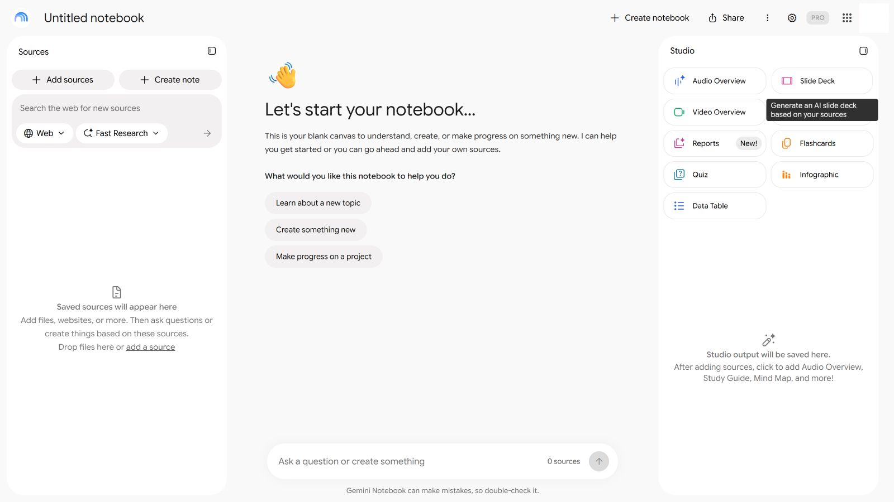
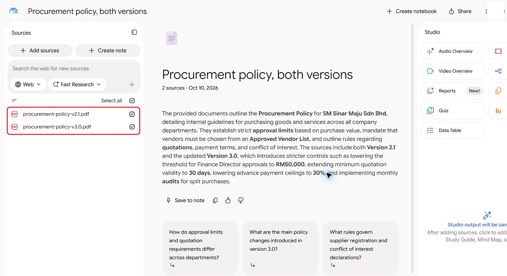
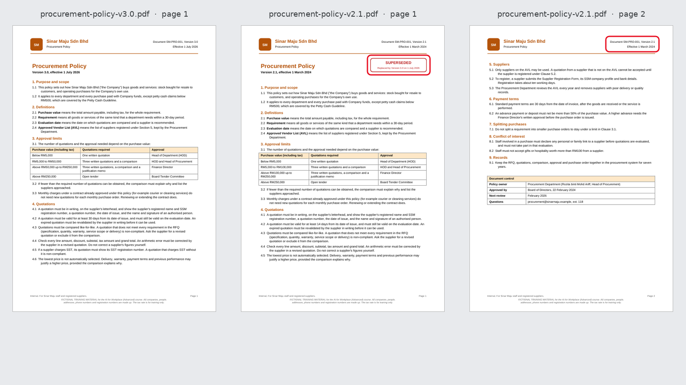
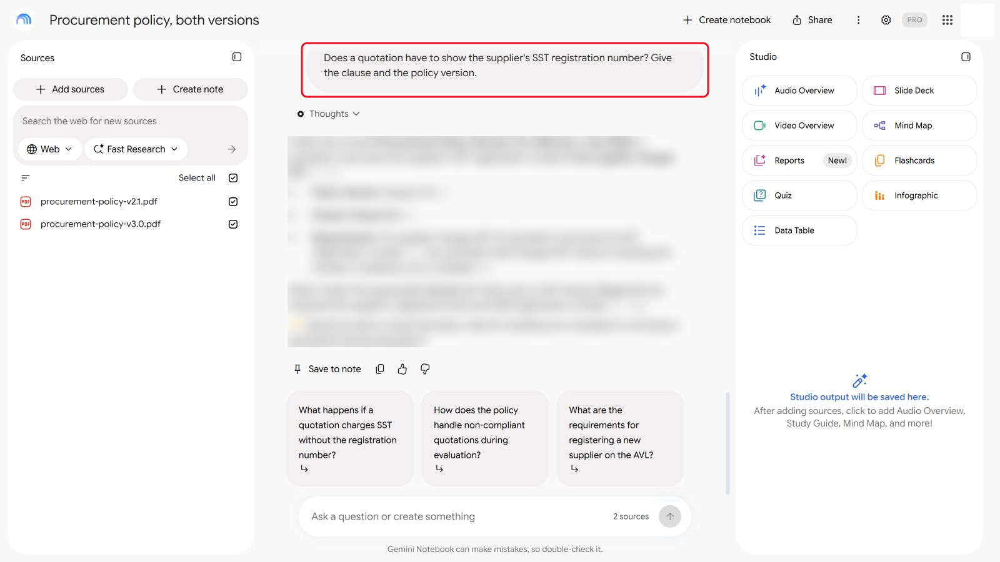
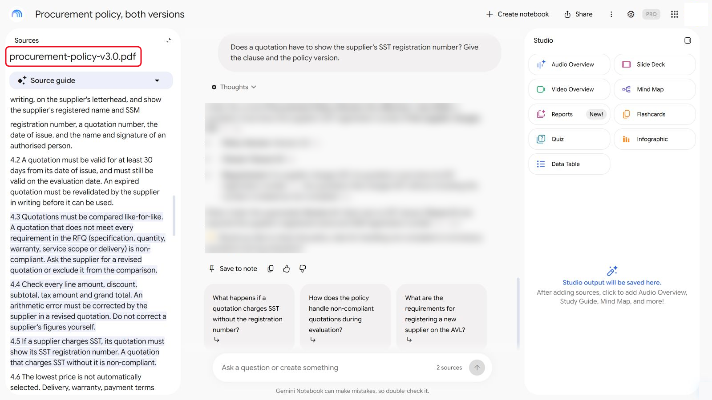
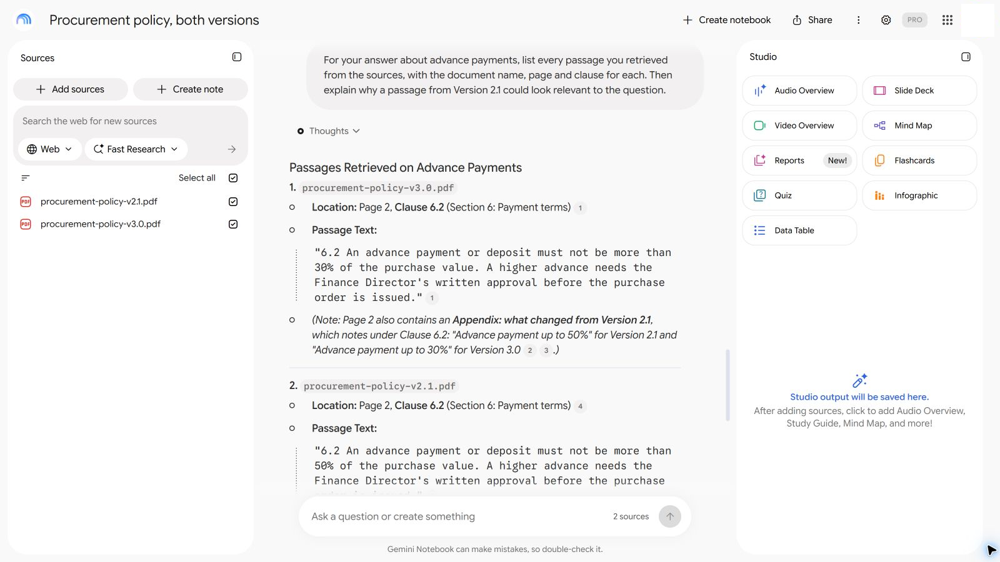
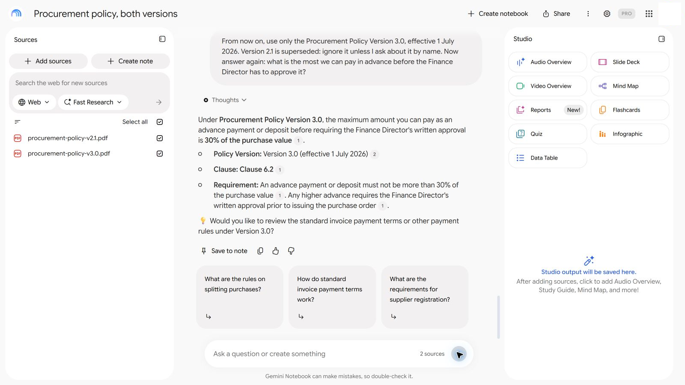

# 09 - Asas Retrieval-Augmented Generation (RAG)

Dalam Modul 04, notebook polisi anda memberi jawapan yang baik dengan citation. Kemudian seseorang menambah salinan lama polisi itu ke dalam notebook yang sama, kerana ia ada dalam folder kongsi. Dalam modul ini, anda melihat apa yang berlaku kepada jawapannya, mencari sebab AI memetik dokumen yang salah, dan membetulkannya.

> **Prompt:** setiap prompt yang anda perlukan ada dalam langkah-langkah di bawah, dengan butang Salin. [Halaman prompt](./prompts.md) juga mengumpulkan semuanya dalam satu halaman.

**Anggaran masa:** 50 minit

**Hasil anda:** Diagnosis citation yang salah dalam bahasa mudah, dan notebook yang telah anda betulkan supaya ia menjawab daripada polisi semasa sahaja.

---

## Apa yang Anda Akan Pelajari

- Terangkan retrieval-augmented generation (RAG) dalam empat langkah: split, index, retrieve, answer
- Nyatakan mengapa alat RAG boleh memetik dokumen yang salah dengan penuh yakin
- Diagnosis citation yang salah dengan menyemak apa yang diambil (retrieved)
- Betulkannya, dengan menyusun semula sumber atau dengan memberitahu alat itu versi mana yang diguna pakai

---

## Sebelum Anda Mula

> **Muat turun:** **[sample-files.zip](../../09-rag-fundamentals/sample-files.zip)**, kemudian klik kanan fail itu dan pilih **Extract All** sebelum anda mula.

Kandungannya:

| Fail | Kandungan |
|---|---|
| `procurement-policy-v3.0.pdf` | Polisi Perolehan semasa, berkuat kuasa 1 Julai 2026 |
| `procurement-policy-v2.1.pdf` | Versi sebelumnya, berkuat kuasa 1 Mac 2024 |

Guna notebook berasaskan sumber, seperti dalam Modul 04. Gemini Notebook (dahulunya NotebookLM) menunjukkan citation dengan paling jelas.

Istilah baharu diterangkan dalam [glosari](../../14-product-cards/glossary.md) (dalam bahasa Inggeris). Jika syarikat anda menyekat Gemini Notebook, lihat [If your company blocks a tool](../../14-product-cards/locked-down.md) (dalam bahasa Inggeris).

---

## Topik

**RAG dalam empat langkah.** Notebook dan Project yang ada fail berfungsi seperti ini:

1. **Split (pecahkan):** setiap dokumen dipotong kepada chunk kecil, selalunya beberapa perenggan setiap satu.
2. **Index:** alat itu memfailkan setiap chunk mengikut maknanya, sedikit seperti pustakawan yang menyusun buku di rak mengikut topik, bukan mengikut tajuk. Begitulah ia menemui chunk tentang "deposit" walaupun anda bertanya tentang "bayaran pendahuluan".
3. **Retrieve (ambil):** apabila anda bertanya soalan, alat itu mencari chunk yang maknanya paling hampir dengan soalan itu.
4. **Answer (jawab):** model menulis jawapan daripada chunk itu sahaja, dan memetiknya.

**Mengapa citation tersilap.** Alat itu mengambil chunk mengikut makna, bukan mengikut tarikh atau versi. Dua versi polisi dengan nombor klausa yang sama dan perkataan yang hampir sama kelihatan sama relevan. Chunk dari halaman 2 tidak membawa cop "SUPERSEDED" dari halaman 1 bersamanya. Jadi AI boleh memetik klausa yang sudah lapuk, dengan tepat, daripada dokumen yang salah.

**Cara membetulkan.** Cara terbaik ialah membuang dokumen yang telah dibatalkan (superseded) daripada sumber. Jika tidak boleh, letakkan versi dan status dalam setiap chunk (pengepala pada setiap halaman membantu), dan beritahu alat itu versi mana yang diguna pakai.

---

## 9.1 Tambah Kedua-dua Versi ke dalam Notebook

1. Cipta notebook baharu bernama `Procurement policy, both versions`.

   

   *Notebook baharu, berasingan daripada notebook dalam Modul 04.*
2. Tambah `procurement-policy-v3.0.pdf` dan `procurement-policy-v2.1.pdf` sebagai sumber.

   

   *Kedua-dua versi menjadi sumber. Ringkasannya sudah menyebut kedua-duanya.*
3. Lihat halaman 1 setiap PDF. Hanya yang lama ada kotak merah **SUPERSEDED**. Sekarang lihat halaman 2 PDF yang lama.

   

   *Hanya halaman 1 polisi lama yang menyatakan SUPERSEDED. Halaman 2 menyatakan Version 2.1 dalam tulisan kecil, dan tiada apa-apa lagi.*

---

## 9.2 Tanya Empat Soalan

Tanya setiap soalan secara berasingan. Bagi setiap jawapan, catat angka yang diberikan dan **versi mana** yang dipetiknya.

```
Jawab daripada sumber, dengan nombor klausa dan versi polisi yang anda gunakan. Berapakah jumlah maksimum yang boleh kami bayar secara pendahuluan sebelum Pengarah Kewangan perlu meluluskannya?
```

```
Berapa lama sebut harga pembekal mesti sah? Beri klausa dan versi polisi.
```

```
Siapa yang perlu meluluskan pembelian bernilai RM80,000 termasuk cukai? Beri klausa dan versi polisi.
```

```
Adakah sebut harga perlu menunjukkan nombor pendaftaran SST pembekal? Beri klausa dan versi polisi.
```



*Tanya setiap soalan secara berasingan. Jawapannya dikaburkan: bandingkan dengan jawapan anda sendiri (tangkapan skrin daripada versi bahasa Inggeris).*

---

## 9.3 Cari Citation yang Salah

1. Bagi setiap jawapan, klik atau buka citation itu dan cari halaman yang ditunjuknya.

   

   *Klik citation untuk membuka petikan itu. Nama fail di bahagian atas memberitahu anda versi mana sumbernya.*
2. Semak versi dalam pengepala halaman: **Version 3.0** atau **Version 2.1**.
3. Tandakan setiap jawapan **Betul** (daripada v3.0) atau **Salah** (daripada v2.1, atau campuran kedua-duanya).

Keputusan anda mungkin berbeza daripada jiran anda: retrieval berubah dari satu larian ke larian lain.

<details markdown="1">
<summary>Tunjukkan jawapan</summary>

Jawapan yang salah datang daripada Version 2.1, yang menyatakan SUPERSEDED hanya pada halaman pertamanya.

| Soalan | Jawapan betul (v3.0) | Jawapan salah (daripada v2.1) | Klausa |
|---|---|---|---|
| Jumlah maksimum yang boleh dibayar secara pendahuluan tanpa kelulusan tambahan? | 30% | 50% | 6.2 |
| Berapa lama sebut harga mesti sah? | Sekurang-kurangnya 30 hari | Sekurang-kurangnya 14 hari | 4.2 |
| Siapa yang meluluskan pembelian RM80,000? | Pengarah Kewangan | Ketua Jabatan (HOD) dan Ketua Perolehan | 3.1 |
| Mesti sebut harga menunjukkan nombor SST? | Ya, jika SST dikenakan | Klausa tentang harga terendah | 4.5 |

Nombor klausa adalah sama dalam kedua-dua versi, dan sebab itulah citation yang salah kelihatan betul. Buka halaman yang dipetik dan semak versi dalam pengepalanya.

Jika setiap jawapan datang daripada Version 3.0, notebook anda melakukan retrieval dengan baik kali ini. Dalam ujian kami, Gemini Notebook menjawab keempat-empat soalan daripada Version 3.0 malah mencatat apa yang dinyatakan oleh Version 2.1. Retrieval berubah-ubah, jadi tanya soalan yang sama dengan perkataan lain (lihat Penyelesaian Masalah), dan bandingkan dengan jiran anda: risikonya ialah anda tidak dapat meramal larian mana yang akan tersilap.

</details>

---

## 9.4 Diagnosis Puncanya

Dalam notebook yang sama, hantar:

```
Bagi jawapan anda tentang bayaran pendahuluan, tunjukkan petikan daripada sumber yang menjadi asas jawapan itu, dengan nama dokumen, halaman dan klausa bagi setiap satu. Kemudian terangkan mengapa petikan daripada Version 2.1 boleh kelihatan relevan dengan soalan itu.
```



*Notebook menyenaraikan petikan yang digunakannya: Clause 6.2 daripada kedua-dua versi. Ini ialah penjelasan notebook itu sendiri, bukan log teknikal carian yang dibuatnya, jadi semak setiap petikan dalam PDF.*

Kemudian, bersama orang di sebelah anda, tulis satu ayat bagi setiap soalan:

1. Langkah RAG mana (split, index, retrieve, answer) yang membenarkan klausa lama itu masuk?
2. Apa pada halaman itu yang boleh memberi amaran kepada AI, dan mengapa ia tidak nampak?

---

## 9.5 Betulkan dengan Dua Cara

**Cara A: beritahu alat itu versi mana yang diguna pakai.** Dalam notebook yang sama, hantar:

```
Mulai sekarang, guna Polisi Perolehan Version 3.0 sahaja, berkuat kuasa 1 Julai 2026. Version 2.1 telah dibatalkan (superseded): abaikannya kecuali saya bertanya tentangnya dengan menyebut namanya. Sekarang jawab semula: berapakah jumlah maksimum yang boleh kami bayar secara pendahuluan sebelum Pengarah Kewangan perlu meluluskannya?
```



*Cara A: beritahu notebook versi mana yang diguna pakai, kemudian tanya semula.*

**Cara B: susun semula sumber.** Buang `procurement-policy-v2.1.pdf` daripada sumber notebook, dan tanya keempat-empat soalan sekali lagi.

Cara mana yang anda akan percaya enam bulan dari sekarang, apabila orang lain bertanya soalan kepada notebook itu?

> **Perkara utama:** instructions membantu, tetapi cara yang boleh diharap ialah senarai sumber. Jauhkan dokumen yang telah dibatalkan daripada knowledge yang digunakan oleh AI untuk menjawab, atau labelkannya dengan jelas pada setiap halaman.

---

## Nota Produk

| Copilot Chat (Basic) | M365 Copilot (Premium) | ChatGPT | Claude | Gemini |
|---|---|---|---|---|
| **Notebook** dengan kedua-dua PDF. Buka citation dengan butang **Sources** | Sama. Researcher juga boleh mencari dalam fail organisasi anda, dan di situ versi lama memang satu risiko | **Project** dengan kedua-dua PDF. Buang fail daripada project files untuk Cara B | **Project** dengan kedua-dua PDF dalam knowledge. Knowledge base yang besar menggunakan RAG secara automatik pada pelan berbayar | **Gemini Notebook**: nyahtanda atau padam sumber untuk Cara B. Klik nombor citation untuk melihat petikannya |

---

## Latihan Kendiri

Fikirkan satu folder kongsi di tempat kerja yang menyimpan beberapa versi dokumen yang sama. Jika seseorang menghalakan notebook AI kepada folder itu, soalan mana yang paling mungkin mendapat jawapan yang sudah lapuk?

---

## Penyelesaian Masalah

| Masalah | Apa yang perlu disemak |
|---|---|
| Setiap jawapan memetik Version 3.0 | Retrieval baik kali ini. Tanya soalan yang sama dengan perkataan lain, seperti "Berapa deposit yang boleh diminta oleh pembekal?" |
| Jawapan tidak menyebut versi | Tanya: "Daripada versi polisi mana jawapan itu? Semak pengepala halaman." |
| Citation membuka halaman yang salah | Cari nombor klausa dalam PDF sendiri dan semak kedua-dua versi |
| Cara A tidak mengubah jawapan | Mulakan new chat dalam notebook dan beri arahan itu dahulu |

---

## Ringkasan Pelajaran

RAG mencari petikan yang sepadan dengan soalan anda mengikut makna, kemudian menjawab daripada petikan itu. Ia tidak tahu dokumen mana yang semasa melainkan petikan itu menyatakannya. Citation yang salah biasanya berpunca daripada sumber, bukan model, jadi pembetulannya bermula dengan menjauhkan versi lama.

**Uji diri:** Kedua-dua polisi ada Klausa 6.2. Mengapa perkara itu menjadikan citation yang salah lebih sukar dikesan?
