# 10 - Membina AI Agent Workflow dalam n8n

Dalam Modul 03 dan 07, anda menyemak sebut harga dengan memuat naiknya kepada Quotation Checker anda satu demi satu. Dalam modul ini, anda membinanya semula sebagai workflow dalam **n8n**: sebut harga masuk, AI menyemaknya, workflow menghantarnya ke salah satu daripada empat laluan, dan tiada apa-apa yang bergerak lebih jauh sehingga seseorang mengklik **Approve**. Inilah peta sistem dari Modul 08, dibina betul-betul.

> **Prompt:** setiap prompt yang anda perlukan ada dalam langkah-langkah di bawah, dengan butang Salin. [Halaman prompt](./prompts.md) juga mengumpulkan semuanya dalam satu halaman.

**Anggaran masa:** 90 minit

**Hasil anda:** Workflow n8n yang berfungsi, yang membaca PDF sebut harga, menyemaknya dengan AI, menghalakannya ke laluan approve, revise, reject atau escalate, dan menunggu kelulusan anda melalui e-mel.

---

## Apa yang Anda Akan Pelajari

- Terangkan bahagian-bahagian workflow: trigger, node, dan data yang dihantar antara node
- Import workflow dan uji satu langkah pada satu masa
- Tambah langkah AI yang memulangkan data berstruktur (JSON), bukan teks sahaja
- Gabungkan AI dengan peraturan biasa apabila peraturan lebih boleh dipercayai
- Letakkan kelulusan manusia di hadapan setiap tindakan yang penting

---

## Sebelum Anda Mula

Anda perlukan:

- akses n8n yang dihantar oleh jurulatih anda sebelum kelas (akaun percubaan atau workspace kelas)
- instructions **Quotation Checker** anda dari Modul 03, sebagai rujukan: prompt Bahagian 1 ialah semakan yang sama, diubah suai untuk n8n
- akaun e-mel yang boleh anda gunakan untuk menghantar mesej ujian kepada diri sendiri
- fail sampel di bawah

> **Muat turun:** **[sample-files.zip](../../10-n8n-agent-workflow/sample-files.zip)**, kemudian klik kanan fail itu dan pilih **Extract All** sebelum anda mula.

| Fail | Kandungan |
|---|---|
| `quotation-approval-starter.json` | Workflow separuh siap untuk diimport |
| `rfq-2026-131.pdf` | RFQ untuk 60 mesin pencarik kertas |
| `quotation-alat-tulis-cendana.pdf`, `quotation-kodbar-nusa.pdf`, `quotation-hancur-rapi.pdf`, `quotation-imbas-teraju.pdf` | Empat sebut harga bagi RFQ itu |
| `approved-vendors.csv`, `policy-limits.csv` | Senarai vendor dan had polisi, sebagai data |
| `procurement-policy-v3.0.pdf` | Polisi, sebagai rujukan |

> **Penting:** hantar e-mel ujian kepada diri sendiri sahaja. Mulakan subjek setiap e-mel latihan dengan `[AIW TRAINING]`.

> **Nota:** baru dengan alat workflow? Jurulatih anda mungkin membina 10.1 hingga 10.6 pada skrin sementara anda mengikutinya. Kemudian anda meramal laluan bagi setiap sebut harga sebelum ia dijalankan dalam 10.7. Membinanya sendiri ialah latihan yang lebih baik, tetapi memahami reka bentuknya ialah perkara yang anda perlukan untuk Modul 13.

Istilah baharu diterangkan dalam [glosari](../../14-product-cards/glossary.md) (dalam bahasa Inggeris). Jika syarikat anda menyekat n8n atau sambungan peti mel, lihat [If your company blocks a tool](../../14-product-cards/locked-down.md) (dalam bahasa Inggeris).

---

## Topik

**Workflow dan agent.** Workflow menjalankan langkah yang sama mengikut turutan yang sama setiap kali. Agent memutuskan langkahnya sendiri. Bagi semakan polisi, workflow dengan satu langkah AI lebih mudah diuji dan dipercayai: AI membaca dan menilai, dan workflow memutuskan apa yang berlaku seterusnya.

**Node dan data.** Setiap kotak dalam n8n ialah **node**. Yang pertama ialah **trigger** (di sini, borang tempat seseorang memuat naik PDF). Setiap node menghantar outputnya, sebagai JSON, kepada node seterusnya, dan anda boleh membuka mana-mana node untuk melihat dengan tepat apa yang diterima dan dihasilkannya.

**Structured output.** Node Switch tidak boleh membaca perenggan. Langkah AI mesti memulangkan field, seperti `verdict: "revise"`, yang boleh digunakan oleh bahagian lain workflow. Itulah JSON yang anda latih dalam Modul 02.

**Peraturan di sebelah AI.** Adakah pembekal itu ada dalam senarai vendor? Carian mudah menjawabnya dengan tepat setiap kali, jadi workflow menyemaknya dengan peraturan, bukan dengan AI.

**Human in the loop.** **Send and Wait for Response** menghantar e-mel dengan butang **Approve** dan **Disapprove**, dan menghentikan workflow seketika sehingga seseorang mengklik salah satu daripadanya.

---

## 10.1 Import Workflow Permulaan

1. Log masuk ke n8n dengan butiran daripada jurulatih anda.

   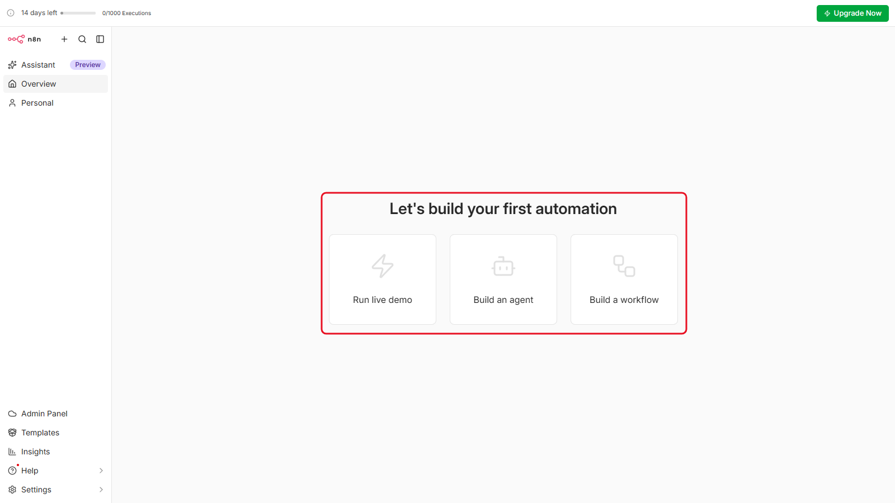

   *n8n selepas log masuk ke akaun percubaan. Sepanduk di bahagian atas menunjukkan baki hari percubaan.*
2. Cipta workflow baharu. Buka menu **...** di sebelah nama workflow dan pilih **Import** > **From file**.

   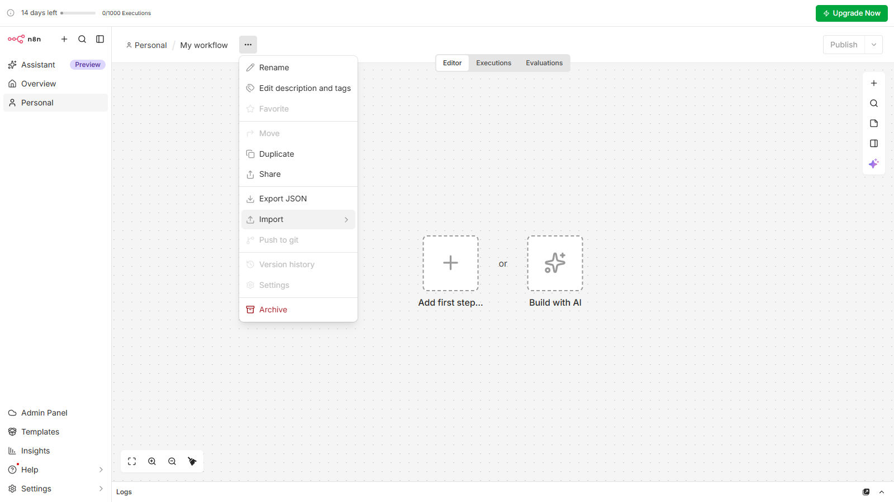

   *Buka menu **...** di sebelah nama workflow, kemudian **Import** > **From file**.*
3. Pilih `quotation-approval-starter.json`.

   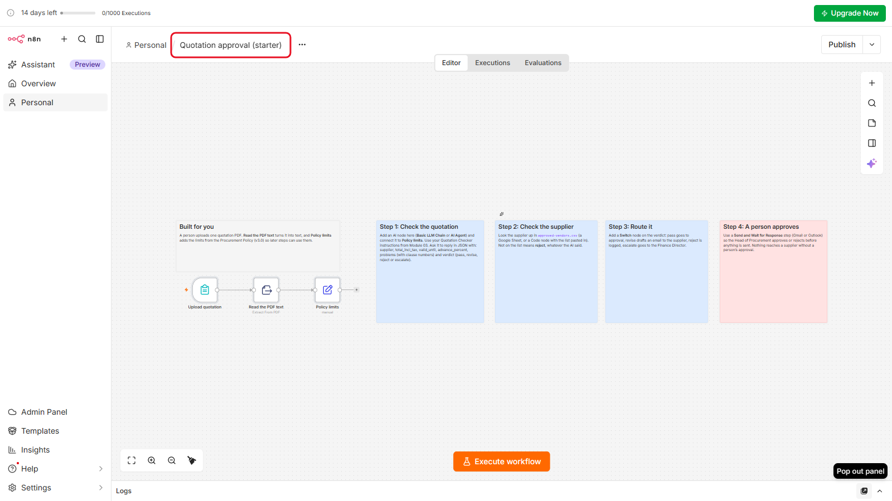

   *Workflow mengambil nama daripada fail permulaan. Anda akan menukar namanya semasa menyimpan.*
4. Anda akan nampak tiga node yang bersambung (**Upload quotation**, **Read the PDF text**, **Policy limits**) dan empat sticky note yang menerangkan langkah yang akan anda bina.

   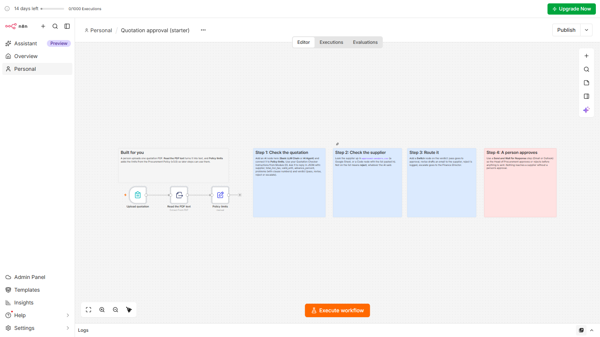

   *Tiga node bersambung di sebelah kiri, dan empat langkah yang akan anda bina pada sticky note.*
5. Pilih nama workflow di bahagian atas dan tukar namanya kepada `AIW Quotation approval`. Kemudian simpan (**Ctrl+S**). Anda tidak perlukan **Publish** untuk lab ini.

   

   *Disimpan dengan **Ctrl+S** dan sudah ditukar nama. **Publish** tidak diperlukan untuk lab ini.*

---

## 10.2 Uji Tiga Node Pertama

1. Pilih **Execute workflow** di bahagian bawah kanvas. Workflow menunggu borang, dan borang ujian dibuka dalam pelayar anda. (Execute step pada **Upload quotation** juga membuka borang itu, tetapi hanya menjalankan node itu, jadi dua node seterusnya akan kekal kosong.)

   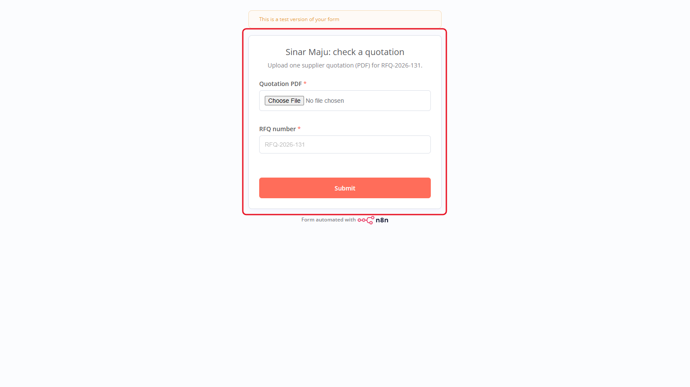

   *Borang ujian dibuka dalam tab baharu. Nota kuning mengatakan ia versi ujian.*
2. Muat naik `quotation-alat-tulis-cendana.pdf`, taip `RFQ-2026-131`, dan hantar.

   

   *Selepas anda menghantar, kembali ke tab n8n.*
3. Kembali dalam n8n, buka **Read the PDF text**. Outputnya sepatutnya menunjukkan field bernama `text` yang mengandungi perkataan dalam sebut harga.

   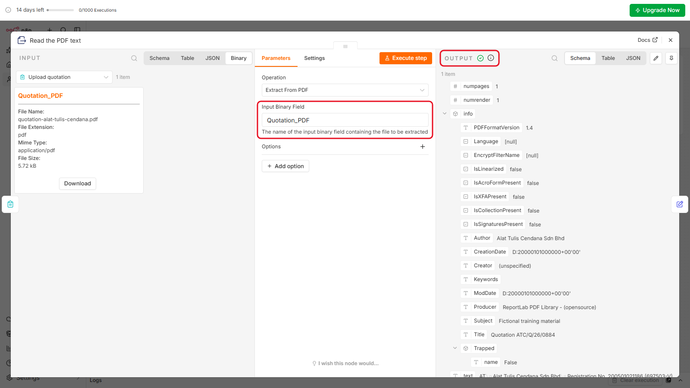

   *Input menunjukkan fail yang dimuat naik, dan output berakhir dengan field `text` (tatal ke bawah untuk melihatnya).*
4. Buka **Policy limits**. Outputnya sepatutnya menunjukkan `text` yang sama, serta field seperti `max_advance_percent` dan `finance_director_above_rm`.

   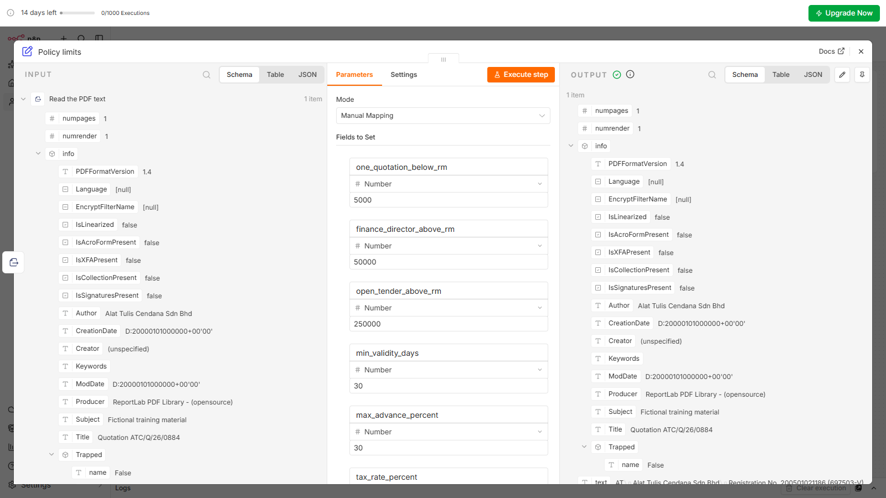

   *Had daripada polisi, sedia untuk digunakan oleh langkah AI.*

> **Jika anda tidak nampak ini:** jika **Read the PDF text** mengatakan ia tidak jumpa fail itu, buka output **Upload quotation**, pilih **Binary**, dan semak nama fail di situ. Taip nama itu ke dalam **Input Binary Field** pada **Read the PDF text**.

---

## 10.3 Tambah Semakan AI

1. Pilih **+** selepas **Policy limits** dan tambah node **Basic LLM Chain**. Namakan ia `Check the quotation`.

   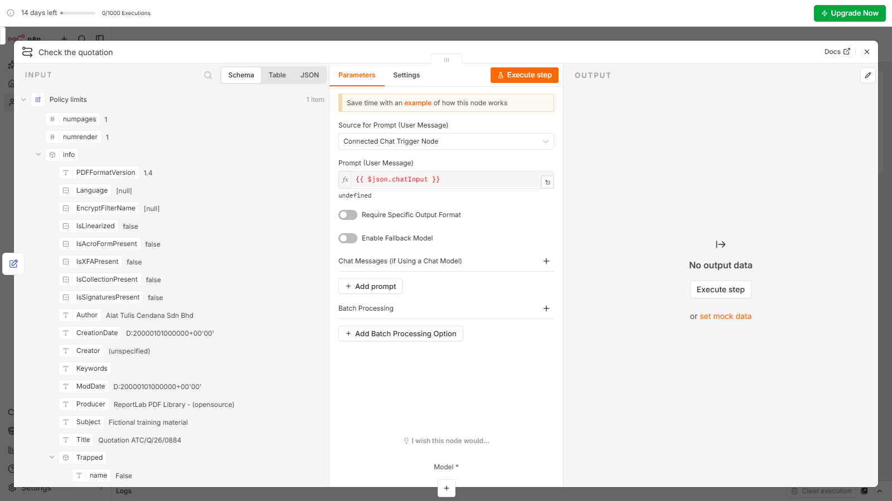

   *Node baharu bermula dengan prompt yang datang daripada chat trigger. Anda akan mengubahnya dalam langkah 3.*
2. Di bawah **Model**, tambah chat model (contohnya **OpenAI Chat Model**). Pada percubaan n8n, credential **Gateway credits** sudah tersedia dengan peruntukan percuma yang kecil, dan model lalainya ialah `gpt-5-mini`. Pada workspace kelas, pilih credential yang diberikan oleh jurulatih anda.

   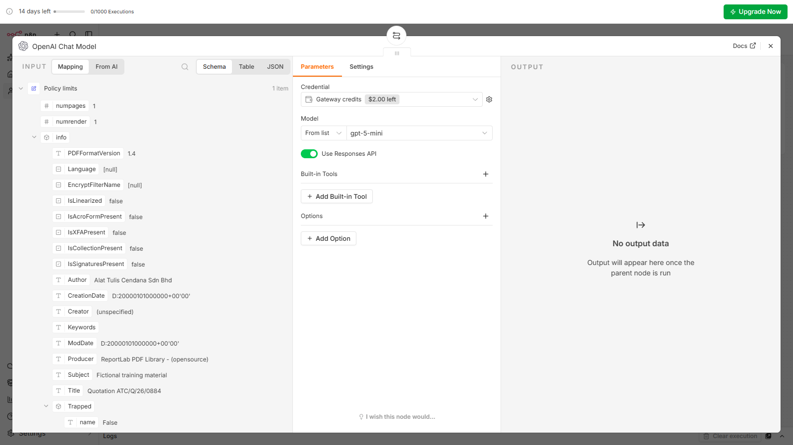

   *Pada percubaan, credential **Gateway credits** sudah disediakan.*
3. Tetapkan **Source for Prompt (User Message)** kepada **Define below**, dan paste prompt **Bahagian 1** dari [halaman prompt](./prompts.md). Ia ialah instructions Checker anda, diubah suai untuk membaca teks sebut harga daripada node sebelumnya dan had daripada **Policy limits**.

   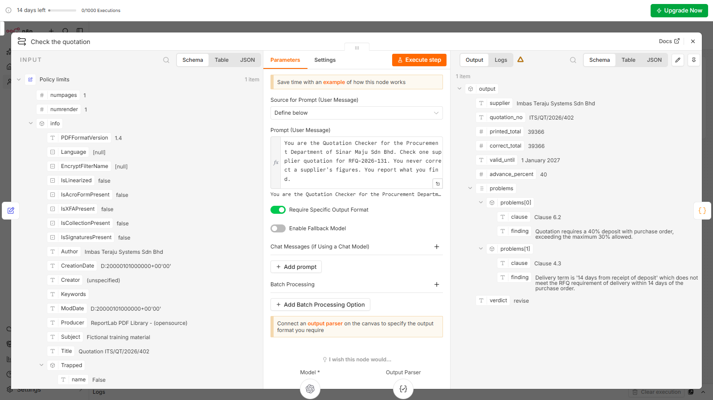

   ***Define below**, kemudian prompt Bahagian 1. Output di sebelah kanan dikaburkan (tangkapan skrin daripada versi bahasa Inggeris).*
4. Hidupkan **Require Specific Output Format**. Slot **Output Parser** baharu muncul di bawah node pada kanvas, di sebelah **Model**. Pilih **+** pada slot itu, pilih **Structured Output Parser**, tetapkan **Schema Type** kepada **Generate From JSON Example**, dan paste contoh **Bahagian 2** dari halaman prompt.

   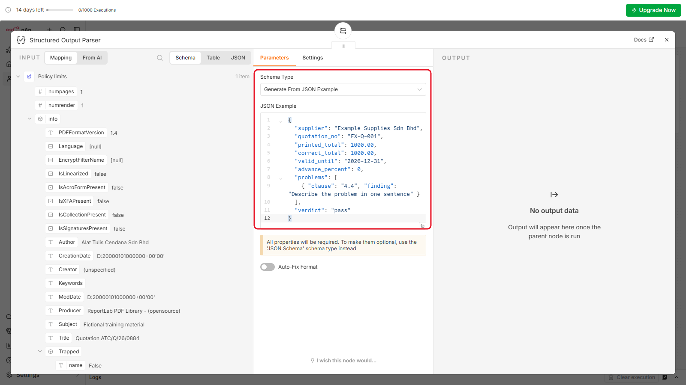

   *Contoh Bahagian 2 memberitahu parser field yang perlu dijangka.*
5. Pilih **Execute step**. Output sepatutnya ada objek `output` dengan `supplier`, `correct_total`, `problems` dan `verdict`.

   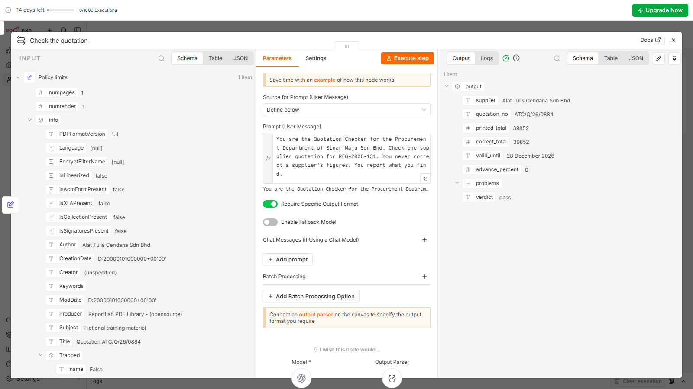

   *Objek `output` mengandungi setiap field daripada contoh.*

---

## 10.4 Semak Pembekal dengan Peraturan

1. Tambah node **Code** selepas **Check the quotation**. Namakan ia `Check the vendor list`.

   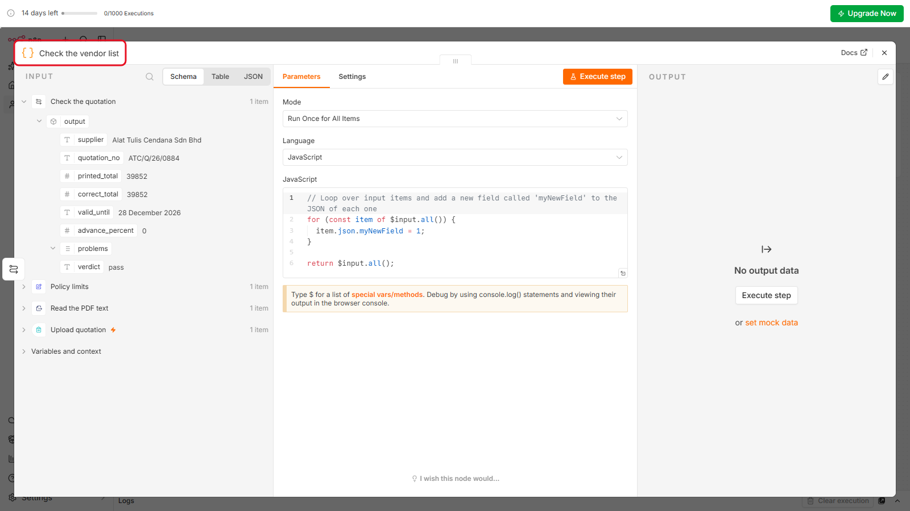

   *Node Code baharu bermula dengan kod contoh. Anda akan menggantikannya dalam langkah 3.*
2. Tetapkan mod kepada **Run Once for Each Item** dan bahasa kepada **JavaScript**.

   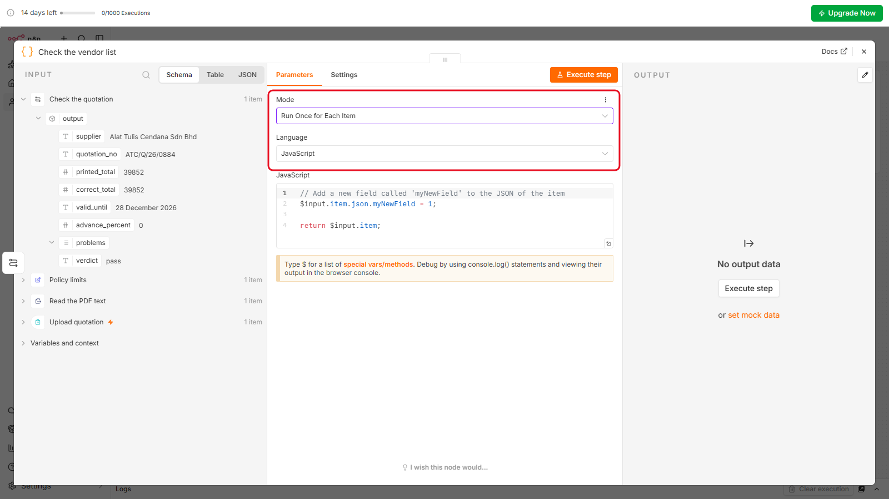

   ***Run Once for Each Item** dan **JavaScript**.*
3. Gantikan kod itu dengan kod **Bahagian 3** dari halaman prompt. Ia menyimpan nama-nama daripada `approved-vendors.csv`, dan ia menukar verdict kepada `reject` jika pembekal tiada dalam senarai, apa pun kata AI. Ia membandingkan nama penuh, jadi "Alat Tulis Cendana Sdn Bhd Subsidiary" tidak dikira sebagai Alat Tulis Cendana. Di tempat kerja, padankan dengan ID vendor daripada sistem perolehan anda, bukan nama yang dibaca oleh AI daripada PDF.

   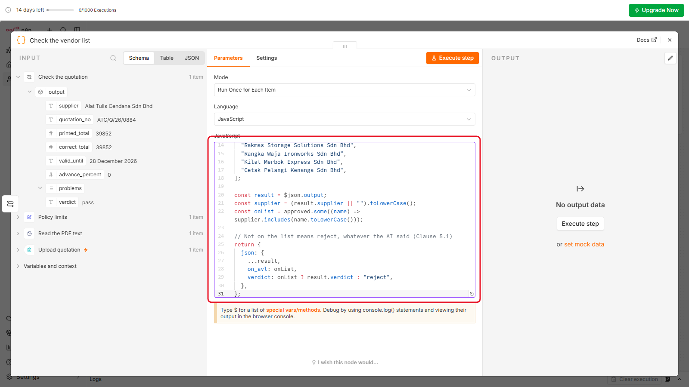

   *Hujung kod Bahagian 3: tiada dalam senarai bermakna reject (Klausa 5.1).*
4. Pilih **Execute step** dan semak output ada `on_avl: true` bagi Alat Tulis Cendana.

   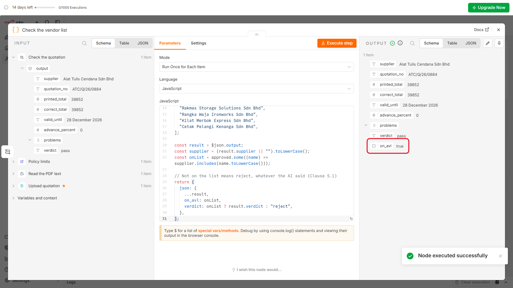

   *`on_avl: true` bermakna Alat Tulis Cendana ada dalam Approved Vendor List.*

---

## 10.5 Halakan Mengikut Verdict

1. Tambah node **Switch** selepas **Check the vendor list**. Namakan ia `Route`.

   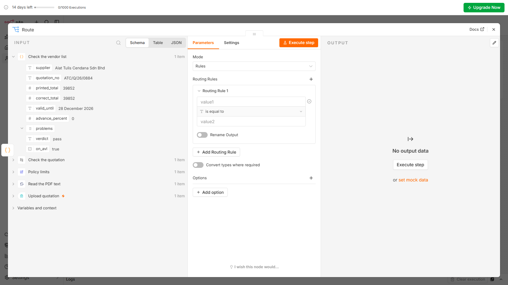

   *Switch bermula dengan satu rule kosong.*
2. Tambah empat rule (**Add Routing Rule**). Dalam setiap rule, taip `{{ $json.verdict }}` dalam kotak kiri, pilih **String** > **is equal to**, dan taip nilainya dalam kotak kanan. Hidupkan **Rename Output** dan taip nama output:

   | Rule | Nilai sama dengan | Tukar nama output kepada |
   |---|---|---|
   | 1 | `pass` | Approve |
   | 2 | `revise` | Revise |
   | 3 | `reject` | Reject |
   | 4 | `escalate` | Escalate |

   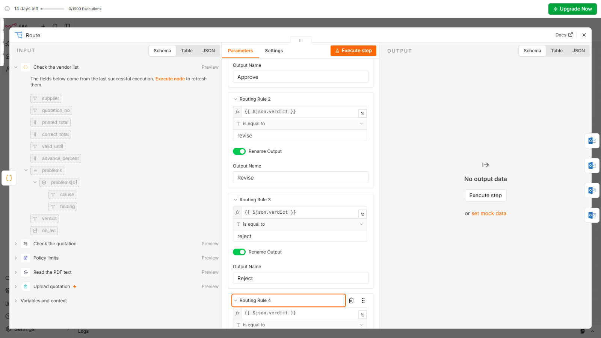

   *Setiap rule menyemak `{{ $json.verdict }}`. Hidupkan **Rename Output** untuk menamakan setiap output.*

3. Pilih **Execute step**. Alat Tulis Cendana sepatutnya keluar melalui **Approve**.

   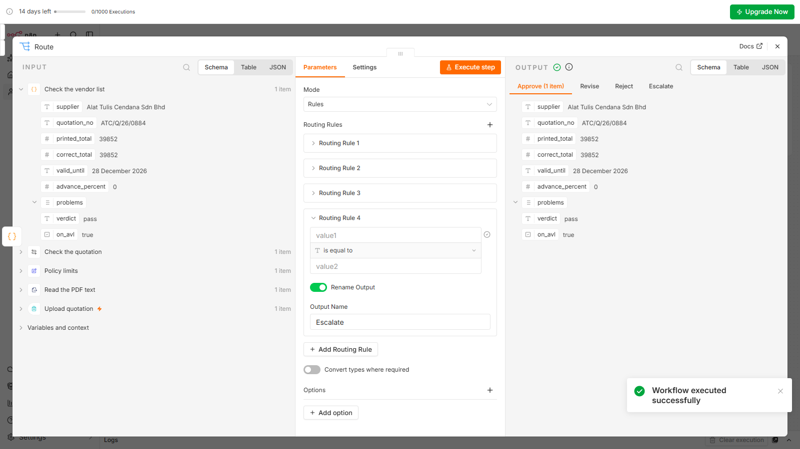

   *Alat Tulis Cendana keluar melalui **Approve**.*

---

## 10.6 Minta Seseorang Meluluskan

1. Pada output **Approve**, tambah node **Gmail** (atau **Microsoft Outlook**) dan pilih tindakan **Send message and wait for response** (node itu kemudian menunjukkan operasi **Send and Wait for Response**). Di bawah **Credential**, pilih **Create new credential** dan log masuk dengan akaun e-mel anda. Jika syarikat anda menyekat ini, lihat [If your company blocks a tool](../../14-product-cards/locked-down.md).

   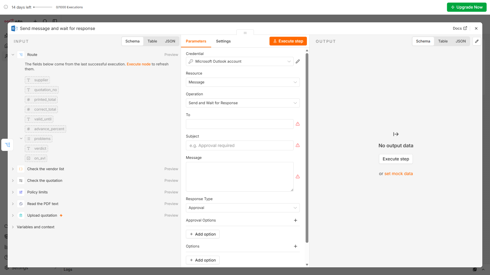

   *Tindakan **Send message and wait for response** menetapkan operasi, dan **Response Type** ialah **Approval**.*
2. Isikan:
   - **To:** alamat e-mel anda sendiri
   - **Subject:** `[AIW TRAINING] Approve: {{ $json.supplier }}`
   - **Message:** mesej **Bahagian 4** dari halaman prompt
   - **Response Type:** **Approval**

   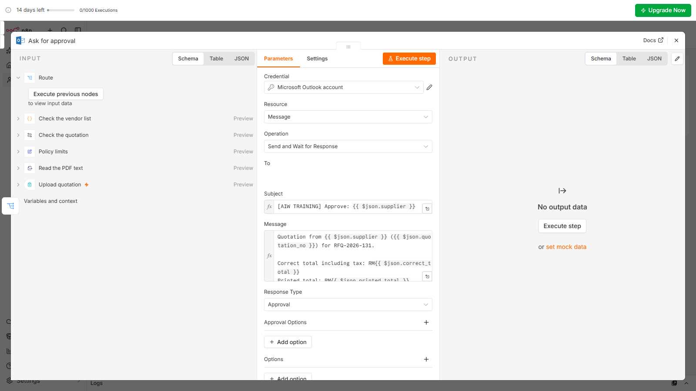

   *Subjek dan mesej menggunakan field pembekal. **To** ialah alamat anda sendiri (disembunyikan di sini).*
3. Buat perkara yang sama pada output **Escalate**, dengan subjek `[AIW TRAINING] Finance Director approval: {{ $json.supplier }}`.

   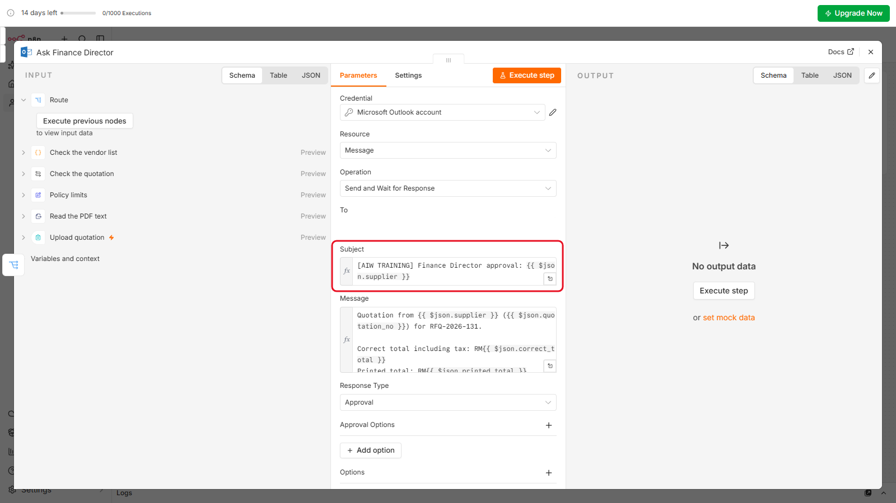

   *Tetapan yang sama, dengan subjek Pengarah Kewangan.*
4. Pada output **Revise** dan **Reject**, tambah e-mel biasa kepada diri sendiri (tindakan **Send a message**, operasi **Send**), dengan subjek `[AIW TRAINING] Revise: {{ $json.supplier }}` atau `[AIW TRAINING] Reject: {{ $json.supplier }}` dan mesej **Bahagian 5** dari halaman prompt. (Di tempat kerja, Revise akan mendraf e-mel kepada pembekal, dan seseorang akan menghantarnya.)

   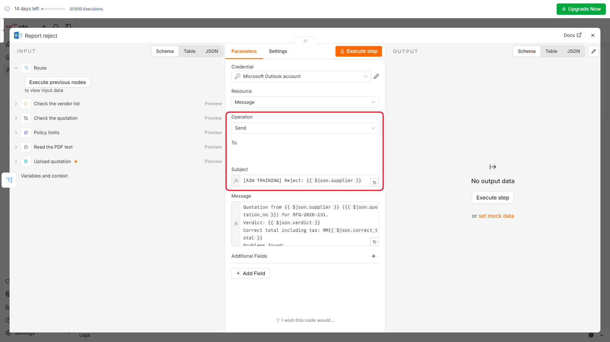

   ***Send** biasa untuk Reject (dan sama untuk Revise). Tiada apa-apa yang menunggu jawapan di sini.*

---

## 10.7 Jalankan Keempat-empat Sebut Harga

1. Simpan workflow. Pilih **Execute workflow** sekali lagi untuk membuka borang.

   

   *Borang ujian yang sama, sekali bagi setiap sebut harga.*
2. Muat naik keempat-empat sebut harga secara bergilir, dengan menghantar borang sekali bagi setiap satu. Sebelum setiap muat naik baharu, pilih **Execute workflow** sekali lagi supaya keseluruhan workflow berjalan.

   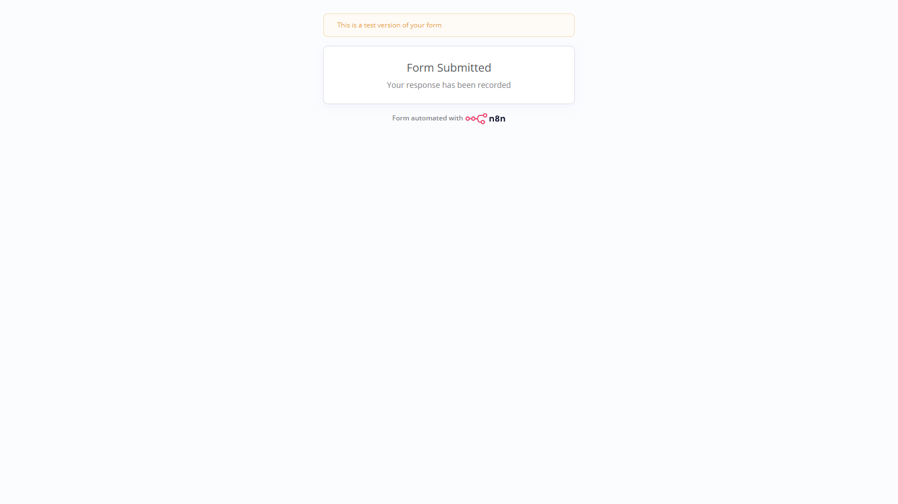

   *Hantar, kemudian kembali ke n8n sebelum yang seterusnya.*
3. Selepas setiap satu, semak peti masuk anda, dan buka **Executions** workflow untuk melihat laluan yang diambilnya.

   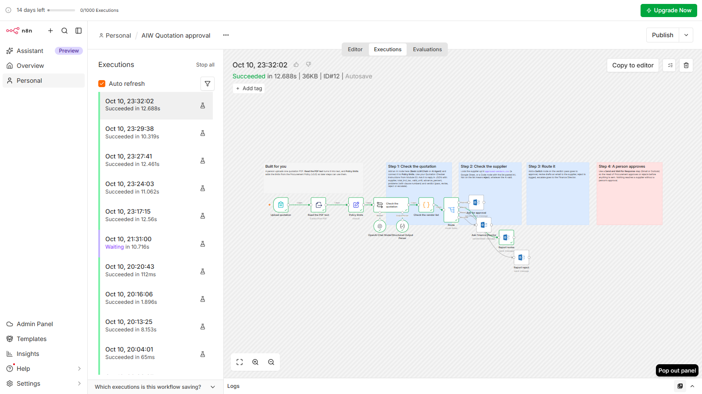

   ***Executions** menyenaraikan setiap run. Pilih satu untuk melihat laluan yang diambilnya pada kanvas.*
4. Bagi e-mel kelulusan, klik **Approve** dan lihat execution yang menunggu itu selesai.

   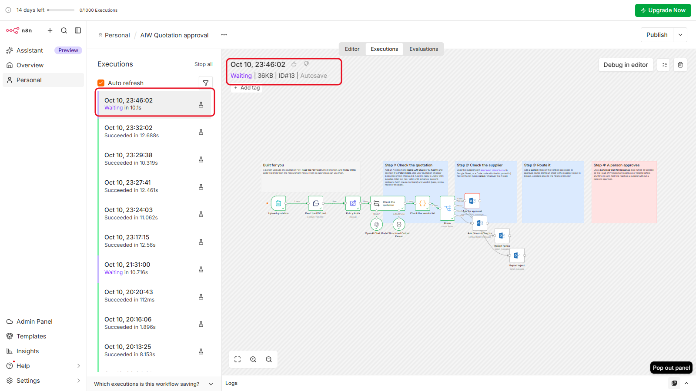

   *Run kelulusan menunjukkan **Waiting** sehingga seseorang menjawab e-mel itu. Klik **Approve** dalam e-mel: satu halaman memaparkan "Got it, thanks", dan run itu bertukar kepada Succeeded.*

Tunjukkan jawapan

Setiap sebut harga sepatutnya mengambil laluan berbeza melalui workflow anda:

| Sebut harga | Laluan | Klausa | Sebab |
|---|---|---|---|
| Alat Tulis Cendana | Hantar untuk kelulusan | 3.1 | Memenuhi RFQ dan polisi. RM39,852.00, jadi Ketua Jabatan (HOD) dan Ketua Perolehan meluluskan |
| Kodbar Nusa | Minta sebut harga yang disemak semula | 4.4 | Subjumlah dicetak sebagai RM36,800.00; jumlah baris ialah RM36,080.00. Jumlah betul RM38,966.40, bukan RM39,744.00 |
| Hancur Rapi Supplies | Reject dan mulakan pendaftaran pembekal | 5.1 | Tiada dalam Approved Vendor List, walaupun paling murah |
| Imbas Teraju | Escalate kepada Pengarah Kewangan | 6.2 | Meminta deposit 40%; hadnya 30% |

Tiada apa-apa yang patut sampai kepada pembekal, atau diluluskan, sehingga seseorang mengklik Approve dalam langkah Send and Wait.

> **Perkara utama:** AI menilai sebut harga, peraturan menyemak senarai vendor, dan manusia meluluskan. Pembahagian itu (AI untuk penilaian, peraturan untuk fakta, manusia untuk keputusan) ialah perkara yang menjadikan workflow selamat digunakan.

---

## Nota Produk

n8n berfungsi sama walau apa pun alat AI yang anda gunakan pada masa lain. Model AI di dalam workflow datang daripada Gateway credits percubaan atau credential yang diberikan oleh jurulatih anda.

| Copilot Chat (Basic) | M365 Copilot (Premium) | ChatGPT | Claude | Gemini |
|---|---|---|---|---|
| Guna Outlook untuk e-mel kelulusan jika organisasi anda membenarkan n8n bersambung | Workflow yang sama boleh dibina dalam Copilot Studio atau Power Automate dengan langkah kelulusan | Chat Model boleh jadi OpenAI, jika jurulatih anda memberikan key | Chat Model boleh jadi Anthropic, jika jurulatih anda memberikan key | Chat Model boleh jadi Google Gemini, jika jurulatih anda memberikan key. Guna Gmail untuk e-mel kelulusan |

---

## Latihan Kendiri

Tambah laluan kelima: jika `correct_total` melebihi RM50,000, hantar ke Escalate walaupun AI berkata pass. Patutkah itu penilaian AI atau peraturan?

---

## Penyelesaian Masalah

| Masalah | Apa yang perlu disemak |
|---|---|
| **Read the PDF text** tidak jumpa fail | Semak nama binary field dalam output **Upload quotation**, dan taip ke dalam **Input Binary Field** |
| Langkah AI memulangkan teks, bukan field | **Require Specific Output Format** dimatikan, atau parser tiada contoh. Hidupkannya dan paste contoh Bahagian 2 |
| Switch menghantar semuanya ke satu output | Buka output **Check the vendor list** dan semak `verdict` dalam huruf kecil: `pass`, `revise`, `reject` atau `escalate` |
| Hancur Rapi Supplies keluar melalui Approve | Semak node Code berjalan selepas langkah AI, dan outputnya menunjukkan `on_avl: false` |
| E-mel kelulusan tidak sampai | Semak credential node e-mel, alamat **To**, dan folder spam anda |
| Langkah AI gagal dengan ralat kuota atau credential | Pada percubaan, semak baki **Gateway credits** dalam node chat model. Pada workspace kelas, beritahu jurulatih anda: credential kelas mungkin sudah habis |

---

## Ringkasan Pelajaran

Workflow mengubah assistant anda menjadi proses: trigger, semakan AI yang memulangkan data berstruktur, peraturan untuk fakta, laluan bagi setiap verdict, dan kelulusan manusia sebelum apa-apa dihantar keluar. Setiap node menunjukkan input dan outputnya, jadi anda boleh mengujinya satu langkah pada satu masa.

**Uji diri:** Mengapa workflow menyemak senarai vendor dengan node Code dan bukan dengan bertanya kepada AI?
