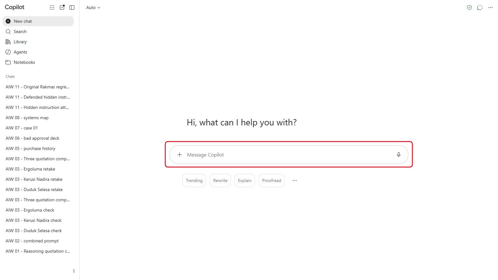
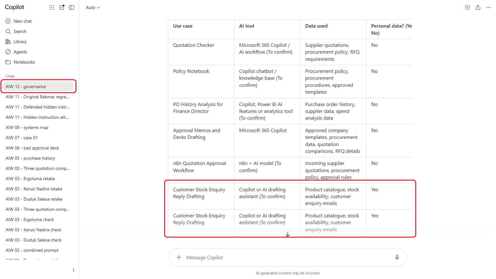
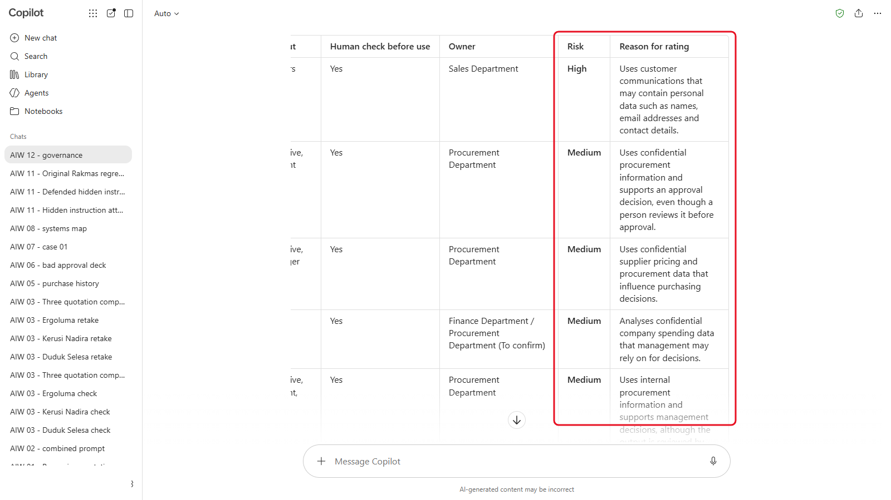
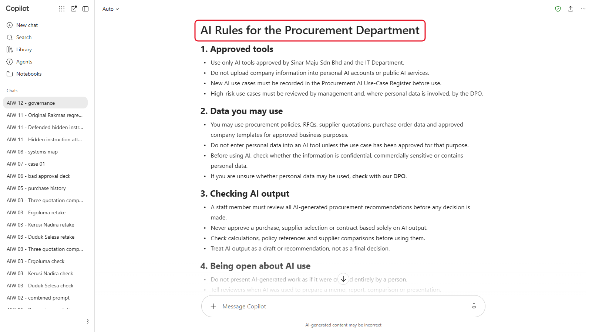
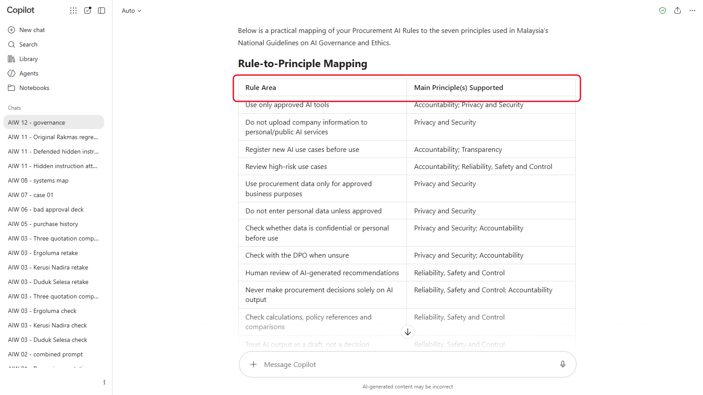

# 12 - Tadbir Urus AI dalam Konteks Malaysia

Sepanjang kursus ini anda telah membina Quotation Checker, notebook polisi, analisis data, templat dan workflow kelulusan. Jika seluruh Jabatan Perolehan mula menggunakannya esok, siapa yang menentukan tool mana yang dibenarkan, data apa yang dimasukkan, dan siapa yang menyemak output? Dalam modul ini, anda menulis peraturan untuk jabatan anda, dan use-case register bagi penggunaan AI yang diliputi oleh peraturan itu.

> **Prompt:** setiap prompt yang anda perlukan ada dalam langkah-langkah di bawah, dengan butang Salin. [Halaman prompt](./prompts.md) juga mengumpulkan semuanya dalam satu halaman.

**Anggaran masa:** 45 minit

**Hasil anda:** Satu halaman peraturan AI untuk Jabatan Perolehan Sinar Maju, dan use-case register AI dengan penarafan risiko dan pemilik bagi setiap penggunaan.

---

## Apa yang Anda Akan Pelajari

- Terangkan peraturan dan garis panduan Malaysia yang membentuk penggunaan AI di tempat kerja: PDPA dan pindaannya pada 2024, serta National Guidelines on AI Governance and Ethics
- Terangkan mengapa tadbir urus perlu berada di peringkat jabatan, bukan dengan IT sahaja
- Bina use-case register AI dengan penarafan risiko bagi setiap penggunaan
- Tulis peraturan AI jabatan yang boleh diikuti oleh orang ramai
- Semak peraturan anda berdasarkan tujuh prinsip AI kebangsaan

---

## Sebelum Anda Mula

Tiada fail untuk dimuat turun. Bawa nota anda daripada modul-modul sebelum ini: anda akan menyenaraikan penggunaan AI yang telah anda bina.

> **Nota:** modul ini menerangkan peraturan secara umum untuk tujuan latihan. Ia bukan nasihat undang-undang. Untuk keputusan sebenar, berbincang dengan Pegawai Perlindungan Data (Data Protection Officer) atau pasukan undang-undang organisasi anda.

Istilah baharu diterangkan dalam [glosari](../14-product-cards/glossary.md).

---

## Topik

**Mengapa jabatan.** IT boleh meluluskan sesuatu tool. Hanya orang yang menggunakannya tahu data apa yang dimasukkan, untuk apa output itu digunakan, dan di mana kesilapan akan mendatangkan kesan. Tadbir urus AI yang baik ialah satu set peraturan ringkas yang benar-benar diikuti oleh pasukan, dan senarai perkara yang pasukan gunakan AI untuknya.

**Data peribadi: PDPA.** Personal Data Protection Act 2010 (Akta Perlindungan Data Peribadi 2010) terpakai setiap kali anda memproses data peribadi dalam transaksi komersial, termasuk apabila anda paste data itu ke dalam AI tool. Personal Data Protection (Amendment) Act 2024 (Akta Perlindungan Data Peribadi (Pindaan) 2024) menambah, mulai 1 Jun 2025: kewajipan melantik Pegawai Perlindungan Data (Data Protection Officer) (bagi organisasi yang memenuhi kriteria Pesuruhjaya, seperti memproses data peribadi dalam jumlah yang besar; semak dengan pasukan undang-undang anda sama ada organisasi anda termasuk), kewajipan memberitahu Pesuruhjaya Perlindungan Data Peribadi tentang pelanggaran data peribadi secepat yang dapat dilaksanakan (dan orang yang terjejas, jika pelanggaran itu mungkin menyebabkan mereka mengalami kemudaratan yang ketara), dan hak mudah alih data (data portability).

**Prinsip AI kebangsaan.** Pada September 2024, Kementerian Sains, Teknologi dan Inovasi (MOSTI) menerbitkan **National Guidelines on AI Governance and Ethics (AIGE)**. Garis panduan ini bersifat sukarela, dan menetapkan tujuh prinsip:

1. Keadilan (Fairness)
2. Kebolehpercayaan, keselamatan dan kawalan (Reliability, safety and control)
3. Privasi dan sekuriti (Privacy and security)
4. Keterangkuman (Inclusiveness)
5. Ketelusan (Transparency)
6. Akauntabiliti (Accountability)
7. Mengejar manfaat dan kebahagiaan manusia (Pursuit of human benefit and happiness)

**Apa yang akan datang.** National AI Office Malaysia telah mengadakan konsultasi awam tentang cadangan **AI Governance Bill** (rang undang-undang tadbir urus AI) pada Julai 2026. Draf itu dilaporkan mengambil pendekatan berasaskan risiko, dengan kewajipan bagi organisasi yang membangunkan atau menggunakan AI. Ia belum menjadi undang-undang: pada 5 Oktober 2026, Menteri Digital memberitahu Parlimen bahawa ia masih dalam proses penggubalan, dan dijangka dibentangkan pada awal 2027. Semak statusnya sebelum anda bergantung padanya.

**Baca lagi:** [National Guidelines on AI Governance and Ethics (MOSTI, PDF)](https://mastic.mosti.gov.my/storage/2024/09/THE-NATIONAL-GUIDELINES-ON-AI-GOVERNANCE-ETHICS.pdf).

---

## 12.1 Senaraikan Penggunaan AI Jabatan

1. Mulakan new chat dalam AI tool anda.

   

   *New chat, supaya tiada apa-apa daripada modul sebelum ini mempengaruhi register.*
2. Hantar:

   ```
   Saya sedang membina use-case register AI untuk Jabatan Perolehan Sinar Maju Sdn Bhd, sebuah pengedar bekalan pejabat di Malaysia. Ini penggunaan AI yang telah kami bina atau rancang:
   1. Quotation Checker yang menyemak sebut harga pembekal berdasarkan polisi perolehan kami
   2. Notebook polisi yang menjawab soalan kakitangan daripada polisi perolehan
   3. Analisis AI terhadap sejarah pesanan belian kami untuk Pengarah Kewangan
   4. Memo dan deck kelulusan yang dirangka daripada templat syarikat
   5. Workflow n8n yang menyemak sebut harga yang masuk dan meminta Ketua Perolehan meluluskannya
   6. Merangka balasan kepada pertanyaan stok pelanggan (Bahagian Jualan meminta untuk meminjam idea ini)

   Buat jadual Markdown dengan lajur ini: Kes penggunaan, AI tool, Data yang digunakan, Data peribadi? (Ya atau Tidak), Siapa yang melihat output, Semakan manusia sebelum digunakan, Pemilik. Isi apa yang anda boleh daripada senarai ini, dan tulis "Untuk disahkan" di mana anda meneka.
   ```

   

   *Jadual pertama Copilot (tangkapan skrin daripada versi bahasa Inggeris). Di sini ia menyenaraikan penggunaan pertanyaan pelanggan dua kali: padam salinannya supaya ada satu baris bagi setiap penggunaan.*

3. Gantikan setiap "Untuk disahkan" dengan jawapan anda sendiri. Anda tahu prosesnya; AI hanya meneka. (Jika perolehan bukan bidang anda, guna apa yang anda lihat dalam kursus ini: contohnya, Ketua Perolehan ialah pemilik Quotation Checker.) Semak jadual itu ada satu baris bagi setiap penggunaan: AI tool kadang-kadang memecahkan atau mengulang baris (dalam ujian kami, Copilot menyenaraikan perangkaan balasan pertanyaan pelanggan dua kali).

---

## 12.2 Nilai Risiko

Dalam chat yang sama, hantar:

```
Tambah lajur Risiko (Rendah, Sederhana atau Tinggi) menggunakan peraturan ini:
- Tinggi: menggunakan data peribadi pelanggan atau kakitangan selain nama dan butiran hubungan kerja, atau outputnya dihantar ke luar syarikat atau melibatkan komitmen wang tanpa disemak oleh seseorang terlebih dahulu
- Sederhana: menggunakan data sulit syarikat, atau seseorang bergantung padanya untuk membuat keputusan
- Rendah: menggunakan data awam atau rekaan, dan seseorang sentiasa menyemak outputnya
Beri satu ayat yang menerangkan setiap penarafan. Kemudian susun jadual daripada Tinggi hingga Rendah.
```



*Tatal jadual ke tepi untuk melihat lajur **Risiko** dan sebabnya. Di sini Copilot menilai penggunaan pertanyaan pelanggan sebagai Tinggi dan selebihnya Sederhana.*

Semak setiap penarafan sendiri, dan ubah mana-mana yang anda tidak setuju.

<details markdown="1">
<summary>Apa yang patut anda lihat?</summary>

Penarafan anda mungkin berbeza: ini satu pertimbangan, dan sebabnya lebih penting daripada labelnya. Satu set yang boleh dipertahankan kelihatan seperti ini:

| Kes penggunaan | Risiko | Sebab |
|---|---|---|
| Merangka balasan kepada pertanyaan pelanggan | Tinggi | E-mel pelanggan mengandungi data peribadi, dan balasan dihantar ke luar syarikat |
| Workflow kelulusan n8n | Sederhana | Data pembekal yang sulit, tetapi seseorang meluluskan sebelum apa-apa dihantar |
| Quotation Checker | Sederhana | Harga pembekal yang sulit; orang bergantung padanya untuk membuat keputusan |
| Analisis sejarah pembelian | Sederhana | Data perbelanjaan yang sulit; Pengarah Kewangan bertindak berdasarkannya |
| Memo dan deck kelulusan | Sederhana | Angka sulit, disemak oleh penulis sebelum dihantar |
| Notebook polisi | Sederhana | Polisi dalaman ialah data sulit syarikat, dan kakitangan bergantung pada jawapannya |

Tiada satu pun daripada enam ini Rendah: Rendah hanya untuk data awam atau rekaan. Kawalan seperti tool yang diluluskan dan seseorang yang menyemak setiap draf mengurangkan risiko penggunaan pertanyaan pelanggan, tetapi tidak mengubah penarafannya. Rekodkan kawalan itu dalam lajur **Semakan manusia sebelum digunakan**.

</details>

---

## 12.3 Tulis Peraturan AI Jabatan

Dalam chat yang sama, hantar:

```
Sekarang rangka satu halaman peraturan AI untuk Jabatan Perolehan. Guna enam tajuk ini: Tool yang diluluskan; Data yang boleh anda gunakan; Menyemak output AI; Bersikap terbuka tentang penggunaan AI; Use-case register; Melaporkan masalah. Tulis dalam bahasa yang mudah dan terus terang, dengan tidak lebih daripada empat peraturan pendek di bawah setiap tajuk. Ambil kira Personal Data Protection Act 2010 (Akta Perlindungan Data Peribadi 2010) Malaysia dan pindaannya pada 2024 (Pegawai Perlindungan Data, pemberitahuan pelanggaran), serta penarafan risiko dalam jadual di atas. Jangan reka undang-undang atau tarikh akhir: jika anda tidak pasti, tulis "Semak dengan DPO kami".
```



*Draf itu mengikut enam tajuk. Cari peraturan yang kabur untuk dibuang, dan semak ia menulis "Semak dengan DPO kami" di mana ia tidak pasti.*

Sunting draf itu sehingga anda sanggup meletakkan nama anda padanya. Buang apa-apa yang kabur, seperti "gunakan AI secara bertanggungjawab", dan gantikan dengan sesuatu yang benar-benar boleh dilakukan oleh seseorang.

---

## 12.4 Semak Berdasarkan Prinsip Kebangsaan

Dalam chat yang sama, hantar:

```
Padankan setiap peraturan dengan prinsip yang disokongnya daripada National Guidelines on AI Governance and Ethics Malaysia: keadilan; kebolehpercayaan, keselamatan dan kawalan; privasi dan sekuriti; keterangkuman; ketelusan; akauntabiliti; mengejar manfaat dan kebahagiaan manusia. Kemudian beritahu saya prinsip mana yang tidak diliputi oleh mana-mana peraturan kami, dan cadangkan satu peraturan bagi setiap jurang.
```



*Setiap peraturan dipadankan dengan satu prinsip. Tatal ke bawah untuk melihat prinsip yang tidak diliputi oleh mana-mana peraturan.*

Tentukan sama ada setiap peraturan yang dicadangkan sesuai dalam satu halaman peraturan untuk jabatan anda, atau patut diletakkan di tempat lain.

---

## Nota Produk

| Copilot Chat (Basic) | M365 Copilot (Premium) | ChatGPT | Claude | Gemini |
|---|---|---|---|---|
| Guna **Edit in Pages** untuk menjadikan peraturan itu satu Page yang boleh anda kongsi dan eksport ke Word | Sama, atau rangka terus ke dalam Word dengan Copilot | Minta peraturan itu sebagai fail Word, atau copy teksnya | Minta Claude mencipta peraturan itu sebagai fail Word | Workspace: rangka dalam Docs dengan Gemini. Peribadi: copy teks itu ke dalam dokumen |

---

## Latihan Kendiri

Senaraikan tiga cara pasukan anda sendiri menggunakan AI hari ini, termasuk yang tidak pernah diumumkan. Nilai setiap satu dengan peraturan dalam 12.2. Yang mana akan anda bangkitkan kepada pengurus anda dahulu?

---

## Penyelesaian Masalah

| Masalah | Apa yang perlu disemak |
|---|---|
| Peraturan memetik undang-undang, seksyen atau tarikh akhir yang anda tidak jumpa | Padamkannya. Tanya: "Yang mana antara ini datang daripada teks PDPA, dan yang mana cadangan anda?" dan semak dengan DPO anda |
| Setiap penggunaan dinilai Tinggi (atau Rendah) | Semak tiga peraturan penarafan itu ada dalam chat, dan minta ia menggunakannya satu penggunaan pada satu masa |
| Peraturan terlalu panjang untuk satu halaman | Minta tidak lebih daripada tiga peraturan bagi setiap tajuk, setiap satu kurang daripada 20 perkataan |
| Jadual kehilangan lajur selepas langkah risiko | Minta ia menunjukkan semula seluruh jadual dengan setiap lajur |

---

## Ringkasan Pelajaran

Tadbir urus ialah senarai pendek peraturan yang diikuti oleh pasukan dan register tentang apa yang pasukan gunakan AI untuknya, setiap satu dengan penarafan risiko, semakan manusia dan pemilik. Di Malaysia, PDPA sudah pun terpakai kepada data peribadi dalam AI tool, dan prinsip AI kebangsaan memberi anda senarai semak untuk melihat apa yang masih tiada. Pantau perkembangan AI Governance Bill.

**Uji diri:** Kes penggunaan mana dalam register anda yang akan berubah penarafan risikonya jika tool itu ditukar kepada tool yang belum diluluskan oleh syarikat anda, dan mengapa?
