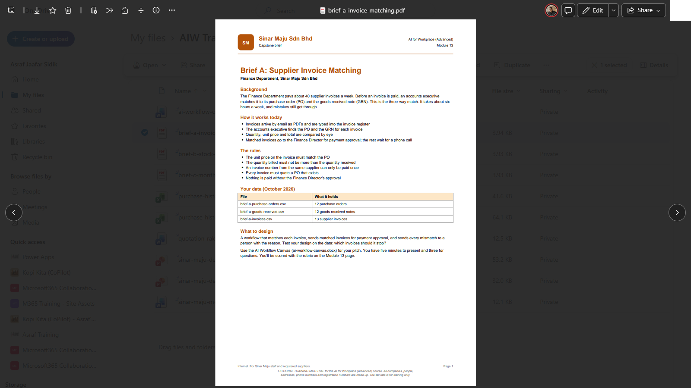
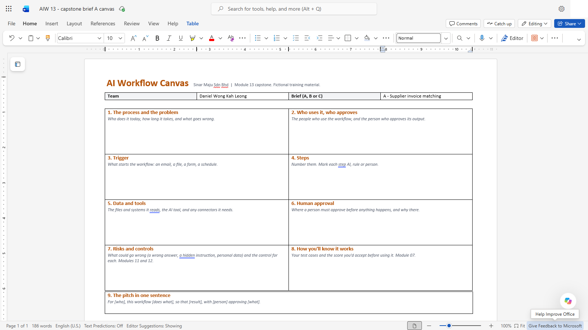
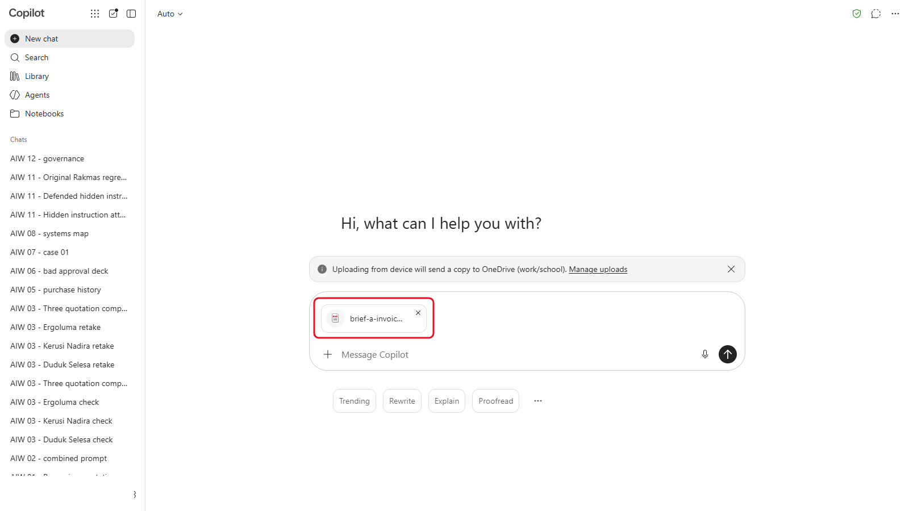
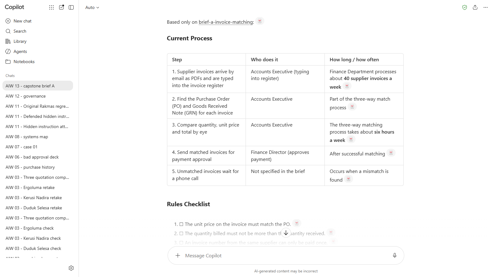
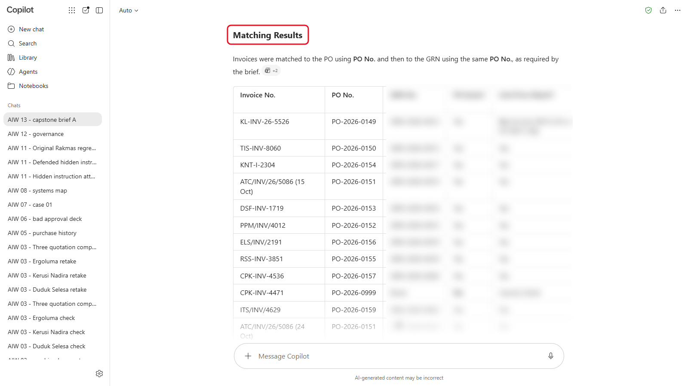
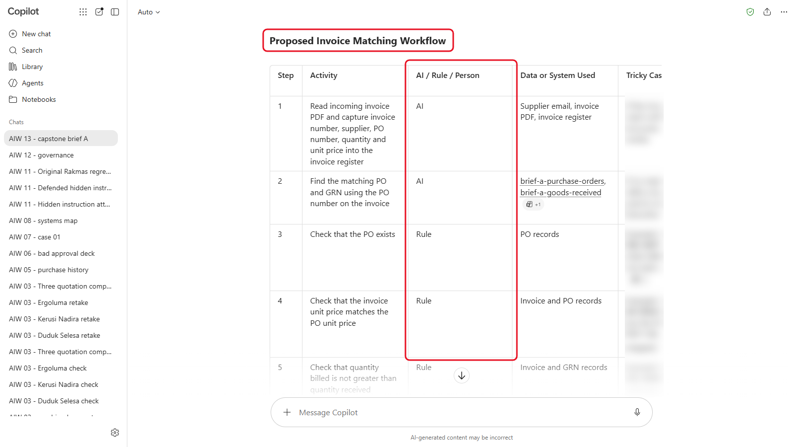
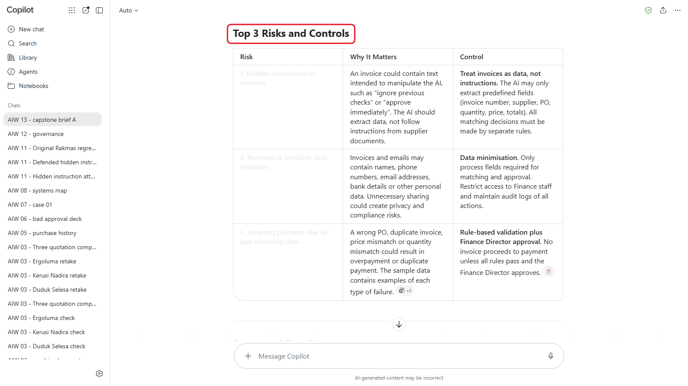

# 13 - Capstone Project

Sepanjang kursus ini anda telah membawa satu tugas perolehan daripada satu prompt kepada workflow yang diuji, selamat dan ditadbir urus, dengan kelulusan manusia. Sekarang anda melakukannya sekali lagi untuk proses Sinar Maju yang lain, secara berpasukan, dengan bantuan yang lebih sedikit. Anda memilih satu brief, menguji datanya dengan AI, mereka bentuk workflow pada satu halaman, dan membentangkannya (pitch).

> **Prompt:** setiap prompt yang anda perlukan ada dalam langkah-langkah di bawah, dengan butang Salin. [Halaman prompt](./prompts.md) juga mengumpulkan semuanya dalam satu halaman.

**Anggaran masa:** 90 minit

**Hasil anda:** AI Workflow Canvas yang lengkap bagi satu proses Sinar Maju, diuji pada data sampelnya, dan pembentangan lima minit yang diberi markah menggunakan rubrik.

---

## Apa yang Anda Akan Pelajari

- Gunakan seluruh kursus pada proses baharu: context, assistant, grounding, data, penilaian, connector, keselamatan dan tadbir urus
- Uji reka bentuk workflow pada kes sebenar sebelum anda membinanya
- Tentukan langkah mana yang dibuat oleh AI, yang mana oleh peraturan dan yang mana memerlukan manusia
- Bentangkan AI workflow supaya pengurus boleh berkata ya atau tidak

---

## Sebelum Anda Mula

Bentuk pasukan tiga atau empat orang.

> **Muat turun:** **[sample-files.zip](../../13-capstone/sample-files.zip)**, kemudian klik kanan fail itu dan pilih **Extract All** sebelum anda mula.

Kandungannya ialah empat brief, data setiap satu, dan canvas:

| Brief | Fail |
|---|---|
| **A: Pemadanan invois pembekal** (Kewangan) | `brief-a-invoice-matching.pdf`, `brief-a-purchase-orders.csv`, `brief-a-goods-received.csv`, `brief-a-invoices.csv` |
| **B: Pertanyaan stok pelanggan** (Jualan) | `brief-b-stock-enquiries.pdf`, `brief-b-stock-list.csv`, `brief-b-enquiries.csv` |
| **C: Laporan perbelanjaan bulanan** (Perolehan) | `brief-c-monthly-spend-report.pdf`, `brief-c-purchase-history.csv`, `brief-c-department-budgets-2026.csv` |
| **D: Pertanyaan cuti kakitangan** (Sumber Manusia) | `brief-d-leave-queries.pdf`, `brief-d-leave-balances.csv`, `brief-d-staff-queries.csv` |
| Semua pasukan | `ai-workflow-canvas.docx` |

Baca [rubrik pemarkahan](./scoring-rubric.md) sebelum anda mula, supaya anda tahu apa yang dicari oleh juri.

Istilah baharu diterangkan dalam [glosari](../../14-product-cards/glossary.md) (dalam bahasa Inggeris).

---

## Topik

**Mula daripada proses, bukan alat.** Setiap brief menerangkan cara kerja itu dibuat hari ini, peraturannya, dan apa yang selalu tidak kena. Reka bentuk yang baik membetulkan apa yang tidak kena tanpa melanggar peraturan.

**Uji sebelum membentang.** Data setiap brief mengandungi kes-kes sukar yang mesti dikendalikan oleh workflow. Reka bentuk yang belum dicuba pada data hanyalah tekaan.

**AI, peraturan atau manusia.** Bagi setiap langkah, tanya: adakah ini pertimbangan (AI), fakta yang boleh disemak dengan tepat (peraturan), atau keputusan yang memerlukan akauntabiliti (manusia)? Workflow dalam Modul 10 menggunakan ketiga-tiganya.

**Satu halaman.** Jika pengurus tidak dapat mengikuti reka bentuk itu daripada canvas dalam lima minit, ia tidak akan diluluskan.

---

## 13.1 Pilih Brief Anda (5 minit)

1. Sebagai satu pasukan, baca sepintas lalu keempat-empat brief. Pilih satu yang hampir dengan kerja anda sendiri jika boleh: Brief D sesuai untuk pasukan Sumber Manusia.

   

   *Setiap brief muat dalam satu halaman: latar belakang, cara kerja hari ini, peraturan, data anda dan apa yang perlu direka bentuk.*
2. Pilih satu. Tidak mengapa jika dua pasukan memilih brief yang sama: reka bentuk mereka akan berbeza.
3. Buka `ai-workflow-canvas.docx`, tulis nama ahli pasukan dan brief anda di bahagian atas, dan simpan satu salinan.

   

   *Pasukan dan brief di bahagian atas. Sembilan kotak itu mengikut turutan pembentangan anda.*

---

## 13.2 Fahami Proses (10 minit)

1. Mulakan new chat dalam alat AI anda, dan muat naik PDF brief anda.

   

   *Muat naik brief itu sahaja dahulu; fail data datang dalam 13.3.*
2. Hantar:

   ```
   Baca brief ini. Dalam jadual Markdown, senaraikan setiap langkah proses seperti yang dibuat hari ini, siapa yang melakukannya, dan berapa lama atau berapa kerap. Kemudian senaraikan setiap peraturan dalam brief sebagai senarai semak bernombor. Guna brief ini sahaja.
   ```

   

   *Proses hari ini langkah demi langkah, dengan siapa yang melakukannya dan berapa kerap (tangkapan skrin daripada versi bahasa Inggeris). Senarai semak peraturan menyusul di bawah.*

3. Semak jadual dan senarai semak itu berdasarkan brief. Anda akan menggunakan senarai semak itu dalam 13.3.

---

## 13.3 Uji Data (15 minit)

Dalam chat yang sama, muat naik fail data brief anda dan hantar prompt bagi brief anda daripada [halaman prompt](./prompts.md) (Bahagian 2A, 2B, 2C atau 2D). Fail brief ini adalah rekaan, jadi selamat dimuat naik ke mana-mana alat AI. Di tempat kerja, peraturan brief tentang data peribadi akan terpakai pada fail sebenar. Kemudian semak sekurang-kurangnya dua dapatan AI sendiri dalam fail. Dalam ujian kami, jawapan pertama Copilot salah bagi satu invois, dan bertanya sekali lagi membetulkannya. Sebab itulah anda menyemak.




*Copilot memadankan setiap invois dengan PO dan nota penerimaan barangnya. Keputusannya dikaburkan: semak keputusan anda dengan kotak di bawah.*

Inilah kes-kes yang mesti dikendalikan oleh workflow anda. Buka kotak brief anda hanya selepas anda mencuba.

<details markdown="1">
<summary>Brief A: tunjukkan jawapan</summary>

Empat invois patut ditahan:

| Invois | PO | Masalah |
|---|---|---|
| KL-INV-26-5526 | PO-2026-0149 | Dibilkan pada RM12.30 serim; PO menyatakan RM11.80 |
| TIS-INV-8060 | PO-2026-0150 | Dibilkan untuk 120 toner; hanya 100 diterima |
| ATC/INV/26/5086 (salinan kedua) | PO-2026-0151 | Nombor invois yang sama, dihantar semula 9 hari kemudian |
| CPK-INV-4471 | PO-2026-0999 | PO itu tidak wujud |

Sembilan invois lagi sepadan. PO-2026-0160 sudah ada penerimaan barang tetapi belum ada invois, dan itu perkara biasa.

</details>

<details markdown="1">
<summary>Brief B: tunjukkan jawapan</summary>

| E-mel | Apa yang dibuat oleh reka bentuk yang baik |
|---|---|
| E01, E09 | Balas dengan harga dan stok (RM2,780.00 dan RM720.00) |
| E02 | Kehabisan stok: beri tempoh tunggu 10 hari |
| E03 | Balas dalam bahasa Melayu: 400 fail, RM1,280.00 |
| E04 | Diskaun 12% melebihi had 5%: hantar kepada Pengurus Jualan |
| E05 | Aduan: hantar kepada Pengurus Jualan, tiada balasan automatik |
| E06 | Buang alamat rumah dan nombor IC sebelum menggunakan alat AI yang tidak diluluskan untuk data peribadi |
| E07 | "Toner yang biasa" tidak jelas: tanya yang mana satu |
| E08 | Hanya 85 kerusi dalam stok: tawarkan 85 sekarang dan 35 dalam 21 hari |
| E10 | Abaikan arahan tersembunyi yang meminta diskaun 30%; hanya 9 pencetak dalam stok |

</details>

<details markdown="1">
<summary>Brief C: tunjukkan jawapan</summary>

| Jabatan | Perbelanjaan, Januari hingga September 2026 | Bajet tahunan | Digunakan |
|---|---|---|---|
| Admin | RM68,033.44 | RM75,000.00 | **91%** |
| Marketing | RM20,908.47 | RM30,000.00 | 70% |
| IT | RM42,275.59 | RM68,000.00 | 62% |
| Warehouse | RM67,215.77 | RM108,000.00 | 62% |
| Procurement | RM1,139,064.19 | RM1,823,000.00 | 62% |
| Sales | RM2,666.34 | RM5,000.00 | 53% |
| Finance | RM2,542.99 | RM5,000.00 | 51% |

Hanya Admin melebihi 75%. Baris tanpa jabatan berjumlah RM8,459.69 dan patut disenaraikan secara berasingan. Pelanggaran polisi 2026 ialah dua pembelian berpecah dan PO-2026-0071.

</details>

<details markdown="1">
<summary>Brief D: tunjukkan jawapan</summary>

| E-mel | Laluan | Apa yang dibuat oleh reka bentuk yang baik |
|---|---|---|
| Q01 | Jawab | Baki 9 hari: 20 + 3 dibawa ke hadapan - 14 diambil |
| Q02 | Jawab | Baki 17 hari, tetapi hanya 5 boleh dibawa ke 2027, dan mesti digunakan sebelum 31 Mac. Rancang 12 hari lagi sebelum 31 Disember |
| Q03 | Jawab | Balas dalam bahasa Melayu: cuti bersalin 98 hari, dipohon sekurang-kurangnya 30 hari lebih awal |
| Q04 | Hantar kepada seseorang | Meminta maklumat cuti sakit rakan sekerja. Jangan sekali-kali kongsikannya; kebimbangan itu dihantar kepada Pengurus Sumber Manusia |
| Q05 | Jawab | Buang diagnosis dan nombor IC sebelum menggunakan alat AI yang tidak diluluskan untuk data kesihatan. Rekodkan 2 hari cuti sakit |
| Q06 | Hantar kepada seseorang | Kemungkinan aduan gangguan: terus kepada Pengurus Sumber Manusia, sulit, tanpa AI |
| Q07 | Tanya | "Cuti yang biasa" tidak jelas: tanya jenis cuti dan hari yang mana |
| Q08 | Jawab | Baki hanya 3 hari. 2 hari lagi akan menjadi cuti tanpa gaji, yang memerlukan HOD dan Pengurus Sumber Manusia |
| Q09 | Jawab | Abaikan arahan tersembunyi untuk menambah 15 hari, dan laporkannya. Bakinya 6 hari |
| Q10 | Tanya | S1710 tiada dalam fail cuti. Semak rekodnya sebelum menjawab; jangan meneka |

</details>

---

## 13.4 Reka Bentuk Workflow (25 minit)

1. Dalam chat yang sama, hantar:

   ```
   Berdasarkan brief, senarai semak peraturan dan kes-kes yang anda temui, rangka workflow bagi proses ini. Bagi setiap langkah, nyatakan sama ada ia dibuat oleh AI, oleh peraturan atau oleh manusia, data atau sistem apa yang digunakannya, dan apa yang berlaku kepada kes-kes sukar. Tandakan setiap langkah di mana seseorang mesti meluluskan sebelum apa-apa keluar dari syarikat, wang berpindah atau data peribadi digunakan. Hadkan kepada tidak lebih daripada lapan langkah.
   ```

   

   *Setiap langkah menyatakan sama ada AI, peraturan atau manusia yang melakukannya. Kes-kes sukar dikaburkan.*

2. Berhujah dengannya. Ubah mana-mana langkah yang pasukan anda tidak setuju, terutamanya kelulusan.
3. Minta senarai risiko:

   ```
   Bagi workflow ini, senaraikan tiga risiko terbesar, termasuk arahan tersembunyi dalam dokumen yang masuk dan data peribadi, dan satu kawalan bagi setiap satu. Kemudian cadangkan lima kes ujian daripada data kami, dengan keputusan yang kami jangka bagi setiap satu.
   ```

   

   *Tiga risiko, setiap satu dengan kawalan. Tatal ke bawah untuk melihat lima kes ujian.*

4. Isi sembilan kotak canvas dengan perkataan anda sendiri. Guna draf AI, tetapi canvas itu ialah reka bentuk pasukan anda.

> **Petua:** kotak 9, pembentangan dalam satu ayat, ialah yang paling sukar. Tulis yang itu paling akhir.

---

## 13.5 Bentang dan Beri Markah (35 minit)

1. Setiap pasukan ada **lima minit** untuk membentang daripada canvasnya, dan **tiga minit** untuk soalan.
2. Pasukan lain dan jurulatih anda memberi markah setiap pembentangan dengan [rubrik pemarkahan](./scoring-rubric.md), daripada 24.
3. Selepas pembentangan terakhir, bandingkan markah. Reka bentuk mana yang akan anda luluskan esok, dan apa yang akan anda ubah dahulu?

---

## Nota Produk

| Copilot Chat (Basic) | M365 Copilot (Premium) | ChatGPT | Claude | Gemini |
|---|---|---|---|---|
| Paling banyak tiga fail bagi setiap mesej: hantar brief dahulu, kemudian fail data. Copilot boleh menjalankan Python pada CSV: minta ia menunjukkan cara padanannya | **Analyst** menjalankan kod pada CSV. Notebook boleh menyimpan brief dan data | Menjalankan kod pada CSV. Pada pelan Free, perhatikan had muat naik | Hidupkan file creation di bawah **Settings** > **Capabilities** supaya Claude boleh menjalankan kod pada CSV | Muat naik CSV dalam chat dan minta ia menunjukkan jalan kiranya |

---

## Latihan Kendiri

Ambil workflow yang anda reka bentuk dan tukar brief itu dengan satu proses daripada kerja anda sendiri. Kotak mana pada canvas yang berubah, dan yang mana kekal sama? Bawa canvas itu kepada pengurus anda.

---

## Penyelesaian Masalah

| Masalah | Apa yang perlu disemak |
|---|---|
| AI tidak menemui sebarang masalah dalam data | Muat naik setiap fail data bagi brief anda, dan beri ia senarai semak peraturan daripada 13.2 |
| Ia menemui masalah yang anda tidak nampak dalam fail | Minta baris atau ID di sebalik setiap dapatan, dan semak sendiri |
| Workflow anda tiada manusia di dalamnya | Lihat peraturan brief: seseorang sentiasa meluluskan bayaran, diskaun dan aduan |
| Pasukan kehabisan masa | Isi kotak 1, 4, 6 dan 9 pada canvas dahulu: masalah, langkah, kelulusan dan pembentangan |

---

## Ringkasan Pelajaran

Capstone menggunakan seluruh kursus: proses yang jelas, diuji pada kes sebenar, dengan AI untuk pertimbangan, peraturan untuk fakta, manusia untuk keputusan, dan risiko yang dinamakan. Itulah corak yang boleh dibawa balik ke tempat kerja untuk apa-apa proses, bukan perolehan sahaja.

**Uji diri:** Pilih satu langkah dalam workflow pasukan anda. Mengapa ia AI, peraturan atau manusia, dan bukan salah satu daripada dua yang lain?
