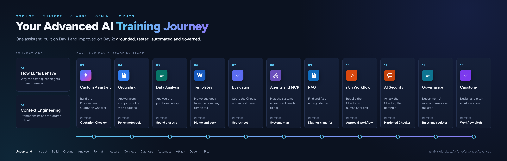

# AI di Tempat Kerja (Lanjutan)

Kursus praktikal dua hari yang membawa peserta daripada sekadar menggunakan pembantu AI kepada membina, mengasaskan pada sumber, menguji dan melindungi penyelesaian AI mereka sendiri.

> **Nota:** versi Bahasa Malaysia sedang disediakan. Modul 01 sudah dalam Bahasa Malaysia. Modul lain masih dalam bahasa Inggeris buat masa ini, dan pautannya akan bertukar sendiri apabila terjemahan siap.

Anda tidak perlukan akaun GitHub untuk menggunakan apa-apa di halaman ini.

---

## Aliran Program

---

## Cara Menggunakan Laman Ini

Setiap modul ada halaman **Nota** dengan objektif, topik dan lab, dan halaman **Prompt** dengan setiap prompt yang anda taip semasa lab. Nota memberitahu anda prompt mana yang perlu digunakan dan bila.

Untuk menyalin prompt: buka halaman prompt modul itu, cari prompt tersebut, dan klik ikon salin di penjuru kanan atas kotak kelabu. Kemudian tampal ke dalam alat AI anda.

> **Muat turun:** **[semua fail kursus (ZIP)](https://github.com/Asraf-JS/AI-for-Workplace-Advanced/archive/refs/heads/main.zip)**. Simpan fail ZIP itu, kemudian klik kanan dan pilih **Extract All** sebelum anda membuka mana-mana fail.

Untuk membaca di luar talian atau mencetak: muat turun **[buku kursus (PDF, dalam bahasa Inggeris)](../AI-for-Workplace-Advanced-Book.pdf)**. Ia mengandungi nota dan prompt setiap modul dalam satu fail.

---

## Senario Kursus

Ini ialah sambungan kepada **AI for Workplace (Beginner)**. Jika anda tidak mengikuti kursus Asas, anda masih boleh menyertai kursus ini: ia bermula dengan cara model AI berfungsi, dan [glosari](../14-product-cards/glossary.md) menerangkan setiap istilah baharu. Peserta membina satu pembantu AI pada awal kursus dan terus menambah baiknya: mengasaskannya pada polisi syarikat, menghasilkan dokumen mengikut jenama syarikat daripada templat, mengukur ketepatannya, dan kemudian membinanya semula sebagai aliran kerja ejen (agent workflow) dengan kelulusan manusia.

---

## Sesuai dengan Langganan AI Anda

Setiap lab ditulis sebagai tugasan yang tidak terikat pada satu alat, dengan nota produk untuk:

| Alat | Peringkat yang diliputi |
|---|---|
| Microsoft 365 Copilot | Copilot Chat (Basic) dan M365 Copilot (Premium) |
| ChatGPT | Pelan percuma dan berbayar |
| Claude | Pelan percuma dan berbayar |
| Gemini | Percuma dan Google Workspace |

Lab yang memerlukan alat tambahan menggunakan pilihan percuma: Gemini Notebook, dahulunya NotebookLM (akaun Google), dan n8n (akaun percubaan). [Kad produk](../14-product-cards/) menerangkan cara membuat setiap lab dalam alat anda.

---

## Modul

| # | Modul | Prompt | Lab | Masa |
|---|---|---|---|---|
| 01 | [Cara Model Bahasa Besar Sebenarnya Berfungsi](./01-how-llms-behave/) | [Prompt](./01-how-llms-behave/prompts.md) | Bandingkan analisis sebut harga pada dua jenis model | 40 min |
| 02 | [Kejuruteraan Konteks dan Output Berstruktur](../02-context-engineering/) (EN) | [Prompts](../02-context-engineering/prompts.md) | Rantaian prompt tiga langkah dengan output Markdown | 50 min |
| 03 | [Membina Custom AI Assistant](../03-custom-assistants/) (EN) | [Prompts](../03-custom-assistants/prompts.md) | Pengesah Sebut Harga Perolehan | 70 min |
| 04 | [Penyelidikan Bersumber dan Jawapan Berasaskan Sumber](../04-grounded-research/) (EN) | [Prompts](../04-grounded-research/prompts.md) | Buku nota pengetahuan polisi dengan semakan petikan | 55 min |
| 05 | [Analisis Data Lanjutan dengan AI](../05-data-analysis/) (EN) | [Prompts](../05-data-analysis/prompts.md) | Analisis sejarah pembelian | 55 min |
| 06 | [Mengawal Output dengan Templat Word dan PowerPoint](../06-output-templates/) (EN) | [Prompts](../06-output-templates/prompts.md) | Memo kelulusan dan dek daripada templat syarikat | 60 min |
| 07 | [Menilai Output AI](../07-evaluating-output/) (EN) | [Prompts](../07-evaluating-output/prompts.md) | Beri skor kepada Pengesah Sebut Harga pada sepuluh kes ujian | 45 min |
| 08 | [Ejen AI, Penyambung dan MCP](../08-agents-connectors-mcp/) (EN) | [Prompts](../08-agents-connectors-mcp/prompts.md) | Petakan sistem yang diperlukan oleh pembantu AI untuk bertindak | 45 min |
| 09 | [Asas Retrieval-Augmented Generation (RAG)](../09-rag-fundamentals/) (EN) | [Prompts](../09-rag-fundamentals/prompts.md) | Kenal pasti punca petikan yang salah | 50 min |
| 10 | [Membina Aliran Kerja Ejen AI dalam n8n](../10-n8n-agent-workflow/) (EN) | [Prompts](../10-n8n-agent-workflow/prompts.md) | Aliran kerja kelulusan sebut harga dengan kelulusan manusia | 90 min |
| 11 | [Keselamatan AI untuk Pengamal](../11-ai-security/) (EN) | [Prompts](../11-ai-security/prompts.md) | Pusingan cuba pecahkan: arahan tersembunyi | 45 min |
| 12 | [Tadbir Urus AI dalam Konteks Malaysia](../12-ai-governance/) (EN) | [Prompts](../12-ai-governance/prompts.md) | Peraturan AI jabatan dan daftar penggunaan AI | 45 min |
| 13 | [Capstone Project](../13-capstone/) (EN) | [Prompts](../13-capstone/prompts.md) | Reka bentuk dan bentangkan aliran kerja AI | 90 min |
| 14 | [Kad Produk](../14-product-cards/) (EN) |  | Cara membuat langkah biasa dalam Copilot, ChatGPT, Claude dan Gemini | Kendiri |

---

## Data Sampel

Semua data lab dalam repositori ini adalah rekaan. Setiap modul yang memerlukan fail ada `sample-files.zip` dalam foldernya, dibuat daripada data sintetik untuk syarikat rekaan Sinar Maju Sdn Bhd. [Fail sampel](../06-output-templates/sample-files/) Modul 06 mengandungi templat Word dan PowerPoint.

Tolong jangan muat naik data sebenar syarikat, pelanggan atau peribadi ke dalam mana-mana alat AI semasa kelas, melainkan organisasi anda telah meluluskan alat itu untuk tujuan tersebut.

---

## Sebelum Anda Mula

Anda perlukan komputer riba dengan Word, Excel dan PowerPoint versi desktop, akses kepada sekurang-kurangnya satu alat AI di atas, dan akaun Google untuk Gemini Notebook (dahulunya NotebookLM). Jurulatih anda akan berkongsi butiran akses n8n sebelum Modul 10. Jika syarikat anda menyekat mana-mana alat ini, lihat [If your company blocks a tool](../14-product-cards/locked-down.md) (dalam bahasa Inggeris). Istilah baharu diterangkan dalam [glosari](../14-product-cards/glossary.md).

---

## Perlukan Bantuan?

Semasa kursus, tanya jurulatih anda. Selepas kursus, hubungi penyelaras latihan yang menguruskan kelas anda.

---

*Kemas kini terakhir: Oktober 2026 | Jurulatih: Asraf, Microsoft Certified Trainer (MCT) dan jurulatih bertauliah HRD Corp*

© 2026 Asraf. Hak cipta terpelihara.
